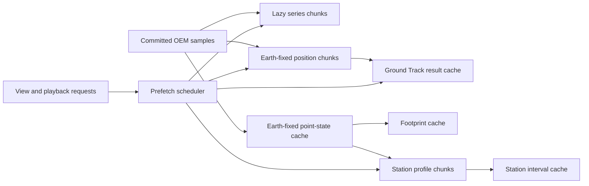

# play-oem caching

## Summary

Play-OEM uses caches to reuse derived calculations and coordinate concurrent
lazy work. The caches belong to the data store or to small process-wide geometry
helpers. They do not replace the raw OEM samples, change coverage semantics, or
persist parsed OEM data between application runs.

The main cache owner is `OemDataStore`. Its derived range tiers are created on
request, filled in chunks, and tied to a store epoch. Point Earth-fixed lookups,
station intervals, footprints, and completed Ground Track queries have separate
bounded caches because they retain different results and have different validity
rules.

## Cache ownership

The store keeps caches whose values depend on committed OEM data. A reset starts
a new epoch and clears those values. Derived range data is kept in lazily
allocated mapped buffers; ready flags and chunk memos identify which rows are
currently usable. Chunk size is 4096 rows.

| Cache or tier | Cached value | Identity and limit |
|---|---|---|
| Series tier | Requested derived telemetry columns, such as speed or angular velocity | Store epoch and series group; chunked by row. |
| Earth-fixed range tier | Converted Earth-fixed position samples for range consumers | Store epoch; chunked by row. |
| Earth-fixed point-state cache | Converted six-component sample states used by point lookup | `(epoch, source frame, sample row)`; LRU, 8192 entries. |
| Station profile tier | Regularly sampled station look-angle data | `(epoch, raw revision, policy revision, station identity and coordinates)`; chunked by row. |
| Station interval cache | Derived access intervals for a station query | Epoch, raw revision, policy revision, station, time bounds and elevation threshold; up to 128 entries. |
| Station layout interval cache | Access intervals assembled once for a complete OEM segment layout | Epoch, raw revision, policy revision, station, elevation threshold and layout identity; up to 128 entries. |
| Ground Track result cache | Complete, seam-split coordinate groups | `(epoch, raw revision, bounds, margin, map center)`; up to 4 entries and subject to the derived memory budget. |
| Footprint cache | Footprint geometry for a point state and elevation threshold | `(epoch, time, Earth-fixed position, threshold)`; LRU, 32 entries. |

The default derived-buffer memory budget is 256 MiB. It accounts for materialized
derived chunks and cached Ground Track results, not raw OEM storage or every
small dictionary/LRU cache. Before evicting derived chunks, the store evicts
Ground Track results. It then releases least-recently-used, unpinned chunks
where the platform supports mapped-buffer advice. Chunks referenced by a live
view or covered by the active playback range are protected. If the platform
cannot release mapped pages this way, the budget cannot force those pages out
of resident memory.

## Chunk reuse and concurrent requests

Series, Earth-fixed range, and station-profile tiers use `ChunkMemo` to track
each derived chunk as absent, computing, complete, or tentative. A completed
chunk is reused while its epoch and policy stamp still match. Concurrent callers
for the same chunk share one in-flight computation instead of duplicating it.
Cancellation or invalidation prevents an obsolete in-flight result from being
published as complete.

The final partial chunk of a still-loading stream can be tentative. The caller
that requested it may use the result, but a later request recomputes that chunk
so newly appended OEM rows can be included. Once input coverage is complete,
eligible computed chunks become reusable until eviction or invalidation.

The prefetch scheduler also coalesces identical queued or running requests. This
is request-work deduplication rather than another result cache: the derived
buffers and tier caches remain the owners of reusable data. Nonblocking queries
can schedule work and return incomplete coverage; a cached value is reported
only when the requested data is ready and valid for the snapshot.

## Validity and invalidation

Cache identity follows the data that produced each value:

- **Store reset or new load epoch:** clears derived buffers, chunk memos,
  point-state and result caches, and scheduled work. Old snapshots cannot use
  the new epoch's derived data.
- **Raw append:** publishes a new raw revision. Ground Track results are cleared
  because their range and completeness depend on that revision. Station profile
  tiers, range interval results, and layout interval results are also cleared.
  Completed series and Earth-fixed
  chunks for earlier committed rows can remain reusable; the unfinished tail is
  recomputed as needed.
- **Interpolation policy change:** increments the policy revision and clears
  station profile, range interval, and layout interval data. Their sampled states
  depend on interpolation.
  Converted exact Earth-fixed samples and Earth-fixed range chunks remain valid.
  Old snapshots are rejected by point-state lookup after the policy changes.
- **Derived-chunk eviction:** clears the chunk's ready markers and memo entry so a
  later query recomputes it. Pinned chunks and chunks in the active time range
  are skipped.
- **Footprint and Ground Track result eviction:** drops the cached result only;
  a later request recomputes it from valid source or tier data.

The Earth-fixed point-state cache is keyed by epoch, frame and row, so policy
changes do not discard converted raw samples. Its entries do not contain
interpolated query states. Each point lookup still applies the active
interpolation policy to its support samples.

## Process-wide geometry helpers

Some inexpensive-to-retain objects are shared outside the store:

- The WGS-84 coordinate transformers in `ground_track.py` and
  `ground_stations.py` each use a one-entry `lru_cache`.
- Ground-station ECEF positions use a 256-entry `lru_cache` keyed by the
  immutable station value.

These helpers are independent of OEM load epochs. They cache reusable tools or
station geometry, not orbit histories.

## View rendering caches

Matplotlib cursor blitting keeps a rendered figure background so playback can
redraw animated cursor lines without redrawing the full plot. The background is
reused only while the figure geometry and axis limits match; a missing or stale
background falls back to a full draw. This cache contains pixels, not plotted
OEM samples. The compact-controls GTK style helper retains its native provider
for the lifetime of the process.

## OEM file caching

Opening an OEM parses it into the active store. There is no production
repeat-open cache of completed stores, no serialized parsed-data cache, and no
persistent disk cache. Reopening a file performs another load; operating-system
file caching may affect I/O time but is outside Play-OEM's cache lifecycle.

## Interpolation and cache boundaries

The stateless point interpolator does not retain support points or cache an
orbit-wide interpolation grid. Exact source samples are read from raw storage;
Earth-fixed exact sample conversions may be reused through the point-state
cache. Range tiers cache converted or derived samples, not arbitrary point
interpolation results. See [interpolation](PLAY_OEM_INTERPOLATION.md) and
[frame conversion](PLAY_OEM_FRAME_CONVERSION.md) for the associated lookup and
conversion rules.

## Verification

Cache behavior is covered by store and tier tests for repeated queries,
concurrent chunk requests, append and reset invalidation, interpolation-policy
changes, eviction, and snapshot validity. Performance measurements should
separate cold computation, warm cache reuse, partial-load recomputation, and
memory-pressure behavior; a cache hit does not by itself imply a particular
end-to-end speedup.
