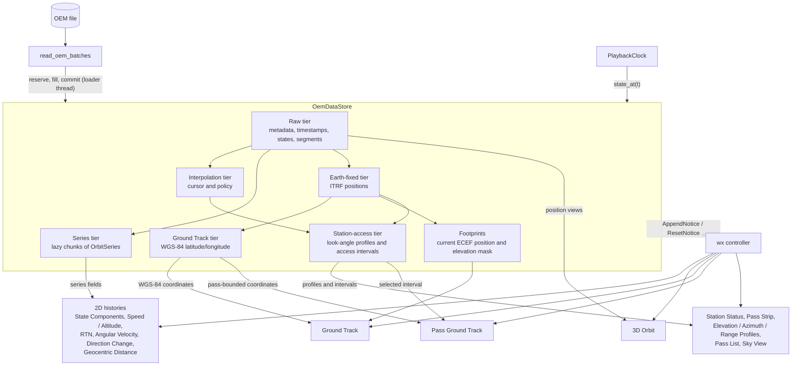
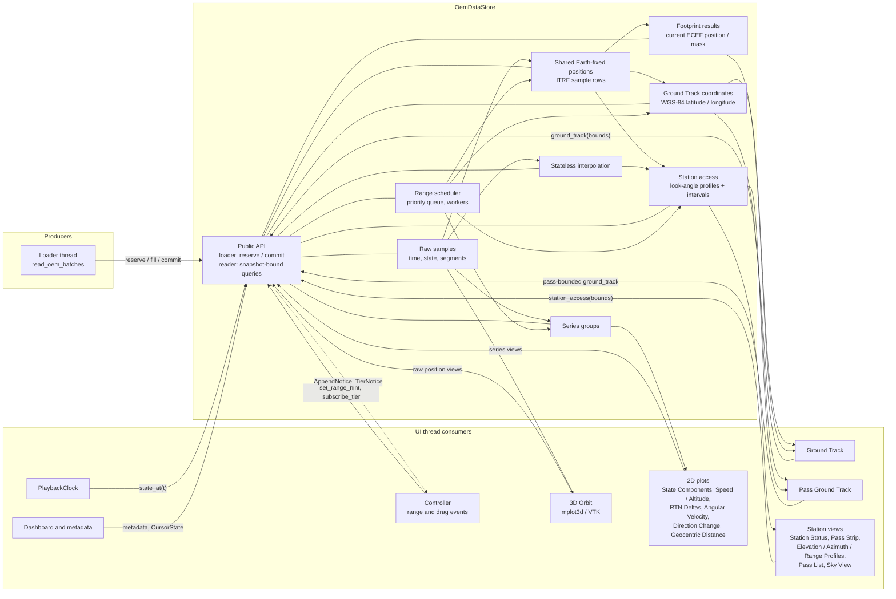
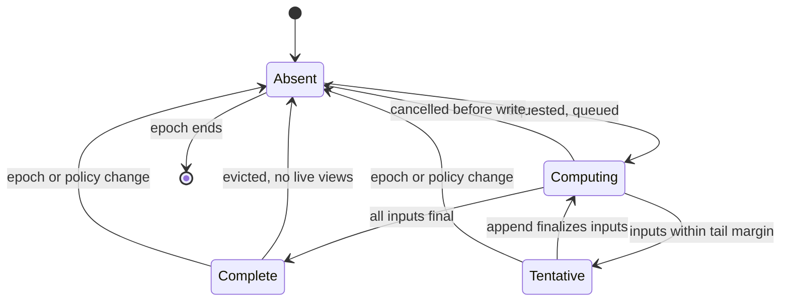
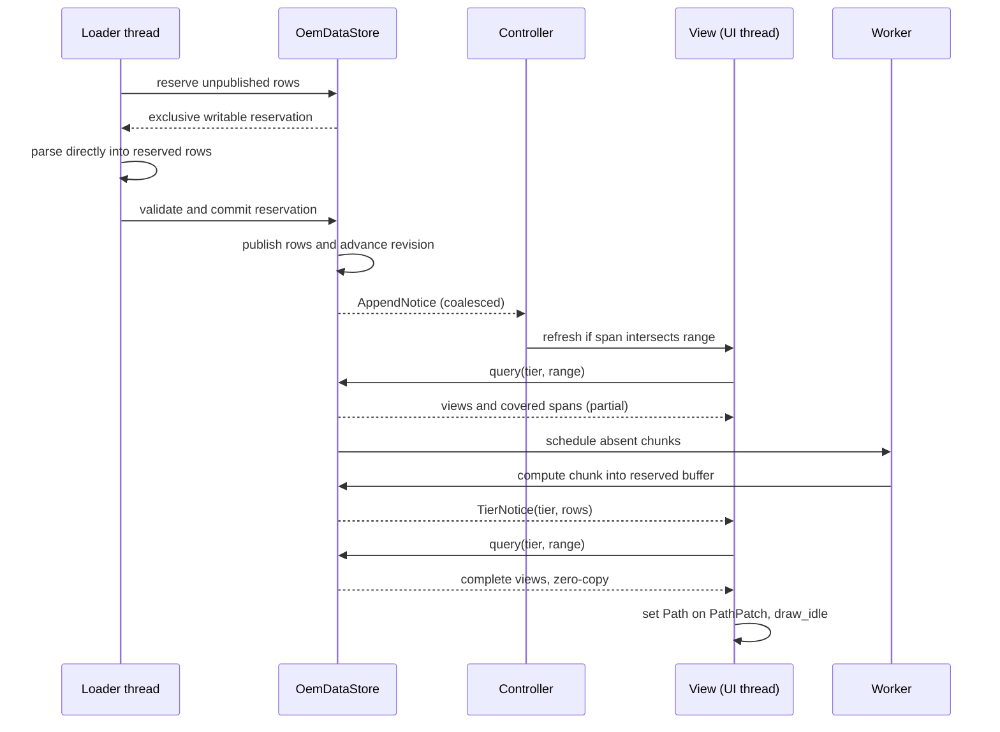
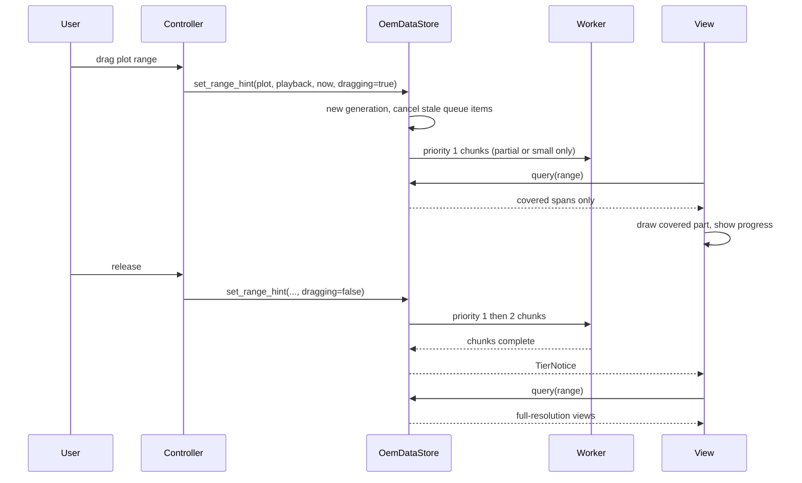
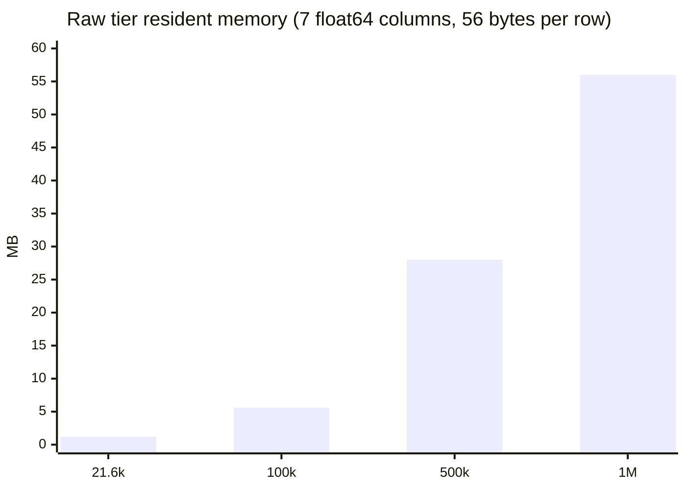
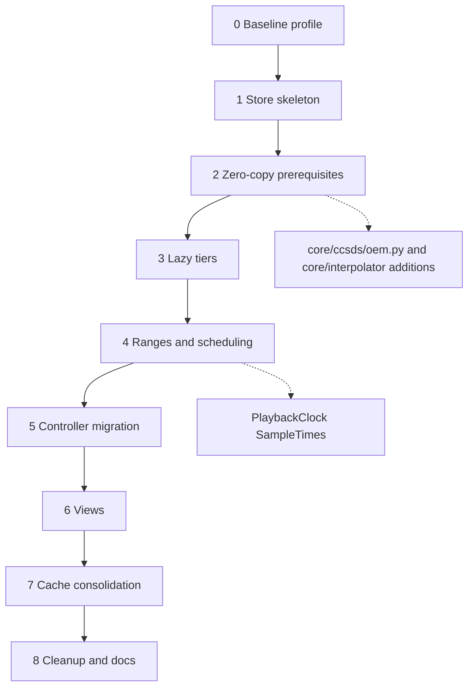

# `play-oem` — Unified OEM Data Store Software Design

**Status: In progress.** This design consolidates the loaded OEM and every quantity derived from it
for analysis and plotting into one in-memory store, `OemDataStore`. Backwards compatibility with
the current module, class, and constructor shapes is not required.

Implementation is tracked in the
[Unified OEM Data Store Implementation Plan](./PLAY_OEM_DATA_STORE_IMPLEMENTATION_PLAN.md).

Current behavior is described in [PLAY_OEM_DATAFLOW.md](./PLAY_OEM_DATAFLOW.md) and its diagram
[PLAY_OEM_DATAFLOW.mmd](./PLAY_OEM_DATAFLOW.mmd). Incremental loading semantics remain as
specified in [PLAY_OEM_INCREMENTAL_LOADING.md](./PLAY_OEM_INCREMENTAL_LOADING.md).

### Implementation status

`OemDataStore` supports fixed-capacity reservations, committed-prefix snapshots and epoch checks
without an orbit-sample staging array. The active player's default load path uses direct
parser-to-store ingestion and generation-tagged raw-append events; cancellation invalidates only
its owned epoch. The raw snapshot records `LOADING`, `COMPLETE`, `FAILED`, or `CANCELLED`;
EOF-validated header and metadata are attached only on completion, and failures preserve a
committed prefix with an error message. Cancellation preserves the committed prefix but prevents
further reservations. Lazy query/result types, the public raw `StoreSnapshot`, the reusable
`ChunkMemo` primitive, and stateless mode on the existing core interpolators support point-state
queries, lazy chunked series and Earth-fixed tiers, prioritized cancellable range prefetch,
partial-coverage results, and chunk-completion notices. Station-access profiles are lazy, chunked,
and shared across minimum-elevation changes. Derived results write directly into final tier
buffers without orbit-sized temporary arrays. Per-chunk LRU eviction protects active ranges and
leased views, and evicted chunks are recomputed before they can be returned again.

Speed / Altitude, RTN Deltas, Angular Velocity, Direction Change, Geocentric Distance, State
Components, both 3D backends, Ground Track, Pass Ground Track, and station views use store-backed
paths. The active player creates one store per load generation, advances its clock through the
store's live sample-time view, retains the installed file until a replacement has usable rows,
and routes point-state and view reads through `StoreViewContext`. Range hints, queued store
notices, and store-backed station prefetch drive affected view updates. Replacement, failure,
cancellation, metadata finalization, and stale notices refresh the active context. The legacy
prepared-batch and compatibility paths remain pending Step 8; Step 7 also remains open because the
JPSS-1 automatic-capacity first-append gate failed. Per explicit user direction, Step 8 ownership
cleanup may proceed while that gate remains unresolved; this sequencing exception does not mark
Step 7 complete or claim performance acceptance. The application's end-to-end no-copy and GUI
responsiveness goals are not yet accepted. See the
[implementation plan](./PLAY_OEM_DATA_STORE_IMPLEMENTATION_PLAN.md) and the performance evidence
below for remaining work and limitations.

`OemDataStore.begin` takes an explicit capacity. For the loader path,
`OemDataStore.capacity_for_file` counts physical lines outside `COVARIANCE_START` /
`COVARIANCE_STOP` blocks. State rows are outside covariance blocks and the parser accepts at most
one state row per physical line, so this remains a safe upper bound while avoiding reservations
for covariance matrices. Universal newline forms and a final unterminated line are supported;
reads are bounded and do not retain file contents. The `IncrementalLoader` performs this scan on
its loader worker when no capacity is supplied; the store epoch is invalidated before the worker
starts, and cancellation is checked between bounded reads. Reserved array sizes are proportional
to the resulting capacity; actual physical-page commitment remains operating-system dependent.
An untouched one-million-row raw reservation on macOS represented 64,000,000 array bytes and
increased fresh-process peak RSS by 32,768 bytes. This is a local observation, not a guarantee for
other operating systems; allocation failures remain explicit load failures.
The automatic-capacity measurements and their limitations are recorded in
[Performance evidence and acceptance](#performance-evidence-and-acceptance).

The store tracks segment boundaries internally as immutable
`(segment_id, first, stop)` tuples; `StoreSnapshot` exposes a read-only `(S, 2)` row-bound table,
with segment identity available from `segment_ids`. Read-only snapshots protect their buffer
views, but reservation ownership is cooperative: writers must
relinquish every writable alias after commit or abort; setting the reservation views read-only
does not revoke aliases created earlier. The loader owner replaces a failed or cancelled epoch
with a new one when discarding the retained prefix.

## Goals

- Give every consumer (2D histories, 3D trajectory, Ground Track, station-access panels, the
  control window) one authoritative source for OEM samples and their derived data.
- Replace identity-based cache validation (`source is self._source`, array prefix comparison)
  with explicit store epochs and append revisions.
- Remove the data copies and parallel references now held by the controller.
- Evaluate lazily: only the raw samples are produced eagerly. Every derived tier is computed on
  first request, for the requested range only, then memoized and extended or invalidated
  incrementally (see [Lazy evaluation](#lazy-evaluation)).
- **Highest priority: never copy orbit data.** Each OEM and derived quantity is written once into a
  reserved buffer owned by the store, and consumers, including Matplotlib artists, read numpy
  views of it. Where this conflicts with another goal it wins (see
  [Zero-copy policy](#zero-copy-policy)).
- Keep append-only incremental loading, range-limited analysis, and tail-only recomputation.
- Preserve numerical results, segment/gap semantics, and cursor interpolation behavior.

Non-goals: owning the playback clock, the plot-range rule, ground-station definitions, saved
state, and rendered artists. These are UI or user state and stay outside the store. The store does
consume the playback range and the resolved plot range as *hints* that drive scheduling, prefetch,
and eviction (see [Ranges and scheduling](#ranges-and-scheduling)), and it supplies the sample
times the clock steps through.

## Verification of the current dataflow diagram

The diagram is accurate for the main path (parse → prepare → install → range-limited views →
caches). Checked against the code, it omits or simplifies the following, which motivate this design:

| Diagram | Actual behavior |
|---|---|
| `CURSOR → SOURCE` "growing sample arrays" | `GroundTrackSource` is a new frozen wrapper created on every append (`AppendablePlaybackData.append_batch`) and again at completion (`controller.py`, metadata finalization). It holds read-only views of the cursor storage; `from_samples` makes full copies for range-limited sources (`_ground_track_source_for_plot_range`, incremental Ground Track preview). |
| `SERIES → POLL` | The full-resolution `OrbitSeries` is published, but `_refresh_incremental_views` temporarily replaces `controller.series` with `downsample_orbit_series(...)` (2,000 samples, `INCREMENTAL_PLOT_MAX_SAMPLES`) and restores it in `finally`. The preview is transient controller state, not a named product. |
| `LOOK → TRAJ` only | `cursor.lookup` is also used by Ground Track (marker and footprints), both 3D backends, `current_station_metrics`, and the control window. |
| Two peer caches | `StationAccessCache` owns `EarthFixedPositionCache` (`position_cache`); Ground Track and station views both reach positions through the access cache. |
| (absent) | `controller._ground_track_coordinates` retains prepared WGS-84 coordinates and is cleared when an appended batch intersects the plot range. |
| (absent) | `compute_ground_footprints` keeps a module-level `lru_cache(maxsize=32)` outside any owner. |
| (absent) | A second worker, `station-access-warmup`, calls `StationAccessCache.prepare` off the UI thread at load completion. |
| (absent) | Metadata (`center_name`, `frame_name`) comes from the first batch, then `GroundTrackSource` and the store are rebuilt at completion. Frame-dependent positions are therefore valid only if the frame did not change. |
| (absent) | `PlaybackData` also carries the clock, metadata strings, and dashboard context, and `load_playback_data` (used only by tests) duplicates the batch derivation path. |

`PLAY_OEM_DATAFLOW.mmd` is the current-state diagram; the architecture diagrams below are the
target store design and are not intended to depict shipped behavior. The current-state diagram
omits benchmark results by design; retained historical measurements are documented in
[Performance evidence and acceptance](#performance-evidence-and-acceptance).

## Current fragmentation

Derived OEM data is currently owned in six places, each invalidated by a different rule:

| Data | Owner | Invalidation |
|---|---|---|
| Source samples, interpolation | `OemCursor` | Append, `set_interpolation` |
| Orbit series | `AppendablePlaybackData` / `OrbitSeriesAccumulator` | Append; rebuilt on time-unit change |
| Display series | `controller.series` (swapped) | Every refresh |
| `GroundTrackSource` | `AppendablePlaybackData`, `controller._ground_track_source` | Rebuilt per append |
| Ground Track coordinates | `controller._ground_track_coordinates` | Cleared on range-intersecting append |
| ECEF positions, station access | `StationAccessCache`, `EarthFixedPositionCache` | `source is` identity, O(n) prefix compare |
| Footprints | module `lru_cache` | Argument equality |

Consequences: the controller keeps `series`, `time_unit`, `cursor`, `_ground_track_source`,
`_incremental_store`, and `_ground_track_coordinates` in sync by hand (`app/state.py`); views
receive a different subset of these through their constructors; and every append pays for a
full prefix comparison in `source_prefix_matches` (twice: position cache and access cache).

## Architecture



`OemDataStore` is created once per application and outlives individual OEM files. It is the only
object that holds OEM-derived arrays. The controller captures one immutable `StoreSnapshot` per
refresh and supplies a snapshot-bound read context to views; views do not capture snapshots or
pass the store and snapshot separately to each query. Neither the controller nor views own copies
of source samples.

### Tiers and ownership

| Tier | Contents | Depends on |
|---|---|---|
| Raw | `OemMetadata`; one reserved `[t, x, y, z, vx, vy, vz]` group plus `segment_ids` and a segment-bounds table | — |
| Interpolation | Stateless evaluator over raw chunks, `InterpolationPolicy` (method, degree) | Raw, policy |
| Series | Lazily computed derived-quantity chunks; range decimation as index sets | Raw |
| Earth-fixed | ITRF position per sample, with computed mask | Raw, frame name |
| Ground Track | WGS-84 latitude/longitude by window | Earth-fixed |
| Footprints | Small footprint results for a current ECEF position and elevation mask | Earth-fixed, elevation policy |
| Station access | Per-station look-angle profiles (azimuth, elevation, range) and access intervals | Earth-fixed, interpolation, station definition |



Consumers read only through the public API. The table lists the tiers each consumer touches, which
is also the set it registers with `subscribe_tier`; a tier with no subscriber is never computed
ahead of time.

| Consumer | Tiers read | Returns | Per-frame cost |
|---|---|---|---|
| `PlaybackClock`, dashboard | Raw, interpolation | `SampleTimes` view, `CursorState` | `searchsorted` plus one evaluation |
| 2D plots | Series (per open panel's column group) | Column-group views over the plot range | Slice only |
| 3D Orbit | Raw position columns; Earth-fixed when the frame requires it | Column views (VTK may copy, see zero-copy policy) | Slice only |
| Ground Track, Pass Ground Track | Earth-fixed, Ground Track, footprints; pass graph also reads its selected interval | Coordinate views, small footprint arrays | Slice plus footprint at `now_s` |
| Station Status, Pass Strip, Elevation / Azimuth / Range Profiles, Pass List, Sky View | Station access, Earth-fixed, interpolation | Leased profile-column views, intervals, and current metric records | Range-limited station query, point-metric lookup, and at most 2,000 plotted samples per profile segment |
| Controller | None directly | Notices and `covered` spans | None |

### Shared data across current graph types

The registered graph names below follow `views/registry.py`. The table distinguishes a shared
intermediate from a shared algorithm: a shared input or buffer does not imply that the graphs
consume the same final coordinates or results.

| Current graph types | Shared intermediate or computation | Graph-specific result |
|---|---|---|
| 3D Orbit; State Components; Speed / Altitude; RTN Deltas; Angular Velocity; Direction Change; Geocentric Distance | OEM timestamps, six-state rows, segment boundaries, and the relevant lazily produced `Series` column groups | Each graph requests only its fields. Store-backed State Components and Matplotlib 3D read raw columns; VTK packs only its bounded display path. The active player still uses its legacy `OrbitSeries` path. |
| Ground Track; Pass Ground Track | Earth-fixed ITRF sample positions and the `prepare_ground_track` conversion path | WGS-84 latitude/longitude coordinates; Pass Ground Track uses the selected pass interval as its bounds. |
| Station Status; Pass Strip; Elevation Profile; Azimuth Profile; Range Profile; Pass List; Sky View | Per-station `StationAccess` results: look-angle profiles contain times, azimuth, elevation, and slant range; access intervals provide pass boundaries and summary metrics | Profile graphs select different fields from the same look-angle profiles. Pass-oriented graphs consume the same interval results. Current station status also evaluates the cursor state at playback time. |
| Ground Track and Pass Ground Track; all station views | The same raw sample identity and Earth-fixed position tier/cache; `state_position_to_itrf_m` is the shared frame-conversion algorithm | Ground Track converts ITRF positions to geodetic coordinates. Station analysis converts spacecraft-minus-station ECEF positions to local ENU, then azimuth/elevation/range. These final products are not interchangeable. |

Footprints are Ground Track-specific small results computed from the current Earth-fixed position
and elevation mask; station profiles do not consume them. In the current application,
`view_factory` passes the station access cache's `EarthFixedPositionCache` to both Ground Track
preparation and station analysis, while `Pass Ground Track` uses that same cache with pass-bounded
coordinates. The migration must preserve this sharing in one store-owned Earth-fixed tier, not
copy the ITRF rows into per-view caches.

Each tier is a private component of the store. Existing algorithms (`compute_orbit_series`,
`OrbitSeriesAccumulator`, `OemCursor`, `prepare_ground_track`, `prepare_station_access`,
`compute_ground_footprints`) are reused as tier implementations; only ownership and invalidation
move.

### Zero-copy policy

The current code duplicates orbit data in many places. Verified instances:

- `OemCursor` keeps samples in its own arrays, and every interpolator stores its own copy through
  `add_data_point`. `_create_interpolators` rebuilds them from `list(zip(...))`, and
  `_append_locked` re-reads a segment's existing rows when it creates an interpolator.
- Growing cursor and `OrbitSeriesAccumulator` storage reallocates and copies every array.
- `OrbitSeries.position_km` and `velocity_km_s` are unit-scaled duplicates of `states_m`;
  `elapsed_time` and `rtn_elapsed_time` are rescaled duplicates of `timestamps_s`.
- `GroundTrackSource.from_samples` copies timestamps, states, and segment IDs; the controller does
  this for every range-limited source and the Ground Track preview.
- `downsample_orbit_series` copies the selected rows of every series field.
- `_shared_positions_by_window` duplicates ITRF positions that `EarthFixedPositionCache` holds.
- Parser batches become Python lists, then per-row `.copy()` arrays, then storage rows.

Zero copy takes priority over every other goal in this document, including lazy-evaluation
granularity, decimation quality, and API convenience. Where a rule below conflicts with another
section, this section wins. The store follows these rules for orbit samples and everything derived
from them (series fields, ITRF positions, WGS-84 coordinates, access samples):

1. **One write per quantity.** A quantity is written once into its final location. Parsing writes
   rows directly into raw storage; a derived tier computes straight into its buffer with `out=`.
   There are no intermediate lists, staging arrays, or `.copy()` calls.
2. **Reserved contiguous buffers, never reallocated.** Each tier owns one contiguous `float64`
   array per column group, allocated once per epoch at its final capacity and filled in place.
   For file-backed OEM loads, capacity is a hard upper bound from the bounded scan of physical
   lines outside covariance blocks; callers loading a source without that bound must supply a
   capacity hint. Derived tiers reserve on first request. macOS testing observed that untouched
   `np.empty` pages do not materially increase resident memory, but other operating systems may
   commit reserved pages differently, so account for the full array size when budgeting. Growth
   therefore never moves data, a range is always one slice of one array, and earlier views never
   go stale. Chunks (see [Lazy evaluation](#lazy-evaluation)) remain the unit of computation and
   validity tracking, not of storage. Exceeding capacity is an error that fails the load, not a
   reallocation.
3. **Views are numpy views.** Queries return read-only `ndarray` views (`writeable=False`) of
   the reserved buffers. A range or window is a basic slice found by `searchsorted` on the time
   column; segment selection is slice arithmetic using a small per-segment bounds table. Nothing
   is gathered, filtered with a boolean or fancy index, or concatenated.
4. **Plot-ready column groups.** Matplotlib's `Line2D` (`ax.plot`) copies its inputs, but a
   `Path` built on a `float64` `(N, 2)` array keeps a reference to it, even when the array is
   strided, and `PathPatch(path, fill=False)` and `LineCollection` draw it without copying.
   Verified on Matplotlib 3.9.4: contiguous, column-sliced, row-strided, and both strided
   together all share memory with the source, survive an Agg draw, and see in-place updates.
   The `ColumnGroupView.pair()` regression test checks the same property for strided pairs.
   Fancy-indexed columns and `float32` input copy. Each tier therefore stores
   row-major column groups with the time column first, `[t, f1, f2, ...]`, so that any plotted
   pair `(t, fk)` is the zero-copy view `group[lo:hi, 0::k][:, :2]`, and a pair `(f1, f2)` such
   as longitude/latitude is `group[lo:hi, i::j][:, :2]`. Column groups follow what is plotted
   together (Raw `[t, x, y, z, vx, vy, vz]`, Kinematics `[t, speed, distance, altitude]`,
   RTN, angular rates, Ground Track `[t, lon, lat]`, and so on). The duplicated `t` column per
   group is the single deliberate redundancy: 8 bytes per sample per group, in exchange for removing
   a per-series, per-view copy.
5. **No unit-scaled or re-origined duplicates.** The store keeps SI units and TT seconds. Kilometer,
   degree-display, and elapsed-time forms are applied by the artist, not stored: a 2D artist uses
   `set_transform(Affine2D().translate(-t0, 0).scale(1 / unit_s, 1e-3) + ax.transData)`, with
   axis limits set explicitly from the plot range (autoscale ignores artist transforms) and a
   `FuncFormatter` for tick labels. A time-unit change therefore only updates a transform.
   `OrbitSeries.position_km`, `velocity_km_s`, `elapsed_time`, and `rtn_elapsed_time` stop existing
   as arrays.
6. **Plot without decimation by default, through a simplifying artist.** Agg clips and simplifies
   a path (`path.simplify`) without copying its vertices, but only for artists drawn through
   `draw_path`, such as `Line2D` and `PathPatch`; `LineCollection` is drawn through
   `draw_path_collection`, which does not simplify (measured at 300,000 points: 31 ms versus
   12 to 14 ms). A time-series artist therefore uses `PathPatch(Path(view), fill=False)` on the
   full range slice, not `ax.plot` (which copies) and not a `LineCollection` of one long path.
   Decimation that gathers rows is removed from the default path. If measurement shows the
   full-range draw is too slow, use a uniform row stride (`view[::k]`), which remains a zero-copy
   view. Extreme-preserving decimation needs a gather and is a last resort, bounded by
   `MAX_DISPLAY_POINTS_PER_SEGMENT`, and must be justified by a benchmark.
7. **Segments and gaps without separators.** A multi-segment series is one `PathPatch` per
   segment slice (a `LineCollection` only when there are many short segments), never one array
   with NaN separator rows. Invalid
   samples inside a segment are stored as non-finite values, which Matplotlib already breaks lines
   on.
8. **Stateless interpolation.** `InterpolatorFactory.create(..., stateless=True)` returns the
   existing core interpolator configured for view evaluation. Its `interpolate_view` method
   selects a centered support window from the raw views and runs the existing Hermite, Lagrange,
   or Chebyshev implementation on the same interpolator instance; it creates no interpolator per
   query. It clears support-row references and scratch caches before returning. `spec=None` selects
   linear interpolation, and exact samples are read-only row views. The only allowed temporaries
   are the fixed-size result vector and `O(degree)` support and scratch values per query. This
   policy forbids allocations proportional to the orbit length, not every small per-query result.
   Stateless mode currently requires centered windows with no boundary extension; other boundary
   policies are rejected rather than silently changing the selected support rows.
9. **No cross-tier duplication.** A tier references the tier below it. Station access reads ITRF
   positions from the Earth-fixed tier; Ground Track reads them from the same buffers.
   Per-window position dictionaries are removed.
10. **Snapshots hold views.** `StoreSnapshot` fields are read-only views limited to
    `sample_count`. Taking one allocates no sample storage.
11. **Updates mutate the artist's view, not a copy.** After an append, a view calls
    `set_segments` (or `Path` replacement) with fresh slices of the same buffers; it does not
    rebuild arrays. Because buffers never move, in-place artist reuse is cheap.
12. **Enforced by tests.** Tests assert `np.shares_memory` between every query view and its tier
    buffer and between every plotted `Path` and the store, that ingest uses store-owned rows without
    an orbit-data staging array, and, with `tracemalloc`, that no query or refresh allocates storage
    proportional to the loaded or plotted sample count.

### What zero copy does and does not buy

Zero copy is chosen for memory footprint, single ownership of each quantity, and cheap in-place
updates, not for frame time. Matplotlib consumes NumPy arrays natively, so there is no conversion
or serialization step between the libraries; the cost of a `Line2D` is one `memcpy`. Measured on
Matplotlib 3.9.4 (Agg, 800x400 figure, median of runs):

| Operation | 21,601 points | 300,000 points |
|---|---:|---:|
| `memcpy` of an `(N, 2)` float64 array | 0.01 ms | 0.08 ms |
| `Line2D` create and cache, including its copy | 0.09 ms | 0.80 ms |
| `Path` creation (shares memory) | 0.002 ms | 0.002 ms |
| Full-canvas redraw, `Line2D` | 9.6 ms | 14.0 ms |
| Full-canvas redraw, `PathPatch` (zero copy) | not measured | 12.2 ms |
| Full-canvas redraw, `LineCollection` (zero copy, one long path) | 9.9 ms | 31.2 ms |
| Full-canvas redraw, `LineCollection` of every 4th row | 8.2 ms | 14.0 ms |

Copying is therefore negligible against drawing; a copy matters for resident memory (about 4.8 MB
per 300,000-point `(N, 2)` series, per artist, per view) and for keeping several views consistent.
What dominates frame time is path clipping and simplification, anti-aliased rasterization, text
and tick layout, the number of artists, autoscaling, and the number of full redraws. The
optimization strategies below target those costs, and the zero-copy rules must not choose an
artist that is slower to draw (the `LineCollection` result above) to save a copy.

### Optimization strategies

Beyond zero copy, apply these in priority order. Items 6, 7, and 13 are standard Matplotlib
techniques that I have not measured for this workload; keep any item only if a benchmark in
`scripts/bench_play_oem.py` shows a gain.

1. **Draw less often.** Coalesce store notices so a view redraws at most once per refresh interval
   (the existing five-second loading throttle); use `draw_idle()` rather than `draw()`; refresh
   only panels whose visible range intersects the appended rows (`AppendNotice` carries the new
   span); skip hidden panels and update them when shown.
2. **Blit the moving parts.** Playback moves only a marker and a cursor line. Cache the static
   background, redraw animated artists (`animated=True`) over it, as `_CursorBlitter` does today,
   and recapture the background only when data, limits, or size change. Extend this to the 3D and
   Ground Track markers where the backend allows.
3. **Reuse artists.** Update a `PathPatch` by assigning a new `Path` over the same buffer (or
   `set_segments` on a collection) instead of clearing the axes and replotting. Keep the artist
   count small and constant; merge same-style lines into one collection.
4. **Fix the axes.** Set limits explicitly from the plot range and turn off autoscale
   (`ax.set_autoscale_on(False)`), since autoscale scans all artist data. Compute tick positions
   from the range, not from a data scan. Cache the tick formatter output per range.
5. **Limit the data the renderer sees.** Select the plot-range slice by `searchsorted` on the time
   column (O(log n)) so off-screen rows are never passed to the artist; keep the small support
   margin for lines crossing the boundary. This is a slice, not a copy.
6. **Tune simplification.** Keep `path.simplify` on and raise `path.simplify_threshold` for dense
   series; set `agg.path.chunksize` (for example 10,000) to avoid Agg failures and speed very long
   paths; avoid markers on dense lines.
7. **Cheaper rasterization.** Use `antialiased=False` and thinner lines for dense overview series;
   rasterize (`rasterized=True`) static dense artists so their pixels are cached for non-vector
   backends; avoid alpha on large paths.
8. **Use the right backend per view.** Heavy 3D paths go to VTK (GPU), which also removes
   `mplot3d`'s per-draw projection; prefer a VTK-backed view when the range is large.
9. **Vectorize everything in the store.** Compute chunks with array operations writing into `out=`
   buffers; batch the ITRF conversion per chunk rather than per sample; evaluate interpolation for
   many query times in one call; keep inner loops out of Python. Use `float64` throughout to avoid
   dtype conversion copies.
10. **Do not compute what is not shown.** Lazy chunks (see [Lazy evaluation](#lazy-evaluation))
    and `prefetch` of only the visible range; compute heavier column groups (RTN, Euler rates)
    only when a panel using them is open.
11. **Move heavy work off the UI thread.** Chunk computation and access scans run on workers that
    release the GIL in NumPy kernels; the UI thread only slices and hands views to artists. Bound
    the work per timer tick so the UI never blocks for longer than a frame.
12. **Cache the cursor path.** Keep the last evaluated segment and bracket indices for `state_at`
    during playback, since consecutive frames query nearby times; avoid repeated `searchsorted` over
    the full timeline.
13. **Reduce redraw cost by size.** Lower the draw resolution (figure DPI) during playback or
    while the user drags a range slider, and render at full resolution when the interaction ends.
14. **Keep append preparation bounded.** Parse into reserved typed rows, validate a batch at a
    time where practical, and do no derived computation at ingest (see
    [Append-path cost](#append-path-cost)). Text parsing may still require per-row Python work.
15. **Measure first.** Profile with `cProfile` or `pylance-python-profiling` and Matplotlib's
    `fig.canvas.draw` timing before changing an artist or layout; the dominant cost is workload
    dependent, as the table above shows.

Unavoidable copies, each bounded, outside the store, and listed so they are not mistaken for
violations:

- **Matplotlib 3D** (`mplot3d`) projects every vertex to 2D on each draw, producing
  Matplotlib-owned arrays. Pass it column views of the raw group (`[:, 1:4]` position components)
  and scale by axis, not by copy. The projection output cannot be avoided.
- **VTK** requires tuple-contiguous point data for `numpy_to_vtk` to share memory. Measured with
  VTK 9.6.2, `deep=False` shares a C-contiguous `float64` array, but copies a strided raw-column
  view; `deep=True` copies even contiguous input. A strided source therefore needs one packed
  point buffer. The backend uses `deep=False` and retains each NumPy buffer for the VTK array's
  lifetime, avoiding a second deep copy. This layout buffer is the explicit VTK exception.
- **Small analysis products** (access intervals, pass metrics, footprint boundary points,
  `CursorState`) are not copies of orbit data and are allocated normally. Station-access profile
  samples are new data on a 30-second grid and are stored once, in the access tier.

### Lazy evaluation

Today the loader thread eagerly derives the full `OrbitSeries` for every appended batch, even for
quantities no open panel shows and ranges outside the plot range. The store instead separates
*ingest* from *derivation*.

**Eager (ingest only):** validate and append raw timestamps, states, and segment IDs; update the
loaded span and the maximum within-segment gap. This is the only work on the loader thread besides
parsing.

**Lazy (everything else):** each derived tier is a *chunked memo*. Samples are partitioned into
fixed-size chunks (initially 4,096 samples, aligned to absolute sample index). A tier holds, per
chunk, the computed arrays and a state:

| State | Meaning |
|---|---|
| absent | Never requested |
| complete | All inputs lie in the loaded prefix; valid until `epoch` or a tier-specific policy changes |
| tentative | Chunk is the open tail or depends on a neighbor not yet loaded; recomputed after the next append |

A query names a sample range (derived from plot bounds plus the tier's margin). The tier computes
only the absent or tentative chunks that cover it, then returns read-only slices of the reserved
buffers.
Chunks needing adjacent samples (RTN deltas, direction-change rates, Euler-angle rates) read one
sample of overlap from the neighboring chunk; a chunk whose overlap is not yet loaded stays
tentative.

Consequences for each tier:

- **Series.** Fields with new values are computed per chunk by the existing
  `compute_orbit_series` vectorized routines, writing into their rows of the reserved column group
  (zero-copy rules 1 and 4). Position and velocity are columns of the raw group. Elapsed time and
  kilometer scaling are not stored; artists apply them as transforms (rule 5), so a time-unit
  change neither recomputes nor rescales anything (`_rescale_time_axes` disappears). Column groups
  (for example RTN and Euler/angular-rate fields) are separate memos so a panel that shows only
  speed and altitude does not pay for them. A range query returns slices of the group; a stride is
  used only if measurement requires it (rule 6), never a gather.
- **Interpolation.** A stateless evaluator reads the raw rows around the query time as views
  (zero-copy rule 8). There are no per-segment interpolator objects to build, extend, or
  rebuild, so a policy change only bumps `policy_revision`.
- **Earth-fixed positions.** Chunked memo of ITRF positions. This generalizes the existing
  `computed` mask in `EarthFixedPositionCache`.
- **Ground Track.** WGS-84 coordinates are memoized per sample chunk on top of Earth-fixed
  positions; a window query returns the covered chunk slices without concatenation. Footprints are
  memoized by position and elevation (small results).
- **Station access.** Split into two layers (see [Station-access tier](#station-access-tier)):
  a chunk-memoized per-station *look-angle profile* on a fixed time grid, and access intervals
  derived from the profile for the queried window.

Rules:

1. **Pure function of the inputs.** A chunk is a deterministic function of raw samples in its
   input range, the frame, and (for station access) the interpolation policy and station
   definition. This is what makes memoization and recomputation after invalidation safe.
2. **Request-driven margins.** The store applies each tier's support margin (Ground Track margin,
   access window margin, derivative overlap) itself; callers pass plot bounds only.
3. **No hidden work in the append path.** `commit` never calls a derived tier. Requests made before
   a range is loaded evaluate only the loaded portion and report the covered span, so partial
   results are never presented as complete.
4. **Per-frame path is O(1) and cheap.** `state_at` must not trigger chunk computation. Anything
   heavier is requested ahead of time through `prefetch`.
5. **Prefetch, not polling.** `prefetch(snapshot, request)` schedules computation on a worker and
   returns a cancellable future; it replaces `_warm_station_access_then_refresh`. Concurrent
   requests for the same chunk share one computation (in-flight de-duplication). Priorities and
   cancellation follow [Ranges and scheduling](#ranges-and-scheduling).
6. **Observable cost.** Each tier exposes counters (chunks computed, hits, evictions) for tests
   and for `scripts/bench_play_oem.py`.

Laziness replaces most incremental-refresh special cases. With no eager series, the "preview"
series during loading is simply a range query of the loaded prefix, and a view refresh after an
append touches only tentative chunks and newly requested ones.



Chunk lifecycle: a chunk's state is the only thing that decides whether a query computes.



Load-to-draw flow: ingest does no derived work, and a view's first query schedules the chunks it
lacks.

### Ranges and scheduling

`play-oem` has two independent ranges. The *playback range* bounds the clock (`PlaybackClock`
playback bounds, default the first two days). The *plot range* is resolved by
`time_range.resolve_plot_range` from a rule that can follow the playback range, offset from the
current time, or be fixed, so it can move during playback and while the user drags a slider. The
store treats both as inputs, never as owners of data.

**Range hint.** The controller publishes a `RangeHint` whenever either range, the current time, or
the coverage changes:

```python
@dataclass(frozen=True)
class RangeHint:
    plot: tuple[float, float] | None   # resolved plot range, TT seconds
    playback: tuple[float, float]      # playback bounds
    now_s: float                       # clock time
    dragging: bool                     # a range or timeline drag is in progress
```

`set_range_hint(hint)` is cheap, thread-safe, and does no computation. It replaces the previous
hint and re-prioritizes queued work.

**Priority classes.** Queued chunk and window work is ordered by the hint:

| Priority | Work |
|---|---|
| 0, blocking | `state_at` rows and interpolation support around `now_s` (raw tier only, no queue) |
| 1 | Chunks intersecting the plot range, for tiers with an open panel |
| 2 | Chunks within one range-width on each side of the plot range, and around `now_s` plus the current playback direction |
| 3 | Chunks in the rest of the playback range |
| 4 | Everything else, such as full-file analyses requested by `prefetch` |

Only tiers that an open panel uses participate in priorities 1 and 2; the controller registers
tier interest when a panel opens or closes (`subscribe_tier(tier)` and its disposer), so closed
panels cost nothing.

**Dragging and stale work.** While `dragging` is true, the store computes only priority 1 chunks
that are already partly computed or small, returns whatever is available, and reports the
uncovered sub-ranges so the view can draw the covered part immediately and fill in on a
completion notice. Every queued item carries the range generation that created it; a new hint
cancels items that no longer intersect the plot range plus its priority 2 margin, and a running
chunk computation checks its generation between chunks, so cancellation latency is at most one
chunk. A completed chunk is kept even if cancelled work is discarded, since it is memoized state.
Computation that finishes after the hint moved on still publishes into the memo; it is not
discarded unless the epoch changed.

**Partial results are explicit.** A range query returns a typed result with requested and covered
TT-second spans. Covered spans are sorted, non-overlapping, and split at OEM gaps or unavailable
chunks; `complete` is true only when the requested in-coverage data is ready. A view draws covered
spans, shows progress for the rest, and subscribes to chunk-completion notices
(`TierNotice(tier, first_row, stop_row)`). Notice row indices are relative to the named tier's
index domain; a view refreshes only when a completed span intersects its request. Views never
block the UI thread waiting for a chunk.

**Full-range requests.** A plot range that spans the whole file is allowed. A query whose row count
exceeds `FULL_RESOLUTION_MAX_ROWS` (a constant set from the delivery-sequence benchmark, initially
200,000) returns a uniform stride view (zero-copy rule 6) and the view marks the plot as
downsampled; below it, drawing is full resolution. The stride is chosen from the visible pixel width,
and is the same slice arithmetic for every series, so panels stay aligned.

**Clock integration.** Today `PlaybackClock` keeps its own Python list of sample times
(`_sample_times`, extended by `extend_coverage`), a further duplicate of `timestamps_s` and a list
copy on every batch. The clock instead receives a `SampleTimes` object wrapping the read-only
column `raw[:, 0]` and the store's loaded-row count. Sample stepping uses `searchsorted` on that
view instead of `bisect` on a list. Coverage growth is delivered by `AppendNotice` (new `t_end`) and
no longer passes the new timestamps. The playback range, `seek`, and `tick` stay in the clock;
`state_at(now_s)` is the only per-frame store call. After a seek the controller publishes a hint,
which moves the priority 0 and 2 windows and lets prefetch run ahead of playback direction and
speed.

**Range-first loading.** Rows are appended in file order and the layout requires that, so a plot
range later in the file than the loaded prefix has no rows until the parser reaches it. This is
handled in two steps:

1. *Mitigation (in scope).* The loader parses and publishes rows without deriving series. If the
   resolved plot range or saved playback range lies beyond the loaded span, the view shows
   "loading to reach range" with progress rather than an empty plot. A larger batch is an optional,
   benchmark-gated optimization, not a way to seek; the current loader's batch size is set at
   session creation and runtime adaptation requires a loader and parser change.
2. *Sparse time index (deferred).* The parser records `(row_index, timestamp, byte_offset)` every
   K rows. A later design can use it to seek straight to a range. That requires non-contiguous
   raw storage (a range parsed ahead of its predecessors), which conflicts with the single
   contiguous reserved buffer and the `searchsorted` slice model, so it is deferred and listed in
   the deferred choices. It must not be started without resolving that conflict.



### Station-access tier

Station access is analyzed on a time grid (at most 30 s steps per OEM segment) over a window that
extends past the plot range by a margin, not on the sample grid, so it does not fit the
sample-aligned chunks used by the other tiers. The tier is therefore two layers:

- **Look-angle profile (expensive, chunk-memoized).** For each station, azimuth, elevation, and
  slant range on a *fixed grid anchored at the segment start* with step `MAX_ACCESS_SAMPLE_STEP_S`,
  stored as one reserved `[t, az, el, range]` column group per station and segment, with a
  computed mask. Each grid point needs one interpolated state (`state_at` evaluation over raw rows)
  and one topocentric conversion; ITRF positions of source samples come from the Earth-fixed tier.
  Because the grid is anchored, any window selects a row slice of it, overlapping windows share
  rows, and a moving range computes only new grid rows. This replaces the current rebuild of a
  whole margin-extended window whenever the request leaves the cached one.
- **Intervals (cheap, derived on query).** Access intervals, pass peaks, and closest-range values
  are computed from the profile slice for the queried window by vectorized threshold-crossing
  detection plus the existing crossing and peak refinement (`_refine_crossing`, `_refine_peak`),
  which evaluate a few extra states. They are small results, memoized per `(station, window)`, and
  dropped when the profile rows under them change.

Segment boundaries, gaps larger than `MAX_SOURCE_SAMPLE_GAP_S`, and invalid grid points are
non-finite rows in the profile and break intervals as they do today. The tail-safety rule applies
to profile rows: rows within the interpolation-support margin of the loaded end are tentative.
Station definition or minimum-elevation changes invalidate only the station's intervals (the mask
is a threshold), not its profile; a station edit that moves the site invalidates that station's
profile. Grid anchoring means a changed segment start (new epoch) invalidates everything, which the
epoch already guarantees.

### Epochs and revisions

Replace identity and prefix-comparison checks with two counters on the store:

- **`epoch`** increments when previously valid data cannot be extended: a new OEM, a failed or
  canceled load being discarded, or a change of frame or center. All tiers are cleared.
- **`revision`** increments on each accepted append within an epoch. Appends are strictly
  after the loaded tail (the existing `append_batch` contract), so earlier rows never change.
- **`policy_revision`** increments when interpolation method or degree changes. It invalidates
  the interpolation and station-access tiers only; raw, series, Earth-fixed, and Ground Track
  tiers are unaffected.

A memoized chunk records `(epoch, policy_revision, complete)`. Validation is integer comparison
plus the chunk state; `source_prefix_matches` is removed. Because committed rows are immutable, the
prefix invariant is guaranteed by construction instead of re-verified.

### Public interface

The low-level store API below remains available to the loader, scheduler, and specialized
consumers. Application and view call sites use a snapshot-bound read context instead. This keeps
one stable snapshot, effective plot range, display unit, and coverage together, so callers do not
repeat the store/snapshot/range arguments for every query.

```python
from __future__ import annotations

from collections.abc import Callable, Mapping, Sequence
from concurrent.futures import Future
from dataclasses import dataclass
from enum import Enum
from typing import Generic, Literal, TypeVar, Union

T = TypeVar("T")
TimeBounds = tuple[float, float]  # TT seconds
SeriesGroupName = Literal[
    "kinematics", "rtn", "direction-rates", "distance-delta"
]
TierName = Literal[
    "series", "earth-fixed", "ground-track", "station-access", "footprints"
]

class LoadStatus(str, Enum):
    EMPTY = "empty"
    LOADING = "loading"
    COMPLETE = "complete"
    FAILED = "failed"
    CANCELLED = "cancelled"

@dataclass(frozen=True)
class TimeCoverage:
    requested_s: tuple[float, float]
    covered_s: tuple[tuple[float, float], ...]
    complete: bool

@dataclass(frozen=True)
class StoreQuery(Generic[T]):
    epoch: int
    revision: int
    policy_revision: int
    value: T
    coverage: TimeCoverage

@dataclass(frozen=True)
class RowSpan:
    first: int
    stop: int  # exclusive

@dataclass(frozen=True)
class QueryRequest:
    tier: TierName
    bounds_s: TimeBounds
    station: GroundStation | None = None
    series_groups: tuple[SeriesGroupName, ...] = ()
    max_samples: int | None = None
    minimum_elevation_deg: float | None = None
    margin_s: float = 0.0
    center_longitude_deg: float = 0.0

@dataclass(frozen=True)
class ColumnGroupView:
    values: np.ndarray  # read-only view over the final store-owned tier buffer
    columns: tuple[str, ...]
    segment_bounds: tuple[RowSpan, ...]

SeriesGroups = Mapping[SeriesGroupName, tuple[ColumnGroupView, ...]]
GroundTrackGroups = tuple[ColumnGroupView, ...]  # per map-centered, seam-split run
EarthFixedPositions = tuple[ColumnGroupView, ...]

@dataclass(frozen=True)
class LookAngleProfileView:
    group: ColumnGroupView  # columns: ("t", "azimuth", "elevation", "range")

@dataclass(frozen=True)
class StationAccessView:
    station: GroundStation
    profiles: tuple[LookAngleProfileView, ...]
    intervals: tuple[AccessInterval, ...]  # small, window-specific records
    limitation: str | None

@dataclass(frozen=True)
class TierNotice:
    epoch: int
    tier: TierName
    group: SeriesGroupName | None
    station_id: str | None
    first_row: int
    stop_row: int  # exclusive, in this tier's index domain

@dataclass(frozen=True)
class AppendNotice:
    epoch: int
    revision: int
    first_new_index: int
    sample_count: int
    time_span_s: TimeBounds

@dataclass(frozen=True)
class ResetNotice:
    epoch: int

StoreNotice = Union[AppendNotice, ResetNotice, TierNotice]

@dataclass(frozen=True)
class OemMetadata:
    header: tuple[tuple[str, object], ...]
    meta: tuple[tuple[str, object], ...]

@dataclass(frozen=True)
class StoreSnapshot:
    epoch: int
    revision: int
    policy_revision: int
    sample_count: int
    metadata: OemMetadata
    time_unit: TimeUnit  # display unit chosen from the loaded span
    # Read-only ndarray views limited to sample_count; no sample storage is allocated.
    raw: np.ndarray          # (N, 7): [t, x, y, z, vx, vy, vz]; timestamps_s is raw[:, 0]
    segment_ids: np.ndarray  # (N,)
    segment_bounds: np.ndarray  # (S, 2) first/stop row of each segment
    max_within_segment_gap_s: float
    status: LoadStatus
    failure: str | None

@dataclass(frozen=True)
class RangeHint:
    plot: TimeBounds | None
    playback: TimeBounds
    now_s: float
    dragging: bool = False

class OemDataStore:
    def __init__(
        self, derived_memory_budget_bytes: int = 256 * 1024 * 1024,
    ) -> None: ...

    # Mutation (loader thread or reset on UI thread)
    def begin(self, metadata: OemMetadata, policy: InterpolationPolicy) -> None
    def reserve(self, max_rows: int) -> RawReservation
    def commit(self, reservation: RawReservation, count: int) -> AppendNotice
    def abort(self, reservation: RawReservation) -> None
    def finalize(self, metadata: OemMetadata) -> None
    def set_interpolation(self, policy: InterpolationPolicy) -> None
    def set_range_hint(self, hint: RangeHint) -> None
    def clear(self) -> None
    def close(self) -> None

    # Queries (any thread; range queries use one immutable snapshot)
    def snapshot(self) -> StoreSnapshot
    @property
    def sample_times(self) -> SampleTimes
    def state_at(self, snapshot: StoreSnapshot, t_s: float) -> CursorState
    def series(
        self, snapshot: StoreSnapshot, bounds_s: TimeBounds,
        groups: Sequence[SeriesGroupName] | None = None,
        max_samples: int | None = None,
        *, wait: bool = False,
    ) -> StoreQuery[SeriesGroups]
    def prefetch(self, snapshot: StoreSnapshot, request: QueryRequest) -> Future[None]
    def earth_fixed_positions(
        self, snapshot: StoreSnapshot, bounds_s: TimeBounds, margin_s: float = 0.0,
        *, wait: bool = False,
    ) -> StoreQuery[EarthFixedPositions]
    def ground_track(
        self, snapshot: StoreSnapshot, bounds_s: TimeBounds, margin_s: float = 0.0,
        center_longitude_deg: float = 0.0, *, wait: bool = False,
    ) -> StoreQuery[GroundTrackGroups]
    def station_access(
        self, snapshot: StoreSnapshot, station: GroundStation, bounds_s: TimeBounds,
        minimum_elevation_deg: int | None = None, *, wait: bool = False,
    ) -> StoreQuery[StationAccessView]
    def station_metrics_at(
        self, snapshot: StoreSnapshot, station: GroundStation, t_s: float,
    ) -> StationMetrics | None
    def footprints(
        self, snapshot: StoreSnapshot, t_s: float, min_elevation_deg: float,
    ) -> GroundFootprints | None

    # Notifications
    def subscribe(self, callback: Callable[[StoreNotice], None]) -> Callable[[], None]
    def subscribe_tier(self, tier: TierName) -> Callable[[], None]
```

#### Snapshot-bound consumer API

Promote the existing `StoreViewContext` to the normal read facade (renaming it only if a broader
name is needed). A context factory captures the current snapshot and caller-owned view state;
`refresh()` returns a new context for the latest snapshot while preserving that state.
All view queries on one refresh use the same snapshot and therefore the same epoch, append
revision, and interpolation-policy revision.

```python
context = StoreViewContext.capture(
    store,
    time_unit=display_unit,
    plot_range=resolved_range,
    coverage=coverage,
)
rtn = context.series("rtn")
state = context.state_at(now_s)
next_context = context.refresh()
```

The consumer facade exposes bound methods for series, state, Earth-fixed positions, Ground Track,
station access, station metrics, and footprints. Each method delegates to the existing store query
and retains its typed result and revision/coverage envelope. Single-group queries expose their
segments directly; multi-group queries provide named group access so a caller need not index a
generic mapping such as `query.value["rtn"]`. Empty or unavailable ranges are represented by the
same typed result shape with explicit status/coverage, not a special `None` return. Query failures
remain explicit.

Range queries remain non-blocking by default. Results identify ready, partial, and pending
coverage; they retain read-only views and chunk leases rather than copying samples. A plotting
adapter consumes these toolkit-neutral results and applies axis transforms or creates artists.
The store does not return Matplotlib artists, convert history to display units, or block the UI
while waiting for derived chunks.

Views distinguish pending coverage from terminal `FAILED` and `CANCELLED` load states using the
bound snapshot. They continue to render any committed prefix, but report a failure message or
cancellation notice instead of presenting terminal data as still loading or as a complete empty
result. Separate segment views remain separate plot runs so a data gap is never bridged.

Use one small view-binding helper to manage a view's context replacement, requested tier
subscriptions, and unsubscribe-on-close lifecycle. Individual views specify which tiers they
need and how to render results; they do not call `subscribe_tier` or manually coordinate snapshot
identity. The controller refreshes the context once per relevant notice/range update and shares it
with affected views.

Raw reservation and commit APIs remain loader-level primitives. The application uses
`IncrementalLoader.start(..., store=...)`; only the loader's ingestion sink handles reservation,
commit, abort, and batch publication. Do not add a convenience write API that stages or copies an
orbit-sized input.

These value types are implemented in `play_oem.oem_data_store`; the active raw snapshot includes
the lifecycle fields shown above. The implementation provides non-blocking range queries for
series, Earth-fixed positions, Ground Track coordinates, and station access; missing work is
queued by `prefetch`, and
`wait=True` is available for synchronous callers and tests. Ground Track requests reuse the
Earth-fixed tier and cache a bounded number of range-limited, map-centered seam-split results.
Playback timestamps use a live `SampleTimes` view over the raw time column. Station profiles are
computed lazily on a grid
anchored at each segment start, shared across minimum-elevation changes, and use the store's
point-state interpolation without constructing an `OemCursor` copy of the orbit history.

The memory-budget implementation evicts completed derived chunks individually in LRU order.
It protects chunks referenced by live `ColumnGroupView` or derived NumPy views, and chunks in
active ranges. Ground Track range results are also counted and evicted as bounded LRU query
results. On platforms with mmap advice, chunk eviction advises only the selected pages of the
chunk's private anonymous mapping, then invalidates its memo entry while holding the store and memo
locks; a later query recomputes the chunk before exposing it. The budget can be exceeded while
live views or active ranges prevent eligible eviction, and operating-system page advice does not
guarantee an immediate RSS reduction. If mmap advice is unavailable, chunk eviction is disabled;
Ground Track result-cache eviction remains available. Raw storage remains independent of this
policy.

Footprints and current station metrics are implemented as current-state point queries; footprint
results are held in a bounded store-local cache. The ranged Ground Track coordinate query remains
a target interface rather than an implemented `OemDataStore` query. Station profile layouts are
currently rebuilt after each raw append; incremental tail-only profile extension is not yet
implemented.

Target contract: `TimeBounds` are TT-second bounds. Range-query methods are non-blocking: they
return computed views and explicit coverage while missing chunks are queued for the store worker.
`prefetch` accepts the same tier/range selection and returns a cancellable future; it does not
return a second copy of query data. `kinematics` contains speed, distance, and altitude; `rtn`
contains RTN deltas; `direction-rates` contains direction-change and angular-rate fields that
share adjacent-sample work; `distance-delta` contains geocentric-distance changes between adjacent
samples. Delta groups omit the first sample in each OEM segment, represented by their segment
bounds. State Components and 3D positions come from the raw tier.
`TimeCoverage.covered_s` may contain multiple spans when segments, gaps, or pending chunks split
the result. `StoreQuery`
stamps results with the snapshot's epoch, append
revision, and interpolation-policy revision; the shared view-binding helper rejects stale
notifications or results, so individual views do not repeat epoch/policy checks. `SeriesGroups`,
`EarthFixedPositions`, and `GroundTrackGroups` expose read-only `("t", "longitude", "latitude")`
column-group views per map-centered run, including interpolated seam endpoints. The store bounds
this range-result cache;
views share its final arrays instead of preparing independent full-range coordinate copies. For
station access,
each profile group is a view of the shared `[t, azimuth, elevation, range]` tier; intervals are
small derived records, not orbit-sized arrays. `ColumnGroupView.pair("t", "altitude", rows=...)` returns a read-only plotting view for
`Path`/`PathPatch`; no field is returned as a separate copied array and none is in display units
(zero-copy rules 4 and 5). An interpolator created with
`InterpolatorFactory.create(spec, dimension=6, is_cartesian_state=True, stateless=True)` evaluates
directly over `snapshot.raw[:, 0]`, `snapshot.raw[:, 1:7]`, and `snapshot.segment_ids` through
`interpolate_view`; the same configured object is reused across calls and retains no input arrays.
Stateless evaluation uses centered support windows without boundary extension; exact samples are
views, while an interpolated result is a fixed-size vector. The store configures another instance
when the interpolation policy changes. `footprints` resolves the current
state and reuses its Earth-fixed position internally; callers do not pass a separately converted
position. `TimeCoverage.complete` means all required data within the requested in-coverage span is
ready; OEM segment gaps remain represented as breaks, not as pending work. `TierNotice` reports a
completed tier-local row span, after which consumers query again for a `StoreQuery`. Ground Track
notice spans use the corresponding source-row indices before seam-endpoint expansion.
`RawReservation` exposes writable raw and segment-ID views exclusively to the loader;
only `commit` makes its validated prefix visible to snapshots. The loader abandons its writable
views after commit or abort. Its contract and cancellation semantics are specified under
[Appends](#appends).

Notices are queued to the wx thread by the controller; the store itself does not import wx.
`TierNotice` carries `epoch`, `tier`, optional `group` and `station_id`, and `first_row` and
`stop_row`, where the row span is half-open and tier-local. Its arrival means that a query may now
cover additional requested time; views query again rather than retaining notice-owned arrays.

### What the store absorbs

| Removed | Replaced by |
|---|---|
| `AppendablePlaybackData`, `PreparedPlaybackBatch`, `IncrementalPlaybackPreparer` | `OemDataStore.begin/reserve/commit`; the loader session writes directly into the store |
| `PlaybackData` fields `series`, `time_unit`, `cursor`, `ground_track_source`, `incremental_store`, `source_sample_count` | `StoreSnapshot` |
| `OemCursor` sample arrays and per-segment interpolator copies, `OrbitSeriesAccumulator` capacity-doubling arrays | Reserved raw group plus the stateless interpolation evaluator |
| `GroundTrackSource`, `source_prefix_matches` | `StoreSnapshot` arrays plus epoch/revision |
| `EarthFixedPositionCache`, `StationAccessCache` as app-scoped objects | Store tiers |
| `controller.series` swap, `_ground_track_source`, `_ground_track_coordinates`, `_incremental_store`, `_station_access_cache` | Store queries |
| `_ground_track_source_for_plot_range` and the duplicated range slicing in `open_ground_track_view` | `ground_track(bounds, margin)` and `station_access(bounds)` |
| `load_playback_data` / `playback_data_from_batch` duplicate derivation | One path through the store; synchronous load drains the stream into the store |
| `PlaybackClock._sample_times` list and `extend_coverage(timestamps)` | `SampleTimes` view over the raw time column plus `AppendNotice` |
| Module-level footprint `lru_cache` | Footprint tier with epoch-scoped, bounded storage |

`PlaybackData` shrinks to `clock`, `object_name`, `frame_context`, `dashboard_context`, and
`metadata_details`, all derived from `OemMetadata` and the snapshot by a small
`PlaybackContext` builder. `empty_playback_data` becomes an empty store (`sample_count == 0`)
rather than a placeholder sample; consumers must handle the empty snapshot explicitly.

## Data semantics

### Appends

`commit` validates the populated reservation (finite, strictly increasing timestamps,
non-decreasing segment IDs, strictly after the loaded tail), then, under the store lock:

1. Publishes the validated raw rows, extends the loaded span, and updates the maximum
   within-segment gap and segment offsets. Stateless interpolators retain no points to extend.
2. Marks the previous open-tail chunk of each derived memo tentative. No series, Earth-fixed,
   Ground Track, or access value is computed.
3. Advances `revision` and returns the notice.

The loader thread therefore does parsing plus a cheap array append. Derived data appears when a
view first asks for it.

#### Append-path cost

Appending to a Python list is not the cost; `list.append` is amortized O(1). The cost of the
current incremental load includes Python-level work done *per sample* and *per batch* around it.
The costs below are identified from the code; see
[Performance evidence and acceptance](#performance-evidence-and-acceptance) for the retained
profile results and benchmark method.

| Current cost | Where | Store design |
|---|---|---|
| Python loop calling `add_data_point(float(t), state)` per row, which also copies the point | `OemCursor._append_locked` | No interpolator objects. Interpolation is a stateless evaluator over raw rows, so append has no per-row loop |
| Per-value `_validate_time`, generator `any(...)` monotonic check, then `extend` into a second list | `PlaybackClock.extend_coverage` | One vectorized check per batch in the store; the clock holds a `SampleTimes` view and receives only the new `t_end` |
| `np.flatnonzero(segment_ids == segment)` full scan plus re-adding every earlier point when a segment starts | `OemCursor._append_locked` | Segment boundaries are recorded as row offsets at ingest; no scan, no rebuild |
| Reallocate-and-copy when capacity runs out, plus a view refresh per append | `_ensure_sample_capacity`, `_refresh_sample_views` | Reserved buffer written by slice; the snapshot is a `(buffer, sample_count)` pair, so there are no views to refresh |
| Series accumulation and `GroundTrackSource` rebuild per batch | `append_batch` | Nothing derived at append (lazy tiers) |
| Fixed per-call overhead repeated for small batches (lock, validation, notices) | all of the above | Larger batches; notices coalesced |

**Rules for the append path.**

1. **Direct-to-store ingest.** The store gives the sole loader an exclusive writable reservation
   over a bounded unpublished suffix of its raw group and segment IDs. The parser writes the
   final float64 values directly into those rows. This avoids an orbit-data staging buffer and
   batch copy; parsing individual text rows may still involve Python calls and scalar temporaries.
2. **Publish atomically.** Validate the populated prefix and then, under the store lock, recheck
   the reservation's epoch, starting row and boundary with the current tail. Commit the row count,
   segment offsets, maximum gap and revision together. Readers see only the committed prefix.
   Failure or cancellation discards the unpublished reservation; an epoch change prevents an old
   loader from publishing into the new file. Previously published prefixes remain provisional
   until EOF and context validation succeed, as with the current stream.
3. **Validate at the appropriate boundary.** Preserve parser syntax, metadata, covariance and time
   validation; check finite states, increasing timestamps and segment ordering per batch, using
   vectorized operations where appropriate. The clock and views may rely on committed invariants.
4. **Bounded batch work.** Parse and batch validation occur outside the store lock; the lock covers
   reservation and commit bookkeeping, not parsing or observers. Serialize writers and never
   expose writable reservations to consumers. Deliver notices after releasing the lock.
5. **Tune batch size.** Keep both a row-count bound and a time-based flush so initial playback and
   cancellation are not delayed indefinitely. Measure fixed settings before considering adaptive
   sizing; changing the active session requires explicit synchronization and parser support.
6. **Coalesce notices.** Many appends within a refresh interval produce one `AppendNotice` for
   views (the span is the union), not one per batch.

### Tail-safe invalidation

On append the store applies the existing safety rule in one place. Chunk-memoized tiers (series,
Earth-fixed, Ground Track) only invalidate tentative tail chunks. Station-access windows are kept
only if they end before `previous_end − max_within_segment_gap × (degree + 1)`; Ground Track
windows are dropped if the new span intersects the window plus margin. The maximum
gap is maintained incrementally instead of recomputed from the full prefix. Complete chunks are
never dropped by an append.

### Metadata and frame changes

Frame and center name affect Earth-fixed conversion and station-access validity. The first batch
supplies provisional metadata; `finalize(metadata)` compares it with the provisional value. If
frame or center is unchanged, nothing is invalidated. If either changed, the store begins a new
epoch, clears all tiers, and publishes `ResetNotice`. This replaces the silent rebuild of
`GroundTrackSource` at completion.

### Previews

`series(snapshot, bounds_s, max_samples)` is the only series query. It ensures the chunks
covering `bounds_s` are computed and returns the group slices. `max_samples` is advisory: it
selects a uniform stride only when the benchmark in the delivery sequence shows full-range
drawing is too slow (zero-copy rule 6); `downsample_orbit_series` and its gather are removed. The
controller no longer mutates a shared `series`
attribute, and there is no separate "preview" concept: a partially loaded OEM is just a smaller
range.

### Station metrics at playback time

`state_at(t)` and `station_metrics_at` take the cursor path used per playback frame. They do not
build or extend any history tier. Exact-sample reuse of cached ECEF positions is kept.

## Threading

- One writer: the loader thread calls `begin`/`reserve`/`commit`; the UI thread calls `finalize`,
  `set_interpolation`, and `clear` only when no load is active, or after cancelling it.
- A single store lock protects mutation, snapshot creation, and cache publication. Heavy
  computation (ITRF conversion, access scans) runs outside the lock on a snapshot and publishes
  its result only if `(epoch, policy_revision)` still match.
- Snapshots are immutable views over reserved buffers. Rows below `sample_count` are never moved or
  rewritten, so a held snapshot stays valid with no retained duplicate.
- The station-access warm-up thread becomes `prefetch` requests on the store's worker, ordered and
  cancelled by the range hint. Views refresh from `TierNotice`s rather than a completion callback.
- Generation checks in the loader stay: events from a canceled load must not reach the store.
  The store's `epoch` is additionally checked on publish.

## View contract

Views receive `(store, snapshot)` and a plot range, and request what they need:

| View | Requests |
|---|---|
| 2D histories, 3D backends | `series`, `state_at` for the marker |
| Ground Track | `ground_track(bounds, margin)`, `state_at`, `footprints` |
| Access / Passes / station panels | `station_access`, `station_metrics_at`, `earth_fixed_positions` |

Views keep only artists, transforms, and selection state, never copies of orbit arrays (zero-copy
rules 4 to 7), and refresh them from a new snapshot. A view must not
retain store views across epochs and compares
`snapshot.epoch` to detect a reset. The `update_data(series, time_unit)` in-place refresh hook
becomes `update_data(snapshot)`, returning `False` when the epoch changed or the segment structure
is incompatible, as it does now.

## Memory

**Target scale.** The design is sized for OEMs from a few thousand to about one million samples. At
the JPSS-1 size of 21,601 samples the reserved raw group is about 1.2 MB and derived groups a few
MB; at one million rows the raw group is about 56 MB and each derived group about 8 MB per eight
columns. Beyond that, the lazy and eviction rules below keep resident memory proportional to the
ranges in use rather than to the file.



Computed from row count × 56 bytes, not measured. Derived groups add memory only for the chunks a
view requested.

**Residency and eviction.** Raw rows are always resident. Derived column groups are evicted by
chunk: when computed derived data exceeds a budget (default 256 MB, a setting), the store selects
least-recently-used completed chunks outside active plot/playback ranges. A chunk with an
outstanding `ColumnGroupView` or derived NumPy view lease is skipped, including views retained by
an in-flight draw. The store advises only that chunk's pages in a private anonymous mmap with
`MADV_FREE` when available, otherwise `MADV_DONTNEED`, and atomically invalidates the memo entry.
Advice is platform-dependent and may not immediately lower RSS; correctness does not depend on
pages being discarded immediately because a subsequent query recomputes the invalidated chunk
before returning it. Where mmap advice is unavailable, eviction is disabled. The accounted budget
can be exceeded while active ranges or live views prevent eligible eviction. Eviction counters
are exposed per tier.

Raw samples remain fully resident, written once. Each derived quantity exists in exactly one
reserved buffer and is computed only for chunks a view has requested, so a session that shows
only the first two playback days of a 15-day OEM never touches, and therefore never commits memory
for, series, ITRF, or Ground Track rows for the rest. Reserved but untouched pages cost address
space only; resident memory is rows written times columns times 8 bytes, plus one `t` column per
column group. No view, artist, or plot path holds an orbit-sized array of its own, except the
bounded VTK and Matplotlib 3D exceptions listed in the zero-copy policy. Computed rows are
retained until evicted by the range-based policy above or until `epoch` ends.

## Performance evidence and acceptance

This section consolidates the durable findings from the retired loader-performance plan.
Measurements are historical and workload-specific; none establishes performance for the complete
unified store or the interactive application.

### Measurement policy and provisional gates

All future benchmarks for this migration are headless. Do not launch wx, create windows/canvases,
or use `--gui-stall-probe`. A headless consumer is not a GUI event loop, and headless RSS is not
interactive-app memory.

Use the real loader/session, with a promptly draining bounded consumer, and measure first batch
separately from successful EOF/context-validated completion. Record parser/preparation/publisher
costs without adding overlapping times, plus queue settings, replacement/cancellation behavior,
and process RSS. Compare baseline and candidate in fresh processes, with an unreported warm-up,
alternating order, at least five unprofiled runs, and the same inputs/settings. Report the
environment, warm/cold cache state, sample count, median, and range. Profile separately from
timing runs. Use the ISS (5,402 states, no covariance rows) and JPSS-1 (21,601 states with
21,601 covariance epochs) fixtures, multi-segment inputs, and 100,000- and 1,000,000-state
generated files when practical.

The provisional **headless loader** gates are at least 10% lower median JPSS-1 validated
completion time for combined changes, no more than 5% regression in median first-batch time on
either primary fixture, and no more than 5% regression in comparable headless process peak RSS.
These gates are not GUI acceptance criteria.

The user-set 500 ms maximum loading timer gap remains an open GUI target. It was exceeded in
historical probes, but no further GUI benchmarks are authorized by this plan. No absolute worker
cancellation limit has been agreed; report synchronized cancellation observations without
inventing an acceptance limit.

### Parser and session baseline

The initial headless incremental-session baseline used batch=512, flush=0.1 s, queue size 2, and
a 1 ms polling consumer on macOS arm64 / Python 3.9.6. Times and RSS include warm-up/imports as
specified in the original runs:

| Fixture | First batch median (range) | Validated completion median (range) | Preparation median | Peak RSS |
|---|---:|---:|---:|---:|
| JPSS-1, 21,601 states | 26.3 ms (19.8–33.1) | 1.183 s (1.173–1.266) | 0.303 s | 88.9 MiB |
| ISS, 5,402 states | 18.1 ms (16.7–25.1) | 0.165 s (0.160–0.174) | 0.073 s | 70.2 MiB |

This baseline used the eager `IncrementalPlaybackPreparer`; it is not the final-store baseline.
An exploratory 4,096-row profile of JPSS-1 reported 1.323 s total stream/preparation, with
overlapping cumulative costs of 0.257 s in batch preparation, 0.177 s in `compute_orbit_series`,
0.151 s in `datetime_to_tt_s`, 0.128 s in ISO parsing, 0.126 s in ODM line validation, and
0.090 s in covariance finishing. Treat those profiler values as attribution only; do not add them
or infer savings from them.

Parser optimizations retained after differential tests:

| Change and measurement | ISS | JPSS-1 | Interpretation |
|---|---:|---:|---|
| `datetime_to_tt_s`, parser-only median before → after | 0.072736 → 0.034165 s (53.0% lower) | 0.584417 → 0.436955 s (25.2% lower) | State counts, metadata, and state-data digests matched; parser-only, not end-to-end. |
| Do not materialize covariance matrices when not retained, parser-only median before → after | 0.074006 → 0.074009 s | 0.740772 → 0.667439 s (about 9.9% lower) | Covariance syntax/order/termination validation remains required; no ISS gain. |
| Combined OEM parser and shared ODM line-validation candidate, seven-run headless session comparison | Completion 0.108369 → 0.107317 s (2.6% lower) | Completion 0.841762 → 0.746693 s (16.5% lower) | The original comparison reported first-batch and RSS medians within their provisional 5% limits. Later runs found first-batch timing variable, so this is not a general or UI gate pass. |

The combined parser/validator comparison substituted the prior OEM parser and ODM validator
from commit `f8ce4f9b682fef102118764313f433c96e19981c`; both variants shared the current time
conversion, session, preparer, and benchmark. These results do not settle earlier noisy
first-batch comparisons or generalize to other workloads.

The covariance optimization constructs the symmetric matrix only when covariance retention is
requested; it continues parsing and validating covariance values, epochs, order, and block
termination in both modes. The parser also avoids attempting KVN assignment parsing on lines
without `=`, while the shared ODM line validator uses ASCII/printability checks and preserves
line-length limits and error precedence. Differential tests covered retained/discarded covariance,
malformed records, OEM/OMM/OPM callers, and parser outputs.

The latest publication-attempt instrumentation measured JPSS-1 worker publish attempts near
17 ms, while attempt-to-consumer delivery varied from near zero to about 11 ms. This component
varied more than the attempt time and supports treating first-batch latency as scheduling-sensitive;
it does not identify a definitive scheduling cause. Headless replacement tests also reject stale
generation events. Their deliberate callback gate produced median completion of 1.183/1.052 s for
ISS→JPSS-1 replacement and 0.181/0.186 s for JPSS-1→ISS, but those timings include the held
preparation, replacement startup, and polling; they are not normal first-open or cancellation
limits.

Scale checks found no material general parser/session speedup: 100,000-state completion medians
were 2.874 vs 2.858 s (one segment) and 2.875 vs 2.852 s (four segments), with overlapping
ranges. A one-million-state, four-segment comparison was 28.839 vs 28.692 s (about 0.5% lower)
with about 791 MiB peak RSS in both variants. These were headless warm-cache tests, not lazy-store
or GUI measurements.

### Direct-store measurements

Direct parser-to-store session measurements used batch=512, flush=0.1 s, queue=2, and a headless
1 ms consumer poll. They exclude derived preparation, playback, plot work, and GUI responsiveness.
The explicit-capacity and automatic-capacity runs were separate candidate-only fresh-process
comparisons, not controlled against each other.

| Fixture / sizing | Capacity / states | First raw-append delivery median | Validated completion median | Append notices | Peak RSS |
|---|---:|---:|---:|---:|---:|
| ISS, explicit | 5,402 / 5,402 | 11.821 ms | 42.137 ms | 11 | 69.3 MiB |
| JPSS-1, explicit | 21,601 / 21,601 | 13.106 ms | 486.874 ms | 43 | 70.6 MiB |
| ISS, automatic physical-line bound | 5,437 / 5,402 | 14.086 ms | 46.389 ms | 11 | 70.2 MiB |
| JPSS-1, automatic physical-line bound | 172,833 / 21,601 | 42.345 ms | 516.716 ms | 43 | 72.5 MiB |

These automatic-capacity measurements used the earlier physical-line bound, which counted
covariance rows and reserved about 8x the JPSS-1 state count. The current bound excludes
covariance-block lines; its new allocation size is covered by deterministic tests, while these
historical RSS and timing values are not measurements of the revised bound. Overflow remains an
explicit load failure rather than reallocation or truncation.

Standalone candidate-only raw ingestion (without the bounded session queue or derived preparation)
measured median first commit/completion of 4.041/41.003 ms for ISS and 4.569/476.700 ms for
JPSS-1, with process RSS of 69.1/70.0 MiB. These are warm-cache raw-tier results, not comparable
to the eager-session baseline. Reproduce raw-only ingestion from the repository root:

```shell
python3 scripts/bench_play_oem.py tests/data/ISS_2026-05-20.OEM --store-ingest-bench 5402 --skip-data-benchmarks --repeats 5
python3 scripts/bench_play_oem.py tests/data/JPSS-1.oem --store-ingest-bench 21601 --skip-data-benchmarks --repeats 5
```

Reproduce the direct-session scenarios as follows:

```shell
python3 scripts/bench_play_oem.py tests/data/ISS_2026-05-20.OEM --store-session-bench 5402 --skip-data-benchmarks --repeats 5
python3 scripts/bench_play_oem.py tests/data/JPSS-1.oem --store-session-bench 21601 --skip-data-benchmarks --repeats 5
python3 scripts/bench_play_oem.py tests/data/ISS_2026-05-20.OEM --store-session-bench auto --skip-data-benchmarks --repeats 5
python3 scripts/bench_play_oem.py tests/data/JPSS-1.oem --store-session-bench auto --skip-data-benchmarks --repeats 5
```

### Controller integration measurements

The earlier comparison was taken while the computer was in Low Power Mode and is superseded by
this run. With macOS `lowpowermode=0` (macOS 27.2 arm64, Python 3.9.6), five fresh-process
comparisons alternated the prepared-batch baseline and auto-capacity direct-store candidate on
JPSS-1 (21,601 states, 15,510,165 bytes). Each process used the same batch=512, flush=0.1 s,
queue=2, 1 ms consumer poll, and one unreported warm-up measurement.

| Metric | Prepared-batch median (range) | Direct-store median (range) | Change |
|---|---:|---:|---:|
| First batch / raw append delivery | 13.736 ms (12.212–15.246) | 52.199 ms (50.169–57.493) | +280.0% |
| Validated completion | 0.760986 s (0.758379–0.765112) | 0.532368 s (0.527285–0.541059) | −30.0% |
| Process peak RSS | 90.5 MiB (90.4–90.7) | 82.4 MiB (81.8–82.5) | −9.0% |

The direct-store path used capacity 21,624 for 21,601 states and emitted 43 append notices.
Completion and RSS meet their respective provisional gates, but the first-append result still
fails the maximum 5% regression gate. This is a headless result and says nothing about GUI
responsiveness.

An immediate diagnostic wrapped `capacity_for_file` in the loader worker and repeated the
automatic-capacity session in three fresh processes. The measured scan medians were 77.190 ms
(76.742–79.095); first raw append was 99.388 ms (87.999–101.039), and validated completion was
0.891 s (0.885–0.892). Power mode was not captured for these instrumented runs, and worker-side
timing output perturbs scheduling, so they are diagnostics, not acceptance measurements. A
subsequent run with Low Power Mode on produced similar first-append timings (see below); the
instrumented measurements therefore do not establish that the Low Power Mode-off comparison is
irreproducible. The first-append gate still fails in either observed condition.

A separate five-pair comparison was intentionally run with macOS `lowpowermode=1` after that
setting was discovered. It measured prepared-batch versus direct-store medians of 23.839 versus
97.794 ms for first delivery (+310.2%), 1.244 versus 0.883 s for validated completion (29.1%
faster), and 90.5 versus 82.0 MiB peak RSS (9.4% lower). These are contextual observations, not
acceptance results, and must not be mixed with the Low Power Mode-off comparison.

The capacity scan was optimized without changing its safety contract: it validates the maximum
line length, excludes covariance rows, handles universal newlines and unterminated final lines,
and checks cancellation between bounded reads. The first optimization improved the focused scan
median from 76.318 ms to 50.617 ms (33.7% faster). An ASCII fast path now scans a read-only
mapping and vectorized newline offsets instead of decoding and splitting every line into a string.
In an alternating 11-run JPSS-1 microbenchmark with Low Power Mode on, the mapped path measured
48.711 ms median versus 51.698 ms for the text path (5.8% faster). Non-ASCII input retains strict
UTF-8 and Unicode-whitespace behavior through the text fallback. This scan-only result does not
establish an end-to-end improvement. A subsequent five-repeat automatic-capacity direct-session
run with Low Power Mode on measured 67.209 ms median first-append delivery. It had no paired
prepared-batch baseline; the first-append acceptance gate remains unverified.

A five-pair comparison taken before the mapped fast path, with Low Power Mode on, measured
prepared-batch versus automatic-capacity direct-store medians of 24.275 versus 72.911 ms for first
delivery (+200.6%), 1.249734 versus 0.864098 s for validated completion (30.9% faster), and 90.6
versus 82.2 MiB peak RSS (9.3% lower). The first-delivery result failed the 5% regression gate
and is diagnostic, not acceptance evidence. The mapped-path direct-session measurement is
consistent with lower first-append latency but is not paired or sufficient to establish that the
gate passes.

A newer five-pair fresh-process comparison alternated prepared-batch and mapped automatic-capacity
direct-store runs. Low Power Mode was `1` before and after; each process included one warm-up.

| Metric | Prepared-batch median (range) | Direct-store median (range) | Change |
|---|---:|---:|---:|
| First batch / raw append delivery | 23.967 ms (22.962–26.006) | 68.064 ms (56.555–72.993) | +184.0% |
| Validated completion | 1.253803 s (1.245386–1.266482) | 0.861978 s (0.852843–0.864548) | −31.3% |
| Process peak RSS, including startup and warm-up | 90.5 MiB (90.4–90.6) | 93.9 MiB (93.1–95.1) | +3.8% |

Both variants validated 21,601 states; direct-store capacity was 21,624 with 43 append notices.
Completion meets its provisional gate, and RSS is within the 5% regression limit, but first
delivery still fails by a wide margin. Because Low Power Mode was on, this comparison remains
diagnostic rather than acceptance evidence. Repeat the comparison with power mode verified and
stable before closing Step 7.

Profiling the text path attributes most scan time to reads, per-line splitting/length validation,
and covariance-marker searches. Varying its read size did not materially reduce latency. A regex
replacement for line-length validation was about 9.5 times slower and was rejected. An explicit-
capacity diagnostic had a 17.674 ms median first append, consistent with the capacity scan being
the dominant added delay, but it is not comparable acceptance evidence. An earlier one-pass
mapped-scan prototype matched the text reference on randomized cases but improved the mapped scan
by less than 1.1%; larger chunks likewise showed no material gain, so neither change was adopted.
A later Python-only experiment isolated marker search: a compiled bytes regex over bounded mmap
windows measured 7.408 ms median versus 18.973 ms for literal-prefix mmap search in nine
alternating candidate-only rounds. ASCII validation now uses a reduction instead of allocating a
boolean mask, and newline offsets are shifted in place. In 13 alternating full-scan pairs with
`lowpowermode=1`, the mapped scanner measured 17.379 ms median (17.163–22.190), versus 50.331 ms
(50.030–67.890) for the strict text fallback. These scan-only results are diagnostic, not
acceptance evidence. The scanner retains 1 MiB cancellation-check intervals, matched the text
scanner on 300 randomized ASCII inputs across varied chunk sizes, and the full play-oem and
interpolator suites passed (688 passed, 4 skipped). A separate five-repeat automatic-capacity
direct-session diagnostic with `lowpowermode=1` measured 40.108 ms median first append
(39.425–43.147), 0.831426 s median validated completion, and 93.3 MiB process peak RSS, with
21,601 states, capacity 21,624, and 43 append notices. It is unpaired and cannot establish the
gate.
Do not remove covariance exclusion, weaken capacity safety, or stage orbit-sized data to improve
the result. Step 7 remains open until the first-append gate is addressed and the uninstrumented
comparison is repeated with power mode verified and stable.

Headless lifecycle probes measured JPSS-1-to-ISS replacement completion at 193.948 ms,
cancellation while waiting on a full queue at 104.616 ms, and synchronized parsing/preparation
cancellation at 0.458/0.686 ms. No absolute cancellation-time threshold has been approved; these
observations do not establish one.

A separate synchronous raw-only million-state probe used an explicit capacity of 1,000,000 and
four 250,000-row segments. First commit was about 3.65 ms median, validated raw completion about
7.003 s, and process RSS 130 MiB. This candidate-only probe neither includes derived tiers nor
establishes a speedup or the final memory target.

### Historical GUI and cancellation observations

The following one-off wx observations are retained only to preserve context. They are not a
baseline for the store and must not be repeated as part of this plan:

| Fixture / probe | Controls enabled | First observed canvas draw | Loading timer gaps | Peak GUI RSS |
|---|---:|---:|---|---:|
| ISS, follow-up probe | 0.112 s | 0.625 s | 10; p95 318.1 ms, max 546.6 ms | 437.2 MiB |
| JPSS-1, follow-up probe | 0.124 s | 0.635 s | 33; p95 168.4 ms, max 546.9 ms | 456.3 MiB |

An earlier single ISS probe observed first batch installation at 0.918 s from probe start and a
maximum loading timer gap of 710.4 ms (p95 373.2 ms, p99 643.0 ms). Small samples, different
origins, and startup/render costs make these historical observations non-comparable. They
indicate that the 500 ms GUI target was not demonstrated and must remain unresolved.

Headless cancellation probes waiting on a full one-slot queue took about 101–105 ms, consistent
with the session's 100 ms queue timeout plus scheduling. Synchronized parsing/preparation
barriers, released immediately after cancellation, usually stopped in sub-millisecond to
low-millisecond time with occasional scheduling outliers. These do not bound arbitrary
in-flight parsing or callbacks; no absolute cancellation threshold was approved.

Scheduling/batch tuning remains unmeasured with the unified tiers. Repeat-open caching is a
separate deferred design decision, not a prerequisite or a substitute for first-open performance.

## Delivery sequence

0. **Baseline and parser improvements:** retain the measured baseline and parser changes recorded
   above. Re-profile after the unified store and derived tiers change the work mix.
1. **Store skeleton:** add `OemDataStore`, `StoreSnapshot`, notices, and epoch/revision logic
   with the raw tier and the chunked-memo primitive (state, in-flight de-duplication, counters).
   Equivalence tests against one-shot derivation for several batch sizes and chunk sizes.
2. **Zero-copy prerequisites:** add and validate stateless mode on existing `core.interpolator`
   classes for Hermite, Lagrange, Chebyshev, and linear evaluation over support-row views; add the
   `ColumnGroupView.pair()` helper with allocation and `np.shares_memory` tests; validate
   `PathPatch`/`LineCollection` sharing through an Agg draw; and measure the VTK point-array
   sharing behavior to define its single packed-buffer exception.
3. **Lazy tiers:** implement series, Earth-fixed, and interpolation tiers on the memo primitive
   by wrapping the existing `compute_orbit_series` and conversion routines; remove
   `OrbitSeriesAccumulator` and the time-unit rebuild.
4. **Ranges and scheduling:** add `RangeHint`, priority queue, cancellation by generation,
   partial-result `covered` spans, and chunk-completion notices; replace `PlaybackClock`'s sample
   list with `SampleTimes` over the raw time column; implement the anchored look-angle profile and
   derived intervals; add range-based eviction.
5. **Controller migration:** load via the store, delete `PlaybackData` derived fields,
   `_incremental_store`, `_ground_track_source`, and the `series` swap. Publish `RangeHint` from
   plot-range, playback-range, seek, and drag events. Replace the warm-up thread with `prefetch`.
   Complete the headless scheduling and integration measurements in
   [PLAY_OEM_DATA_STORE_IMPLEMENTATION_PLAN.md](./PLAY_OEM_DATA_STORE_IMPLEMENTATION_PLAN.md)
   as these components become available.
6. **Views:** switch views to `(store, snapshot)` and remove `GroundTrackSource` and the explicit
   cache parameters.
7. **Cache consolidation:** move Ground Track, access, and footprint caches under the store;
   delete `source_prefix_matches` and the module-level footprint cache.
8. **Cleanup:** remove `load_playback_data`/`playback_data_from_batch`, update
   [PLAY_OEM_DATAFLOW.mmd](./PLAY_OEM_DATAFLOW.mmd) and
   [PLAY_OEM_DATAFLOW.md](./PLAY_OEM_DATAFLOW.md) to the store model, and rerun
   `scripts/bench_play_oem.py`.



Dotted edges mark work outside the store that a step depends on.

## Validation

- Final series, cursor lookups, ground track coordinates, and station-access results equal the
  current implementation on ISS and JPSS-1 fixtures, independent of batch size.
- An append never changes data in an earlier snapshot; a snapshot taken before further growth
  remains readable and shares memory with the live chunks (`np.shares_memory`).
- Appending a batch that does not intersect cached windows keeps those windows; one that does
  intersect, or that falls within the interpolation-support margin of a cached access window,
  discards them.
- Interpolation change invalidates only interpolation and access tiers; frame change starts a new
  epoch; a replaced or cancelled load never publishes into the new epoch.
- Multi-segment files preserve segment boundaries and gap handling in every tier.
- Empty store: all views and the control window render their empty state without exceptions.
- Zero copy: `np.shares_memory` holds between every snapshot or query view and its tier buffer,
  and between each plotted `PathPatch`/`LineCollection` segment and the store. `tracemalloc` shows
  ingest using no orbit-data staging array, and `series`, `ground_track`,
  `earth_fixed_positions`, `station_access` (excluding their small results), and a view refresh
  allocating `O(chunk)` at most, never `O(sample_count)`. A grep-based test rejects `.copy()`,
  `np.concatenate`, `np.array(...)`, and fancy-indexed gathers of orbit arrays in store and view
  modules, except the VTK and 3D exceptions. Resident-memory tests confirm that an untouched
  reserved region is not committed on supported platforms.
- Ingest: a reservation is invisible until an atomic commit; invalid or cancelled reservations
  and stale epochs do not publish rows. A failed EOF or context check is visible as a load failure.
  Reservation work is linear in batch size and independent of the loaded prefix, including at a
  segment boundary; verify loader timings against the headless gates in
  [Performance evidence and acceptance](#performance-evidence-and-acceptance). UI delays remain
  unverified and must not be inferred from those measurements. Parsing may perform per-row Python
  calls.
- Ranges: moving or dragging the plot range computes only chunks that are absent, never recomputes
  a complete one, and a drag across the whole file stays within the frame-time budget while
  showing covered spans immediately; a new hint cancels queued work for the old range within one
  chunk; a cancelled computation leaves no partially written chunk marked complete.
- Playback and plot ranges are independent: changing one with the other fixed does not invalidate
  derived data; seeking publishes a hint and playback never triggers chunk computation on the UI
  thread (`state_at` allocates nothing proportional to chunk size).
- Clock: stepping by sample, seeking, and incremental coverage extension give the same results as
  today with `SampleTimes` over the raw column, and the clock holds no copy of the timestamps.
- Station access: profile rows are identical for any window that covers them; sliding a window by
  one step computes only the new grid rows; intervals from a profile slice equal the current
  `prepare_station_access` results (including peaks, gaps, and segment boundaries); a
  minimum-elevation change recomputes intervals but no profile rows.
- Eviction: with a budget smaller than the file's derived data, resident derived memory stays
  within the budget plus the active ranges, views held by an in-flight draw are never released,
  and evicted chunks recompute to identical values.
- Range-first loading: a saved plot range beyond the loaded span shows a loading indication with
  progress, not an empty plot, and appears when the parser reaches it.
- Drawing without decimation produces visually equivalent output to the current decimated plots
  on the ISS and JPSS-1 fixtures, within the interactive frame-time budget measured in the
  [performance report](./PLAY_OEM_PERFORMANCE_REPORT.md).
- Interpolation results from the stateless evaluator match the current interpolators to within
  floating-point tolerance for linear, Hermite, Lagrange, and Chebyshev, across segment boundaries.
- Stateless mode reuses the configured existing interpolator instance across evaluations,
  materializes only selected support rows, and clears all sample references after each call.
  Polynomial paths use the existing concrete algorithms rather than duplicating formulas.
- Headless Agg tests verify that `PathPatch` and `LineCollection` path vertices share the
  `ColumnGroupView.pair()` buffer through a draw and reflect in-place source updates. VTK 9.6.2
  tests verify shallow sharing for packed point arrays and copying for strided input.
- Chunked results are identical to one-shot derivation for any chunk size and request order,
  including requests that straddle chunk boundaries and segment boundaries.
- Laziness: after `begin`/`commit`, no derived tier's computed-chunk counter increases; a request
  computes only chunks covering its range plus margin; repeating it computes none; two concurrent
  identical requests compute once.
- Tentative tail chunks are recomputed after an append and become complete once their overlap is
  loaded; complete chunks are never recomputed by an append.
- A series request never presents unloaded samples as complete and reports its covered span.
- Changing the display `TimeUnit` does not recompute series chunks.
- Performance does not regress against the
  [measurements in the dataflow document](./PLAY_OEM_DATAFLOW.md#latest-measurements); loader-thread
  time per batch drops to parsing plus array append, and time to first plot is not worse.

## Deferred choices

- Whether the Matplotlib 3D view may be restricted to a zero-copy-friendly projection.
- Physical-page commitment for reserved buffers on Windows and Linux has not been measured. The
  macOS probe above is not generalized; the fallback remains a conservative file-derived capacity
  bound with an explicit allocation/overflow failure, never reallocation.
- Whether the store should expose a read-only, non-wx subscription API for headless tools such as
  `scripts/bench_play_oem.py`, or keep it internal to `play_oem`.
- Chunk size (computation granularity only) and whether series column groups are separate memos (measure against
  `scripts/bench_play_oem.py`).
- A sparse time-to-byte index for range-first parsing, which needs non-contiguous raw storage and
  therefore a resolution of its conflict with the single contiguous buffer (see Range-first
  loading).
- The eviction budget default and whether it should adapt to available system memory.
- The batch time budget and bounds for adaptive batch sizing, set from the baseline profile.
- The value of `FULL_RESOLUTION_MAX_ROWS` and whether the stride should depend on pixel width and
  series type; both are set from the benchmark in the delivery sequence.
- Whether the store eventually moves under `ephem_toolkit.core` for reuse by `plot-oem`.
