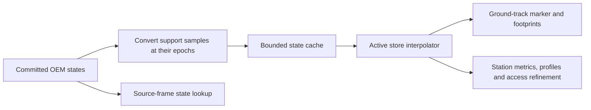

# play-oem frame conversion

## Summary

Play-OEM retains OEM states in their source frame. Earth-fixed point consumers use
`OemDataStore.earth_fixed_state_at()` to convert exact OEM samples to the configured Earth-fixed frame at their
own epochs, then interpolate those six-component states. The active store interpolation
policy and snapshot revision apply to both source-frame and Earth-fixed lookups.

## Frames and state conversion

The target is configured once by `EARTH_FIXED_FRAME_NAME` in `ground_track.py`; its
default is `ITRF1993`. Set it before creating a store, since derived caches assume a
constant target for the lifetime of each store. The supported targets are `ITRF1993`
and `ITRF`. Earth-fixed operations require an Earth center and a supported
`REF_FRAME`. OEM labels ITRF, ITRF1993 and ITRF93 are treated as ITRF93. J2000, EME2000, ICRF and GCRF are
normalized to J2000; TEME is also supported. If the target is `ITRF`, an input
normalized to ITRF93 is transformed to that target instead of being copied. The result
is position in meters and velocity in meters per second. The J2000-to-ITRF transformation includes the
rotating-frame velocity term. For TEME, `frame_utils` estimates the rotation derivative using a centered difference
at half a second either side of the sample epoch before the J2000-to-ITRF transformation.

Unsupported frames and non-Earth centers raise a ground-track preparation error;
incomplete metadata during loading produces an unavailable state. Frame conversion
uses the existing TudatPy/SPICE kernel and Earth orientation setup.

## Point lookup and cache

The point lookup shares the source lookup's envelope, exact-sample, segment, gap,
and interpolation checks. It converts only the segment-local support samples needed
by the current interpolation method. Exact samples are converted directly. It never
interpolates across a segment boundary or extrapolates. Results are `CursorState`
objects whose components and derived values are in the configured Earth-fixed frame.

A store-owned least-recently-used cache retains up to 8192 converted sample states,
keyed by store epoch, source frame and sample row. It is protected by the store lock
and cleared on epoch reset. Policy changes preserve converted samples but invalidate
old snapshots and clear dependent station tiers. Appended samples become available
through new snapshots; older snapshots remain limited to their committed prefix.
The cache is separate from the memory-budgeted Earth-fixed range tier.

The range tier still stores converted positions for committed samples for ground-track
history. It does not contain the velocities needed for six-component interpolation.

## Consumers

Ground-track playback markers, footprints, current station metrics, station profiles,
and station access crossing and peak refinement use Earth-fixed point lookups. Station
geometry consumes the Earth-fixed positions directly, avoiding another inertial conversion.
Access refinement consumes Earth-fixed cursor states directly and needs no frame argument.
The conversion boundary reads the OEM source frame from the store snapshot metadata.
Source-frame state displays and orbit markers continue to use `state_at()`.

## Accuracy and performance

The transform varies with time, so interpolating converted samples generally differs
from converting a source-frame interpolation at the query epoch. Accuracy depends on
sample spacing, interpolation method and orbit. The sample conversion cost is paid on
cache misses; repeated lookups can reuse it. Cache churn, support-window assembly,
interpolator cost, and first-use conversion affect performance. No speedup or numerical
error bound is implied without a representative benchmark and comparison.

## Verification

Point lookup tests cover the supported interpolation methods, exact samples, cache
reuse, segment gaps and out-of-range queries. Changes to the conversion path should
also be checked against independent frame-transform and station-access references,
including TEME velocity and policy changes.
