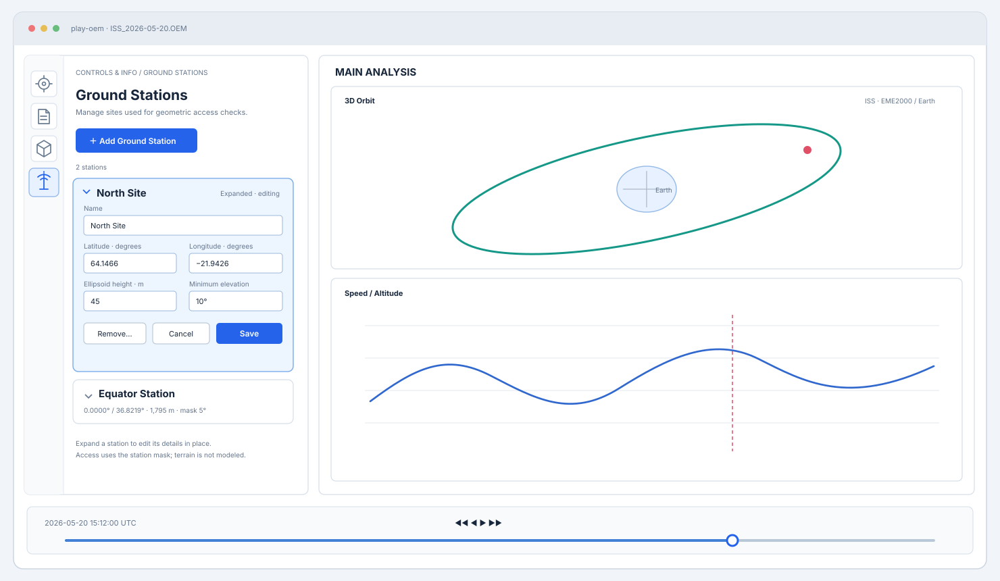
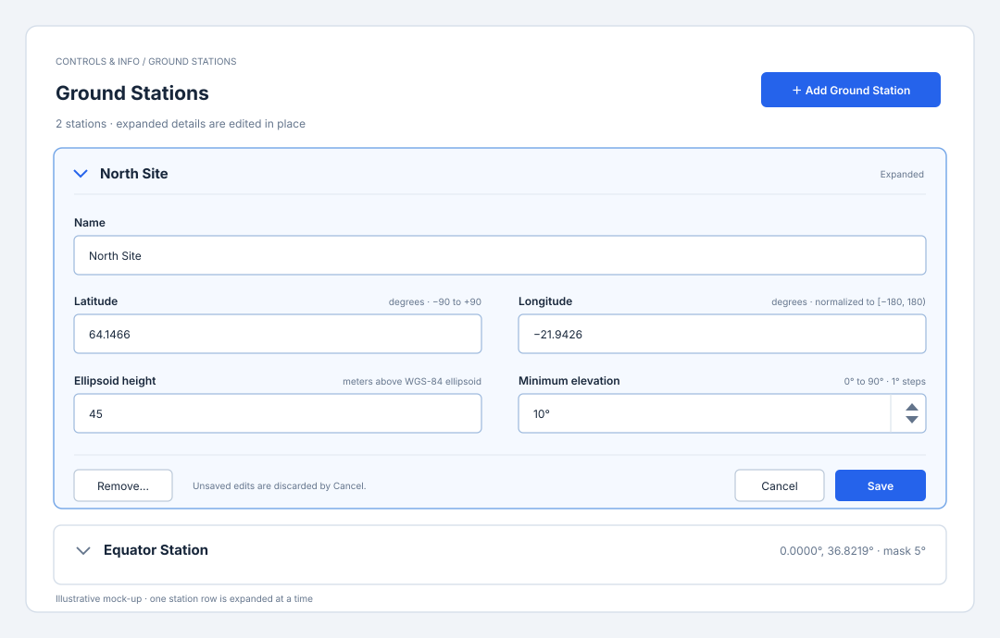
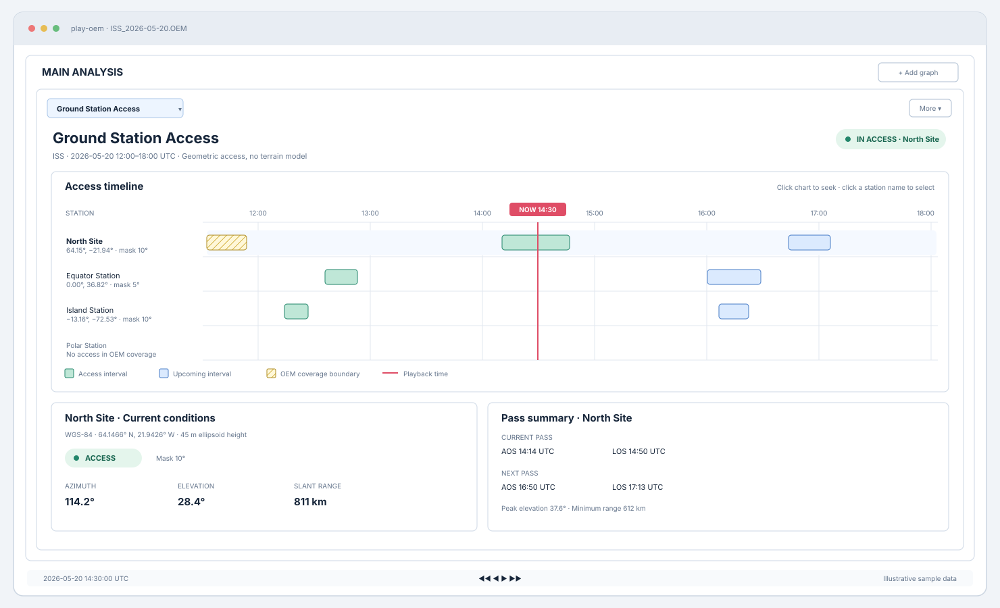

# `play-oem` — Ground Stations GUI Design

This document defines the proposed user-facing design for ground-station management and the
Ground Station Access graph panel. It extends the shared workspace in
[PLAY_OEM_GUI_DESIGN.md](./old/PLAY_OEM_GUI_DESIGN.md) and follows the technical constraints in
[PLAY_OEM_GROUND_STATIONS_SOFTWARE_DESIGN.md](./PLAY_OEM_GROUND_STATIONS_SOFTWARE_DESIGN.md).
Implementation sequencing is in
[PLAY_OEM_GROUND_STATIONS_IMPLEMENTATION_PLAN.md](./PLAY_OEM_GROUND_STATIONS_IMPLEMENTATION_PLAN.md).

## Visual mockups

The SVGs below are illustrative design proposals, not screenshots of the implemented GUI. They
show the manager embedded in the workspace, inline editing in an expanded station row, and the
access-oriented graph panel:

## User goals

- Maintain zero or more ground stations without manually editing a configuration file.
- See, at a glance, which stations can currently see the spacecraft.
- Inspect the next and previous access windows over the loaded OEM's coverage.
- Keep the station view synchronized with playback, seeking, reverse playback, and OEM replacement.

Ground station definitions are available whether or not an OEM is loaded. Access is only
calculated when a supported Earth-centered OEM is available.

## Ground Stations manager

Add **Ground Stations** as a page in the existing Controls & Info feature rail. The manager is
available independently of the loaded OEM.

### Expandable station list

Show one compact row per station with its name, coordinates, elevation mask, and an expand/collapse
control. Keep the list scrollable when it contains more stations than fit in the pane. Only one
station's details are expanded at a time so the Controls & Info pane remains usable.

Expanding a row reveals the station's editable fields directly beneath its summary row. Do not
open a separate edit dialog or navigate away from the manager. The expanded form contains:

- Name
- Latitude and longitude
- Ellipsoid altitude
- Minimum elevation mask

Include **Save**, **Cancel**, and **Remove** actions in the expanded details. Save validates and
applies the edited fields; Cancel discards changes and collapses the row. Remove requires
confirmation naming the station. Preserve a station's ID when editing; assign a new ID only when
adding one. Duplicate names are permitted because identity is not based on name.

The **Add Ground Station** action creates a draft station and expands it immediately into the
same inline form. The draft is not added to the persisted collection until Save succeeds.
Canceling a new draft removes it. When another row is expanded, collapse the previously expanded
row if it has no unsaved changes. If it has edits, ask whether to save, discard, or remain on the
current row before switching.

Fields and validation:

| Field | Control | Validation |
|---|---|---|
| Name | Text field | Trimmed, non-empty |
| Latitude | Decimal-degree field | Finite, -90° through +90° |
| Longitude | Decimal-degree field | Finite, -180° through +180°; normalize to [-180°, 180°) after entry |
| Altitude | Decimal meters | Finite; explicitly labeled as height above the WGS-84 ellipsoid |
| Minimum elevation | Integer-degree spin control | 0° through 90°, 1° increments; initial value 10° |

Keep Save disabled or show a field-specific error while input is invalid. Do not silently replace
malformed values with defaults. Keep station selection and expansion keyboard-accessible, and
expose each row's expanded state and actions to screen readers.

### Empty state

When there are no stations, show a short explanation that access calculations require a station
definition and a prominent **Add Ground Station** action. Do not show a blank table without
guidance.

## Ground Station Access graph panel

The graph view is a shared-clock panel, opened from the existing graph-panel view selector. It is
access-oriented rather than a second Ground Track map: the existing Ground Track view remains
responsible for the spacecraft's global subpoint path and footprint drawing.

### Layout

1. **Header:** “Ground Station Access”, current object name, and loaded OEM coverage span.
2. **Elevation graph:** elevation versus time for the selected station, sharing the application's
   Plot Range on the time axis.
3. **Current station details:** a selectable station list or row selection plus a concise detail
   area for the selected site.
4. **Pass summary:** previous and next pass details for the selected station, bounded to OEM
   coverage.

Use the station selector to choose which station's elevation is graphed. Keep the time axis
readable when the panel is resized.

### Elevation graph

- Plot the selected station's elevation angle against time, in degrees, only where it is at or
  above the station's minimum-elevation mask.
- Keep the vertical scale fixed from 0° to 95°.
- Draw the station's minimum-elevation mask as the lower boundary/reference for the plotted curve.
- Shade the selected station's AOS-to-LOS access intervals behind the elevation curve. Use
  distinct hatching for intervals limited by OEM coverage or an OEM segment gap.
- Draw a vertical playback cursor synchronized with the shared clock.
- The time axis follows the application's Plot Range; use its endpoints and follow rules to
  zoom or move through time. Do not add separate viewport controls to this panel.
- Clicking the graph moves the shared clock; changing the station selector does not seek.
- Provide a legend or accessible textual equivalent for the elevation curve, mask, access spans,
  and current-time cursor.
- Reuse the elevation samples prepared for access prediction; changing Plot Range must not
  recompute access history.

Displayed access spans are based on geometric elevation meeting that station's minimum elevation
mask. Label them as geometric access, not a guaranteed communications link.

### Selected-station details

At the current playback time, show:

- Station name and coordinates.
- **Access** or **No access**, with the configured minimum elevation.
- Azimuth in degrees clockwise from north.
- Elevation in degrees above the local horizon.
- Slant range in kilometers.
- Previous and next AOS/LOS, pass duration, maximum elevation, and minimum range where those
  values are available.

When outside usable OEM data or in a segment gap, keep the graph visible but mark current
azimuth, elevation, and range as unavailable. Do not substitute zero. Times should follow existing
`play-oem` UTC display conventions; elapsed-time labels may be used on the chart axis.

## Behavior and interaction

- The view opens even when there are no stations; show the station-empty message and an action
  that selects the Ground Stations manager.
- With stations but no OEM, show that loading an Earth-centered supported OEM is required.
- For an unsupported OEM center/frame or conversion failure, show the specific reason without
  disabling the station manager or unrelated views.
- Expanding a station reveals inline editable details; saving refreshes its row and invalidates
  only the affected station's access data.
- Adding or removing a station updates the station selector in every open access panel.
- Replacing the OEM recomputes pass intervals and current metrics while preserving the panel.
- Playback updates the cursor and selected-station details without recalculating full pass history.
- Prepare pass history only when the access view is opened or its station/OEM inputs change;
  clock updates refresh current metrics and the cursor only.
- Closing the panel unsubscribes from clock updates using the existing graph-view lifecycle.
- Do not change the existing Ground Track panel's projection, pan/zoom, footprint, or shared
  minimum-elevation behavior.

## Accessibility and visual requirements

- Provide keyboard access to Add, Edit, Remove, station selection, and graph seeking.
- Use text/icons or line patterns as well as color for access state.
- Include units in labels and tooltips; distinguish “elevation” from altitude.
- Keep minimum text readable at the graph panel's minimum supported size.
- Do not claim access when the state or frame conversion is unavailable.
- Ensure graph labels, legend entries, and status text remain meaningful to assistive technology.

## Deferred visual features

Do not add a second global map in the first implementation. A station-location map, station
coverage cones, antenna constraints, terrain obstruction profiles, link budget, and contact
export can be considered separately after validating the elevation graph and live metrics.
