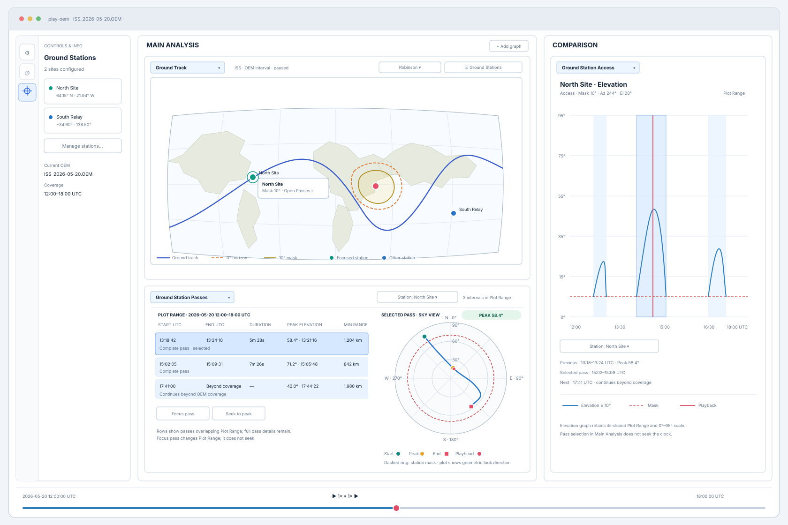

# `play-oem` — Ground Station Visual Analysis GUI Design

This document specifies station overlays on the existing Ground Track map and a pass-inspection
graph view containing a pass table and sky-oriented plot. It extends the shared
[three-pane workspace](./old/PLAY_OEM_GUI_DESIGN.md) and the implemented
[Ground Track](./old/PLAY_OEM_GROUND_TRACK_GUI_DESIGN.md) and
[Ground Station Access](./old/PLAY_OEM_GROUND_STATIONS_GUI_DESIGN.md) designs. Technical
contracts are in
[PLAY_OEM_GROUND_STATION_ANALYSIS_SOFTWARE_DESIGN.md](./PLAY_OEM_GROUND_STATION_ANALYSIS_SOFTWARE_DESIGN.md).
The mockup is illustrative, not a screenshot:

## User goals

- See configured stations in geographic context without leaving Ground Track.
- Find a station's access intervals within the shared Plot Range and compare their key metrics.
- Understand the selected pass's path across the local sky.
- Focus the shared Plot Range or playback clock on a pass through explicit actions.
- Keep existing ground-track navigation, elevation graph, and shared playback behavior predictable.

## Ground Track map enhancement

Add a **Ground Stations** layer toggle to the existing Ground Track controls. When enabled, show
all saved stations as small, high-contrast markers. Keep the map's existing projection, center
longitude, backgrounds, pan/zoom, spacecraft track, subpoint, and coverage boundaries unchanged.

- Emphasize a focused station with a selection ring and persistent name label.
- Reveal other station names on hover, or with an optional **Station labels** toggle.
- Selecting a marker opens a small accessible detail popover with station name, latitude,
  longitude, and minimum-elevation mask.
- Include **Open Passes** in the popover to open Ground Station Passes with that station selected.
- Map clicks on station markers select a station; they never seek playback. Existing map pan,
  zoom, and center-longitude rules remain in force away from markers.
- With zero configured stations, hide the layer toggle or disable it with an explanatory tooltip;
  the Ground Track map remains fully usable.

Do not draw station coverage footprints in this enhancement. The station marker layer is
time-independent and does not implicitly trigger access preparation.

## Ground Station Passes graph view

Register **Ground Station Passes** as a new selectable graph type. Keep the existing Ground
Station Access view focused on its elevation-versus-time graph. A pass view is opened from a
graph-panel selector or from a station marker's **Open Passes** action.

### Header and table

At the top, show the view title, a station selector, loaded OEM coverage, the current shared Plot
Range, and a concise status message. Below it, show a scrollable chronological table with these
columns:

Show the Plot Range as a persistent, clearly labeled readout containing both endpoints in UTC
(for example, `Plot Range: 2026-05-20 12:00–18:00 UTC`). Do not rely only on the graph axes,
table count, or pass times to communicate the filter range. Update the readout whenever shared Plot
Range changes, and keep it visible when no passes overlap.

| Column | Content |
|---|---|
| Start | UTC time of the known access start |
| End | UTC time of the known access end |
| Duration | Shown only when both boundaries are known |
| Peak elevation | Peak angle and its UTC time |
| Minimum range | Closest slant range and its UTC time |
| Coverage | Complete, begins at coverage boundary, continues beyond coverage, or gap-limited |

List only access intervals that overlap the current shared Plot Range, including intervals that
cross either range boundary. Filter by interval overlap, not full containment. Show the interval's
full OEM-bounded start/end and metrics even when part of it lies outside Plot Range; mark
coverage- or gap-limited boundaries as described below. The selected interval's sky path likewise
shows the full available pass, not only the portion inside Plot Range.

Use stable UTC formatting consistent with `play-oem`. Sort by start time by default. When Plot
Range changes, refresh the visible rows from the cached intervals without preparing access
history again. Preserve selection by interval identity while it remains in the filtered table. If
it leaves the range, select the interval containing playback time, then the next interval in the
filtered table, then the first row. Do not show fabricated crossing times or complete durations
for intervals clipped by OEM coverage or gaps.

The selected row updates the sky plot. Selecting a row does not seek or change Plot Range.
Provide the explicit actions **Focus pass** and **Seek to peak**. Focus pass sets the shared Plot
Range to the selected interval within OEM coverage; Seek to peak moves the shared playback clock
to the stored peak epoch. Disable each action when its required event time is unavailable.

### Sky-oriented plot

Place the sky plot beside the table when the panel is wide enough; at narrow sizes, stack it below
the table and allow the view to scroll rather than clipping controls or labels.

- Draw azimuth clockwise from north, with N/E/S/W at 0°/90°/180°/270°.
- Draw the horizon (0° elevation) as the outer circle and zenith (90°) at the center.
- Label elevation rings and show the selected station's mask as a distinct ring.
- Plot the selected pass only where elevation is at or above the station's mask.
- Distinguish start, peak, and end markers by shape or line style as well as color.
- Show a playback cursor marker only when the current clock time falls inside the selected pass.
  Otherwise show a short status such as “Playhead outside selected pass.”
- Never connect through an invalid sample, a segment boundary, or an OEM gap.

The plot shows geometric look direction for the selected pass; it is not a radio-visibility
indicator.

## Workspace and selection behavior

- Ground Station Passes is an ordinary graph-panel view with the existing panel selector, move,
  duplicate, replace, close, and scroll behavior.
- Keep pass-row selection and sky-plot selection local to one Ground Station Passes panel.
  Multiple panels may inspect different stations or passes without changing each other's
  selection.
- A Ground Track marker's **Open Passes** action seeds the new view with that station ID. If the
  station was removed before the view is created, show the normal no-station state.
- Keep the `overview` group unchanged. Include Ground Station Passes in the `all` group through
  normal registry construction.
- Ground Station Access retains its own station selector and continues to use shared Plot Range
  for the elevation graph's time axis.

## Empty, unsupported, and partial-data states

- **No stations:** explain that a station is needed and offer **Manage Ground Stations**.
- **No OEM:** keep station selection available and explain that an Earth-centered OEM is needed
  for pass analysis.
- **Unsupported OEM or unavailable preparation:** show the specific limitation without implying
  no access.
- **No intervals in OEM coverage:** state that no access interval meets the selected station's
  mask anywhere in usable OEM coverage.
- **No intervals in Plot Range:** state that no cached interval overlaps the displayed UTC range
  and suggest widening the shared range. Do not describe this as no access over the full OEM.
- **Coverage- or gap-limited interval:** identify the uncertain boundary in the table and retain
  the known portion of the sky path.
- **Playhead outside selected pass:** keep the selected pass visible and omit the current-time
  marker.

## Accessibility and visual requirements

- Give the layer toggle, station popover, selectors, pass table, and pass actions keyboard
  activation and accessible names.
- Expose the selected table row and station to assistive technology. The sky plot must have a
  textual summary of station, selected interval, mask, peak elevation, and playhead status.
- Use line patterns and marker shapes in addition to color for station selection, mask, and pass
  boundaries.
- Label all angles, distances, and times with units or UTC context.
- Respect dark and light themes and the graph panel's minimum size. Keep useful table columns
  visible at normal widths; allow horizontal table scrolling only when necessary.
- Preserve the application's existing timeline and map navigation controls; do not add wheel zoom
  to the access graph or sky plot.
