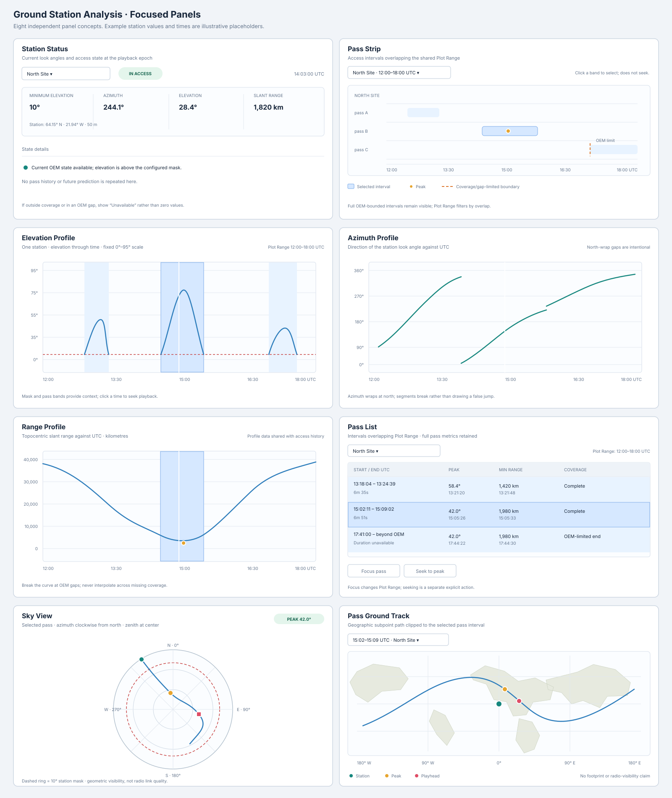
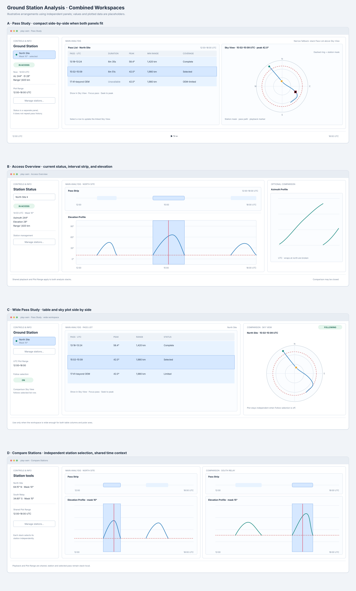
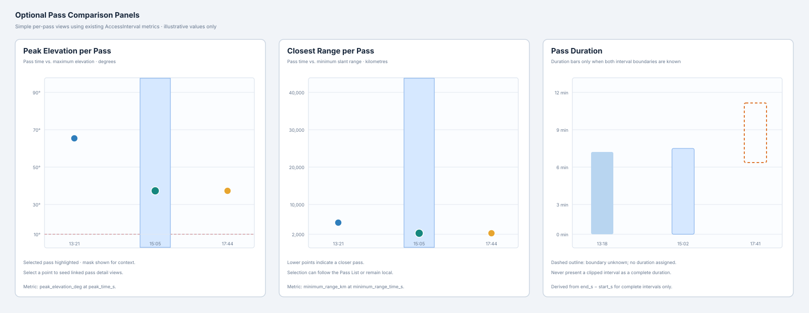

# `play-oem` — Modular Ground Station Analysis GUI Design

**Status: Design baseline; visual acceptance remains in progress.** This document describes eight
focused panels that can be arranged in the existing three-pane analysis workspace. The technical
contract is in the [modular software design](./PLAY_OEM_GROUND_STATION_ANALYSIS_SOFTWARE_DESIGN.md);
the earlier composite design and implementation report are archived in [`old/`](./old/).

## Design goals

- Give each panel one primary job and avoid repeating the same long status or pass summary.
- Preserve the existing Controls & Info, Main Analysis, Comparison, and shared playback layout.
- Let a user combine a few views with adjustable sashes instead of forcing a fixed dashboard.
- Keep Pass List, Pass Strip, time profiles, Sky View, and Pass Ground Track linked by explicit
  interval selection.
- Make one panel usable on its own and avoid opening all panel types by default.

## Visual mockups

The standalone sheet shows each of the eight core panels. The workspace sheet shows the four
recommended combinations, including a compact Pass Study layout, its narrow-width fallback, and
wide-screen alternatives.
The optional sheet sketches the three pass-comparison graphs. All values and plotted curves in
these mockups are illustrative.







## Focused panel set

| Panel | Recommended display |
|---|---|
| **Station Status** | Compact current-state card: station, mask, access state, azimuth, elevation, range |
| **Pass Strip** | UTC Plot Range with one band per access interval and boundary markers |
| **Elevation Profile** | Elevation/time line, 0°–95° scale, mask, pass intervals, playhead; optional above-mask filter |
| **Azimuth Profile** | Azimuth/time line with clear breaks at north wrap; optional above-mask filter |
| **Range Profile** | Slant range/time line in kilometres; optional above-mask filter |

Each time profile has an independent **Show only above minimum elevation** checkbox, checked by
default. Enabling it leaves gaps for below-mask samples; disabling it shows the full profile.
| **Pass List** | Start, end, duration, peak, minimum range, and coverage/gap status |
| **Sky View** | One selected pass in azimuth/elevation polar coordinates |
| **Pass Ground Track** | Pass-bounded subpoint path with the station marked |

Status and list are information panels; the other six are plots. Keep the current selected-pass
summary short in Sky View. Do not repeat the entire pass row or the previous/next-pass paragraphs
from the existing composites.

### Optional pass-comparison plots

If users need to compare pass quality at a glance, consider adding these as separate, small
panels rather than expanding an existing composite:

- **Peak Elevation per Pass:** one point per interval, with peak elevation on the vertical axis.
- **Closest Range per Pass:** one point per interval, with minimum slant range in kilometres.
- **Pass Duration:** one bar per interval, only when both boundaries are complete; visibly mark
  clipped or gap-limited intervals.

The first two can be plotted from values already shown in Pass List, so they require no new
historical profile calculation. They complement the table rather than replace it. Keep them out
of the initial presets; add only if pass ranking is a demonstrated workflow need.

## Main-window configurations

Each configuration uses the existing shell: Controls & Info on the left, the Main Analysis stack
in the center, optional Comparison on the right, and shared playback/UTC controls below.

### A. Pass Study — compact responsive layout

Keep Comparison closed. When the Main Analysis area can fit the compact Pass List and a useful
polar plot side by side, place them in one row. The compact list groups start/end into one UTC
interval column and keeps duration, peak, minimum range, and coverage/status visible. This avoids
stacking two tall panels and keeps the selected pass in view alongside its sky path.

```text
┌ Controls & Info ─────┬ Main Analysis ──────────────────────────────┐
│ Station selection    │ Pass List · compact       │ Sky View         │
│ Station tools        │ UTC · duration · peak     │ selected pass   │
│                      │ min range · coverage      │ polar path      │
├──────────────────────┴── shared UTC / playback timeline ──────────┤
└───────────────────────────────────────────────────────────────────┘
```

Selecting a row publishes its stable interval identity to the linked Sky View. Keep the table
wide enough for its compact columns and the sky plot large enough for readable axes and path
markers. When either panel would fall below its usable minimum, stack Pass List above Sky View;
allow the user to resize the sash in that narrow layout.

The Access Overview and Pass Study presets open independently selectable graph panels. Currently
the Pass Study preset stacks Pass List and Sky View in Main Analysis; the compact responsive
paired layout remains available through **Open Passes** from Ground Track. Automatically arranging
the two independent panels side by side is a remaining workspace-layout acceptance item.

### B. Access Overview

Keep the main stack focused on current state and time history. Comparison can hold azimuth or
range when diagnosing a pass, or remain closed to maximize the elevation plot.

```text
┌ Controls & Info ─────┬ Main Analysis ────────────────┬ Comparison ─────┐
│ Station selection    │ Station Status (compact)      │ Azimuth Profile │
│ Station tools        ├──────── sash ─────────────────┤ optional        │
│                      │ Pass Strip                    │                 │
│                      ├──────── sash ─────────────────┤                 │
│                      │ Elevation Profile             │                 │
├──────────────────────┴── shared UTC / playback ──────┴─────────────────┤
└───────────────────────────────────────────────────────────────────────┘
```

For a simpler setup, leave only Elevation Profile in Main Analysis and use Station Status in the
Controls & Info page rather than opening it as a graph panel.

### C. Wide-screen pass investigation

On wide monitors, place Pass List in Main Analysis and Sky View in Comparison. Reserve enough
width for the full table and a useful polar plot; if either panel becomes too narrow, return to
the stacked Pass Study configuration.

```text
┌ Controls & Info ─────┬ Main Analysis ───────────────┬ Comparison ─────┐
│ Station selection    │ Pass List                    │ Sky View        │
│ Station tools        │ ~60%                         │ ~40%            │
├──────────────────────┴── shared UTC / playback ─────┴─────────────────┤
└───────────────────────────────────────────────────────────────────────┘
```

The Comparison stack follows the Main Analysis pass only when **Follow selection** is enabled.
Otherwise it keeps its own station and pass, supporting side-by-side inspection.

### D. Compare stations

Use matching time-oriented views in Main Analysis and Comparison. Each stack keeps its own
station selection while both use the shared Plot Range and playback clock.

```text
┌ Controls & Info ─────┬ Main Analysis ───────────────┬ Comparison ─────┐
│ Station tools        │ Pass Strip — North Site     │ Pass Strip —    │
│                      │ Elevation — North Site      │ South Site      │
│                      │                             │ Elevation —     │
│                      │                             │ South Site      │
├──────────────────────┴── shared UTC / playback ─────┴─────────────────┤
└───────────────────────────────────────────────────────────────────────┘
```

## Panel interactions

### Selection flow

- Selecting an interval in Pass Strip or Pass List updates other views in the same stack.
- A row action **Show in Sky View** opens or selects a Sky View seeded with that station and pass.
- A separate **Follow selection** toggle controls whether Comparison follows Main Analysis.
- Clicking a profile time seeks playback; selecting an interval does not.
- **Focus pass** updates shared Plot Range; **Seek to peak** explicitly moves playback.
- Station selection remains local to each stack so users can compare stations.

### Responsive behavior

- Prefer side-by-side Pass List and Sky View in Pass Study when the compact table columns and
  polar plot both fit at usable widths.
- Stack Pass List above Sky View when the available Main Analysis width cannot fit both panels;
  keep the sky plot taller than the table in that layout.
- Use the wide-screen separate-stack arrangement only when Comparison is useful for independent
  station/pass inspection, not merely to avoid the narrow-width fallback.
- Respect the existing graph-panel minimum size and scroll the stack rather than compressing a plot
  until its labels or axes are unusable.
- Preserve panel size and selection when toggling Comparison or changing views.

### Visual and accessibility requirements

- Give every panel a concise title, station name, and accessible panel name.
- Keep Plot Range endpoints explicitly labeled in UTC on time-based views.
- Label axis units; distinguish station mask and interval limits by line style/shape as well as
  color.
- Give the polar plot a textual summary of the selected pass and playhead state.
- Ensure table selection, station controls, sashes, and actions work from the keyboard.
- Use theme-aware colors and verify dark/light backgrounds, contrast, and focus indications.

## Presets and view selection

Provide **Access Overview** and **Pass Study** as optional workspace presets. A preset is a
starting arrangement, not a new composite widget: each region remains an ordinary graph panel
that can be changed, moved, duplicated, resized, or closed. Keep the existing `overview` group
unchanged. Do not add every station panel to the default Overview.

The view selector uses the concise labels in the focused panel set. Preserve compatibility for
saved selections of **Ground Station Access** and **Ground Station Passes** by mapping them to
Elevation Profile and Pass List respectively.
