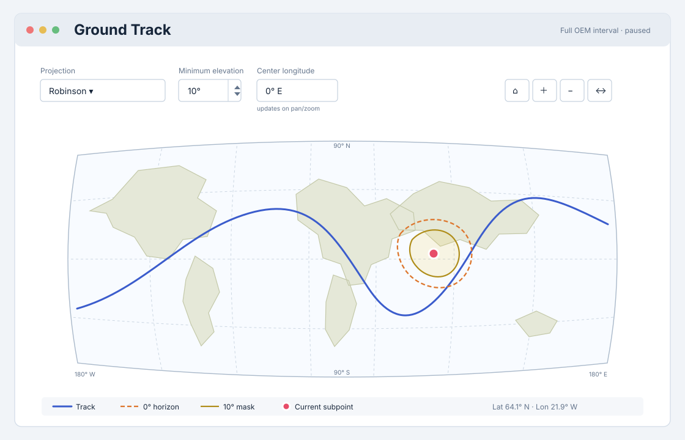
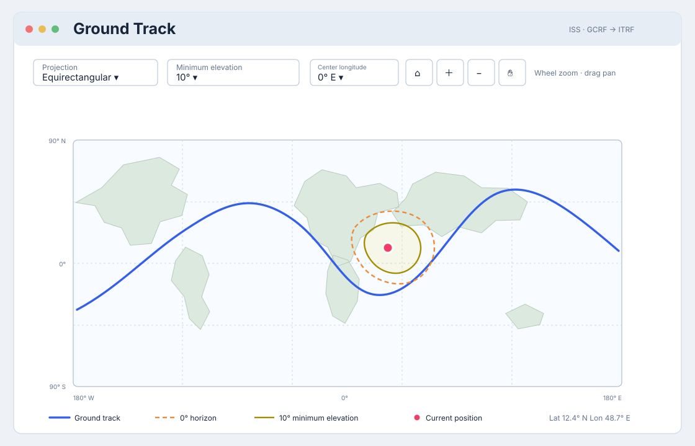
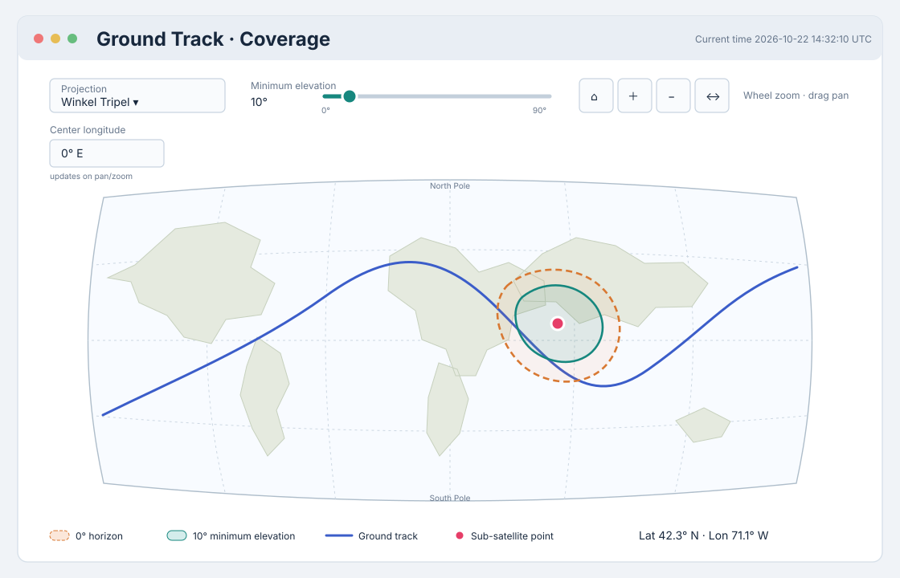
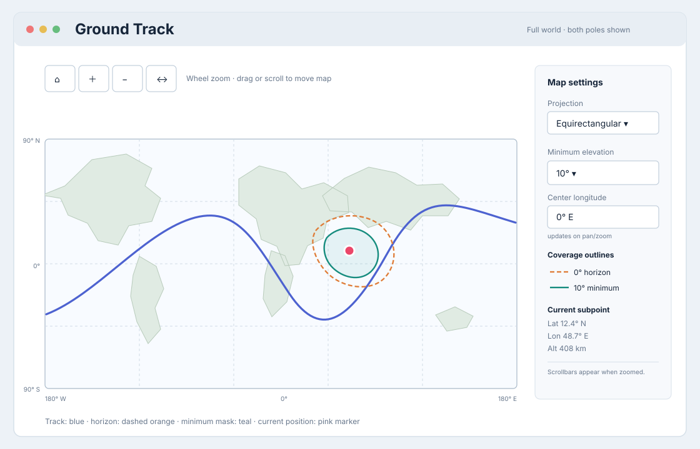

# `play-oem` — Ground Track View GUI Design

This document defines the selected user-facing design for the Ground Track graph view. The
feature is implemented; live visual validation remains outstanding. It extends the three-pane
graph workspace described in
[PLAY_OEM_GUI_DESIGN.md](./old/PLAY_OEM_GUI_DESIGN.md) and follows the coordinate and lifecycle
constraints in [PLAY_OEM_GROUND_TRACK_SOFTWARE_DESIGN.md](./PLAY_OEM_GROUND_TRACK_SOFTWARE_DESIGN.md).
For user instructions, see [PLAY_OEM_GROUND_TRACK.md](../../tools/PLAY_OEM_GROUND_TRACK.md).

## User goal

Show where the satellite passes over Earth during the loaded OEM and follow its current position
while playback is paused, running forward, running in reverse, or being seeked. Ground Track is a
graph view in the existing graph panels, not a separate application window.

## Selected final design

Use the balanced-map layout shown below as the final design. It places projection, minimum
elevation, and center-longitude controls in one row above a large map. Navigation tools remain
near those controls, while the map and full-width legend/readout use most of the panel.

The initial projection is Robinson, as shown in the selected design. Keep Equirectangular and
Winkel Tripel available in the per-panel **Projection** selector. Use pyproj/PROJ for these
projections; every option must show both poles in the same global view. The initial release has
no coastline layer, so the graticule and track remain legible without map-data downloads.

The control row contains:

- **Projection** selector, initially Robinson.
- **Minimum elevation** integer-only spin button, initially 10°, with a range of 0°–90° and
  one-degree steps.
- Editable **Center longitude** in degrees east, normalized to `[-180°, 180°)`.
- Home, zoom-in, zoom-out, and pan controls. Wheel zoom is also available over the map.

The map area shows a graticule, the complete usable OEM ground track, and a distinct marker at
the current playback time. Coastline outlines are deferred. The footer identifies the track, 0° horizon footprint,
minimum-elevation footprint, and current subpoint, with a textual latitude/longitude readout.

## Map and coverage display

Offer these full-world projections:

| Projection | User-facing effect |
|---|---|
| Equirectangular | Keeps latitude and longitude coordinates easy to read; land shapes and areas become increasingly stretched toward the poles. |
| Robinson | Gives a balanced, familiar world-map shape with less polar enlargement; it does not preserve angles or area. This is the initial projection. |
| Winkel Tripel | Balances several forms of global distortion and keeps a natural-looking world outline; it does not preserve angles or area. |

Apply the selected projection and center longitude consistently to the map background or
coastlines, graticule, OEM track, current marker, and both footprint boundaries. Changing
projection resets only that panel to its full-world extent while retaining its center longitude.
It does not change playback time or other graph panels.

Draw the complete usable OEM ground track as a static path. Keep distinct OEM segments separate
and split the path at the map seam, which is `Center longitude ±180°`. Do not join the beginning
and end of an OEM segment unless the source data provides a continuous segment there. Distinguish
the current-time marker from the track by shape as well as color. Include an in-map latitude and
longitude readout when the current position is valid.

Draw two current-time coverage boundaries: the outer **0° elevation (horizon)** boundary and
the inner **minimum elevation** boundary. Measure elevation from the local geodetic horizon on
the WGS-84 ellipsoid, assuming sea-level ground points. Use distinct line styles and labels as
well as colors. These are coverage outlines at the current time, not accumulated orbit coverage.
At 0°, the two boundaries coincide, so draw one clearly identified line. At 90°, indicate that
the inner footprint has collapsed to the sub-satellite point.

Changing the shared minimum-elevation value updates the inner boundary in every open Ground Track
panel. The 0° horizon is unchanged. The setting is saved as application state and does not alter
playback time, projection, or other views.

The view covers the complete loaded OEM time interval, matching the other history plots. It does
not silently retain the legacy `plot-oem` dependent-variable plot's three-hour cutoff. It does
not add a separate timeline, playback controller, or independent legend panel.

## Placement and empty state

- Label the graph type **Ground Track** and expose it as the `ground-track` view in each panel's
  existing selector.
- Open it in Main Analysis or Comparison like any other graph view. Respect the panel's existing
  move, duplicate, replace, close, and scroll behavior.
- Keep the current `overview` composition unchanged. Add Ground Track to the `all` view group
  through normal registry behavior; do not add it to `overview` by default.
- Restore the active time marker when the panel opens or the OEM changes.
- When no OEM is loaded, use the existing empty graph/prompt pattern and do not show placeholder
  coordinates as real data.

## Navigation and playback interaction

Start at the full-world extent. Support toolbar zoom and pan, mouse-wheel zoom centered on the
pointer, and horizontal and vertical scrollbars when zoomed. With pan active, click-and-drag on
the map moves the visible map area. Keep map navigation local to the Ground Track panel; pointer
and drag interactions over the map must not scroll the graph stack.

After wheel zoom, toolbar zoom, click-and-drag pan, or scrollbar movement, update **Center
longitude** to the longitude at the center of the visible map. Editing **Center longitude** moves
the map to that meridian. Normalize the displayed value to `[-180°, 180°)` and handle wrapping at
the seam without a jump. The home action restores the full-world extent around the current
center longitude.

Preserve each panel's zoom, scroll position, and center while playback moves the marker and
footprints. The map does not automatically follow the satellite. Map clicks do not seek playback:
the current generic plot-click handler interprets horizontal coordinates as time, while map
longitude is not elapsed time. Click-and-drag pans only when pan is active and never seeks. The
shared timeline remains the authoritative seek control; seeking in another time-series view moves
the marker to the corresponding Earth-fixed location.

In a gap between OEM segments, keep the historical path visible and hide the current marker or
clearly mark the position as unavailable.

## Layout, labels, and accessibility

- Preserve each projection's intended aspect and full-world extent without stretching it to fill
  a differently shaped graph panel. For Equirectangular, the full-world longitude-to-latitude
  extent is 2:1. Leave unused space rather than distorting geographic shapes.
- Label axes **Longitude (deg)** and **Geodetic latitude (deg)**. Show west/east and north/south
  sign conventions through ordinary signed ticks and labels.
- Make the spin button keyboard-accessible and prevent fractional values. Clearly expose its
  0°–90° range and 1° increment.
- Use theme-readable grid and path contrast. Do not rely on color alone to identify the current
  spacecraft marker or unavailable position.
- Give the figure an informative title including the spacecraft/object name when available.
  Provide a textual current-coordinate readout in addition to the marker position.
- Keep labels, controls, and toolbar actions reachable at the graph panel's minimum size. Verify
  dark and light appearance and keyboard focus in a live wx session.

## Empty and error states

If the OEM is not Earth-centered, its reference frame is unsupported, or the required frame
conversion fails, show a concise explanation inside the graph panel and leave other workspace
views usable. Identify the center or frame that caused the limitation when known. Do not display
a plausible-looking map with coordinates derived from an invalid assumption.

If the cursor is outside usable segment data, keep the static track visible and show an explicit
unavailable marker/readout state. Do not erase the map or imply that playback has stopped.

## Map background

The coastline source is not yet selected. Prefer a low-resolution, locally packaged dataset with
a clear redistribution license and no runtime network access. Evaluate package size and
readability at normal and minimum panel sizes. A heavy mapping dependency or runtime map download
is not the default proposal. If no suitable dataset is approved, ship the first version with the
graticule and ground track only; record coastlines as follow-up work.

## Review checklist for implementation

- The selected balanced-map layout fits and remains legible through panel resize and scrolling.
- Every projection transforms the graticule, map surface/coastlines, track, marker, and footprints
  consistently. Switching projections resets only the affected panel's extent and retains its
  center longitude.
- Both poles and near-polar track data appear in every projection. No projection clips either
  pole.
- The minimum-elevation spin button accepts only integers from 0° through 90° in 1° steps,
  defaults to 10°, restores saved state, and updates all open Ground Track panels.
- At 0°, duplicate boundaries are not overdrawn; at 90°, the collapsed inner boundary is shown or
  explained.
- The full track remains divided at OEM gaps and map-seam crossings.
- The marker follows exact and interpolated cursor times in both playback directions.
- Toolbar and wheel zoom work; pan and scroll move the enlarged map. Navigation updates Center
  longitude, while playback preserves the chosen extent and scroll position.
- Editing Center longitude recenters the map, and its value remains normalized across the seam.
- Map clicks and drags do not seek or change playback; drag pans when pan mode is active.
- Other views and the shared timeline continue to work while the map is open.
- Unsupported center/frame and cursor-gap states are explicit and do not affect other panels.
- The view opens in either graph stack, replaces/closes cleanly, and updates after OEM replacement.
- Keyboard focus, marker shape, text readout, and theme contrast make the state understandable
  without color alone.

## Unselected design candidates

The following mockups are retained as design history. They are not the selected layout.

### Map-first controls

Equirectangular map with projection and elevation controls in a compact row above the map, plus a
legend and coordinates along the bottom.

### Footprint emphasis

Winkel Tripel map with a slider for the shared minimum-elevation mask and translucent, distinctly
styled horizon and mask areas.

### Side controls

Equirectangular map with a dedicated settings/readout column, leaving the map itself uncluttered
and making footprint labels and coordinates persistent.

