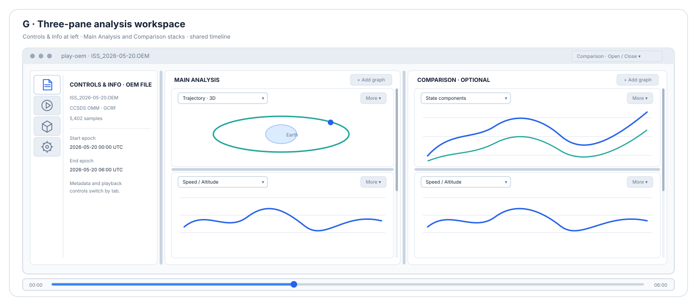
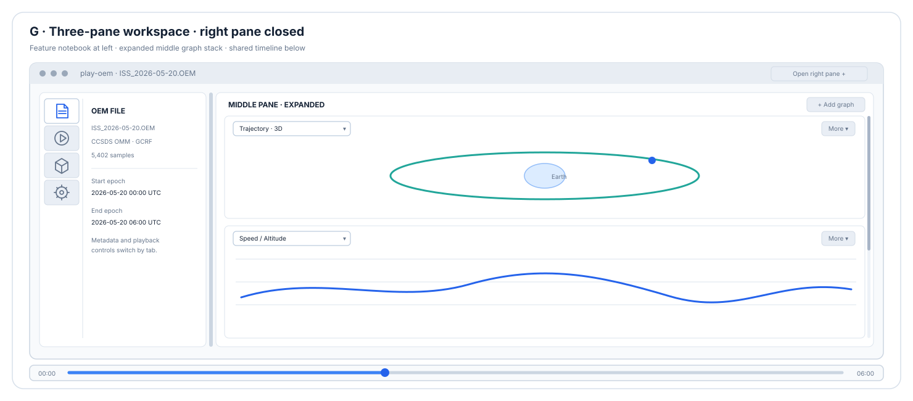
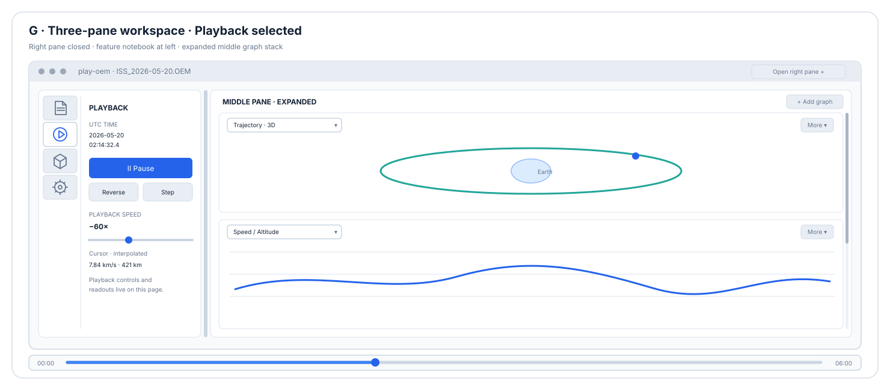

# `play-oem` — GUI Design

This document guides implementation, validation, and iterative improvement of the
`play-oem` graphical interface. It complements, rather than replaces:

- [PLAY_OEM_CONCEPTS.md](./PLAY_OEM_CONCEPTS.md), the user-facing requirements and terminology.
- [PLAY_OEM_SOFTWARE_DESIGN.md](./PLAY_OEM_SOFTWARE_DESIGN.md), the software architecture,
  component contracts, backend decisions, and technical constraints.
- [PLAY_OEM_IMPLEMENTATION_PLAN.md](./PLAY_OEM_IMPLEMENTATION_PLAN.md), the dependency-ordered
  implementation sequence and completion evidence.
- [PLAY_OEM_GUI_IMPLEMENTATION_PLAN.md](./PLAY_OEM_GUI_IMPLEMENTATION_PLAN.md), the detailed
  plan for implementing the selected three-pane layout.

Keep those documents authoritative for their respective subjects. Update this guide when the
GUI workflow, validation approach, or improvement priorities change.

## Visual design concepts

The selected final design is the three-pane analysis workspace (G) below. Its mock-ups are
illustrative proposals, not implemented screenshots; dimensions and colors are illustrative, and
final controls should follow platform conventions.

### Selected design: G. Three-pane analysis workspace

The left **Controls & Info** pane has a vertical icon-only feature rail for non-graph pages. The
middle **Main Analysis** pane stacks zero or more independently selectable graph panels; the
optional right **Comparison** pane can hold another independent stack. A shared time slider spans
below all panes.

The horizontal bars between graph panels in the mockups indicate draggable sashes; their displayed
panel proportions are illustrative.

- **Fits:** users who want non-graph tools kept separate from a flexible, multi-plot analysis area.
- **Trade-offs:** several narrow panes can reduce plot readability; graph stacks need clear add,
  remove, and empty-state behavior. The right pane should be optional so the middle pane can use
  the available width when it is closed.
- **Pane names:** use **Controls & Info**, **Main Analysis**, and **Comparison** in visible pane
  headings and matching wx window names. These describe the left feature pages, the default graph
  stack, and the optional side-by-side analysis stack.
- **Toolbar:** keep playback and non-graph features in the Controls & Info pane. Give every graph
  panel its own view-selection combobox and a compact panel-actions menu; keep the shared time
  slider below the pane area.
- **Implementation:** use nested splitters for the left, middle, and optional right regions, with
  vertically stacked graph hosts in the middle and right. Make every pane boundary user-resizable:
  use draggable vertical sashes for side-by-side panes and horizontal sashes between vertically
  stacked graph panels so each panel's height can be adjusted independently. Resizing a sash changes
  its adjacent panes, subject to usable minimum widths and heights. Use a visible, grab-friendly
  3D sash style that remains distinguishable in dark mode; avoid thin-sash styling. Retain
  independent stack scrolling as the fallback when the panels cannot all fit. Use the vertical
  feature rail to switch among non-graph pages such as OEM file information and playback controls.
  Implement the icon-only navigation as `wx.BitmapToggleButton` controls selecting pages in a
  `wx.Simplebook`, rather than `wx.Notebook`; the native notebook probe could not verify per-tab
  tooltips or keyboard/accessibility behavior on macOS. Preserve the optional right pane's
  contents, user-adjusted width, and internal panel-height allocations when closed, then restore
  them when reopened.

#### Panel and navigation behavior

- Put an **Add graph** action at the top of each graph stack. When a stack has no panels, show an
  empty-state message and the same add action.
- Give each graph panel a selector and a compact menu for moving it within its stack, duplicating
  it, or closing it. Keep panel selectors and plot actions local to their panel.
- Provide draggable sashes for both split orientations: vertical sashes resize side-by-side
  regions, and horizontal sashes resize top/bottom regions, including the heights of individual
  graph panels in a stack. A sash resize should affect its adjacent panes without resetting
  unrelated pane sizes or selected views.
- Keep sash handles wide enough to locate and drag, with visible theme-aware contrast in dark and
  light appearances.
- Keep graph panels at or above a 320 x 280 pixel minimum; scroll each stack rather than
  compressing panels below those minimums when the available pane height is insufficient.
- Closing the right pane hides it without discarding its panel selections, user-adjusted width, or
  panel-height allocations. Reopening it restores that state, while the middle pane expands into
  the freed space when it is closed.
- Provide a **Comparison** toggle in the Main Analysis header to show or hide the optional pane,
  and a close control in the Comparison header to hide it.
- Give every icon button an accessible name and hover tooltip. Support keyboard focus,
  Up/Down navigation between feature pages, and keyboard activation; the selected page must be
  indicated independently of hover or focus.

### Shared interaction principles

- Keep the current UTC time and elapsed time visible during playback, alongside a clear playing
  state and signed speed/direction.
- Give the timeline a large, easy-to-hit seek target. Keep precise text entry and start/end or
  sample-step actions available without crowding the primary transport row.
- Show a concise position/velocity summary and explicit cursor status; reveal secondary OEM
  metadata in a collapsible section.
- Make view/group selection discoverable without dedicating a button to every view in the most
  compact layout. Do not hide essential playback actions in menus.
- Give every graphic panel its own view-selection combobox so users can change that panel's
  contents independently of the other panels.
- Use wx sizers, standard controls, keyboard accelerators, and native focus behavior. Treat accent
  color as a state cue, not the only way to communicate status.
- At narrow window sizes, let controls wrap or collapse deliberately rather than clipping labels
  or making sliders unusable.

### wxPython integration implications

The active `PlayerApp` uses one wx application and event loop for the workspace, control window,
timers, and graph-panel hosts. The left/middle/right regions use nested vertical splitters; each
middle and right stack uses its own scroll window and nested horizontal splitters between graph
panels. These sub-pane splitters use the same live-update, 3D-sash style as the main splitters.
Every `GraphPanelHost` has a 320 x 280 pixel minimum. Matplotlib canvases and native VTK wx content
are parented to their graph-panel host, while the workspace maintains independent panel IDs and
clock subscriptions. Pane headings and wx window names are **Controls & Info**, **Main Analysis**,
and **Comparison**.

For the selected G layout, verify:

- Matplotlib canvases resize and redraw correctly as feature pages are selected and every vertical
  or horizontal splitter sash moves. Verify that adjacent panes resize independently, minimums
  remain usable, sash handles remain visible in dark mode, and right-pane close/reopen preserves
  user-adjusted sizes.
- Hidden views show the current cursor immediately when selected and do not create unnecessary
  render work while invisible. Coalesce or throttle redraws under multi-panel load so rendering
  cannot starve the playback clock or workspace input.
- Closing a tab or view unsubscribes it exactly once; changing tabs does not accidentally close a
  view intended to remain available.
- The VTK wx interactor can be hidden, resized, shown, and rendered correctly in feature pages
  on each supported platform. Preserve the single wx event loop and explicit backend errors.
- Click-to-seek, zoom/pan modes, keyboard focus, and current-state readouts remain consistent
  across panes and pages.

## Existing implementation context

`play-oem` uses one wx application and event loop. wx owns the control window, workspace frame,
nested splitters, graph-panel hosts, timers, and native controls. Matplotlib plots use WxAgg; the
optional VTK wx interactor is embedded in a graph-panel host when initialization and render-context
validation succeed. Each panel host has an instance ID independent of its selected view type, while
the app retains a one-per-registered-view default opening path. The playback clock, cursor lookup,
data loading, and series computation remain independent of the GUI toolkit.

The current startup experience is the compact Overview: a 3D trajectory and a speed/altitude
plot, with playback controls and current-state context in the main control window. Additional
views can be opened independently or as groups. The implementation details and current contracts
are maintained in the software design document.

Matplotlib cursor updates currently use `canvas.draw_idle()` full redraws. Partial WxAgg bitmap
blitting was removed after click-to-seek produced duplicated and mispositioned plot content in
the reported macOS UI. Automated coverage checks that cursor updates request full redraws rather
than partial blits; it does not replace visual verification in the running application.

## Development workflow

For each GUI change:

1. **Identify the user-facing requirement.** Link the change to a requirement in the concepts
   document or record the accepted scope in the implementation plan. Do not change playback or
   data semantics as a side effect of a presentation change.
2. **Trace the existing GUI path.** Follow the relevant event from its wx control or Matplotlib
   callback through the application and playback clock to the view update. Reuse the existing
   clock, cursor, view protocol, registry, and lifecycle patterns.
3. **Keep work on the wx UI thread.** Update widgets, Matplotlib artists, and VTK actors through
   the application's wx event loop. Avoid adding another GUI loop or allowing queued frames to
   accumulate.
4. **Separate model behavior from presentation.** Keep time conversion, cursor lookup, and
   derived data testable without a display. Keep view rendering and wx event handling in their
   existing GUI layers.
5. **Add focused automated coverage.** Test event-to-action wiring, synchronization, redraw
   requests, invalid-input behavior, and view lifecycle as applicable. Use headless Matplotlib
   tests for backend-independent behavior and a display-backed wx test environment for wx
   integration.
6. **Run a manual interaction check for visible behavior.** Exercise the affected window with
   realistic OEM data. Verify that the change is perceivable and that plot interaction, keyboard
   focus, and window lifecycle remain usable.
7. **Record evidence and limitations.** Update the implementation-plan checklist and evidence.
   Distinguish automated results, manual observations, and platform/backend measurements; do
   not generalize a single host's result to untested platforms.

## GUI validation checklist

Use the checks relevant to the change; complete the broader release checks in implementation
plan Step 28.

### Controls and synchronization

- Play, pause, reverse, speed changes, stepping, seeking, and end-of-range behavior remain
  synchronized across the control window and every open view.
- Timeline dragging and click-to-seek move the shared cursor to the expected time. Seeking does
  not change playback speed or direction.
- Direct time entry accepts supported formats; invalid input is clearly reported and does not
  move the cursor.
- Keyboard shortcuts work when appropriate and do not intercept typing while an editable field
  has focus.
- The time slider reflects clock changes without recursively triggering additional seeks.

### Plot interaction and data honesty

- Click-to-seek changes only the requested time; repeated clicks do not duplicate, offset, or
  otherwise corrupt plotted content.
- Matplotlib navigation modes do not accidentally convert zoom/pan gestures into seeks.
- Views remain synchronized after seeking in either direction and when opened during playback.
- OEM segment gaps are visible and are not drawn or interpolated across. Readouts identify
  sampled, interpolated, gap, or unavailable state as appropriate.
- Units, reference frame, and altitude assumptions remain clear in axes and readouts.

### Layout and lifecycle

- Default Overview and requested individual/group views open without duplicate windows.
- Existing windows are raised when their view is requested again.
- Closing one plot does not stop playback or close other views; closing the control window shuts
  down timers, subscriptions, plot frames, and the wx event loop cleanly.
- Resizing and moving windows does not hide controls, clip important readouts, or corrupt plots.
- Error messages for unavailable wxPython, Matplotlib, or explicitly requested VTK are actionable.

### Responsiveness and portability

- Measure the user-visible playback update rate with the documented workload and distinguish it
  from renderer-only or headless throughput.
- Check that UI input remains responsive under high playback rates and with large OEM histories.
- Check the selected 3D backend's initialization and rendering on each supported platform before
  claiming cross-platform support.
- Record operating system, Python and dependency versions, backend, dataset, view selection,
  playback rate, run duration, and measurement method for performance results.

## Improvement priorities

Treat these as ordered investigation areas, not authorization to change requirements or weaken
correctness. Implement a change only after establishing the current behavior and its acceptance
criterion.

### 1. Re-establish the performance baseline

The existing native wx measurements in Step 27 and the software-design document predate the
switch from partial blitting to full `draw_idle()` redraws. They must not be treated as current
performance results. Re-run the all-view workload on the current path before deciding whether
the accepted below-target baseline still applies. Keep the N1 threshold and any acceptance or
deferral explicit.

Measure UI playback updates and interaction responsiveness separately. Include the exact host,
backend, synthetic or real OEM data, number of samples, open views, playback multiplier, run
duration, and counting method. A headless Agg render-loop result is not evidence of native wx UI
responsiveness.

### 2. Verify the click-to-seek correction visually

Exercise click-to-seek in each 2D time-series view in a live wx session. Check ordinary clicks,
repeated clicks, clicks near plot edges, and interaction while playback is active. Confirm that
zoom/pan toolbar modes retain their expected behavior. Record manual results separately from
automated redraw tests.

### 3. Improve usability from observed friction

Use manual checks and user feedback to identify problems with control discoverability, status
messages, slider precision, keyboard focus, layout, and the amount of information in the default
dashboard. Prioritize issues that prevent a required action or make state ambiguous. Avoid adding
controls or dashboard density without evidence that they solve a concrete usability problem.

### 4. Validate accessibility and platform behavior

Check keyboard-only operation, visible focus, control labels, readable sizing, and platform-native
behavior. Verify the wx/Matplotlib/VTK combination independently on macOS, Linux, and Windows.
Document unsupported or unverified behavior rather than assuming consistency across native
window systems and graphics contexts.

### 5. Revisit rendering optimizations only with evidence

If a current-path measurement shows a material responsiveness problem, profile the full update
path before optimizing. Preserve full-resolution data for cursor lookup, maintain the view
contract, and verify that any rendering optimization does not reintroduce corruption or stale
cursor positions. Re-run focused correctness tests and the same benchmark workload after a
change. Keep algorithmic or backend experiments out of the GUI interaction path unless evidence
shows they are needed.

## Completion evidence

A GUI improvement is complete when:

- The intended user-visible behavior is demonstrated or tested.
- Playback and data semantics, plot accuracy, and window lifecycle remain intact.
- Relevant focused tests pass; any manual checks are identified as manual rather than automated.
- Performance claims have reproducible workload details and match the current implementation.
- The implementation plan, software design, and concepts document are updated if the change
  affects their scope.

## Archived design alternatives

Earlier candidates and abandoned designs, with their mock-ups, are retained in the
[`old/` archive](./old/PLAY_OEM_GUI_DESIGN_ALTERNATIVES.md). They are not part of the selected
G design.
