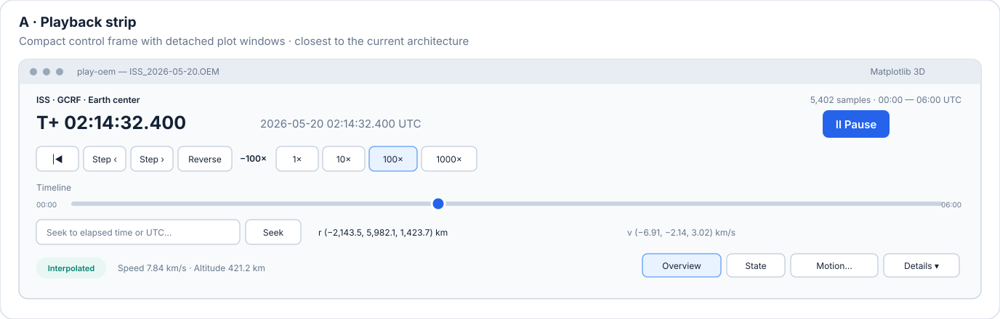
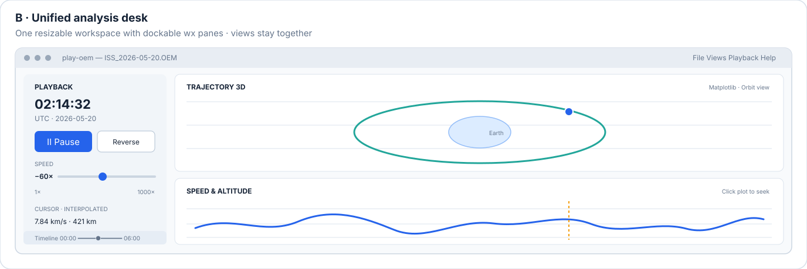
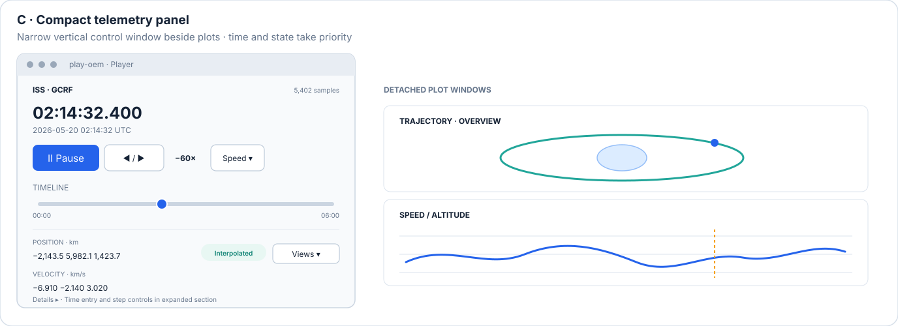
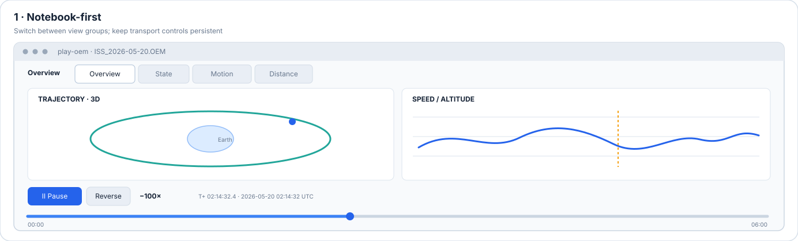
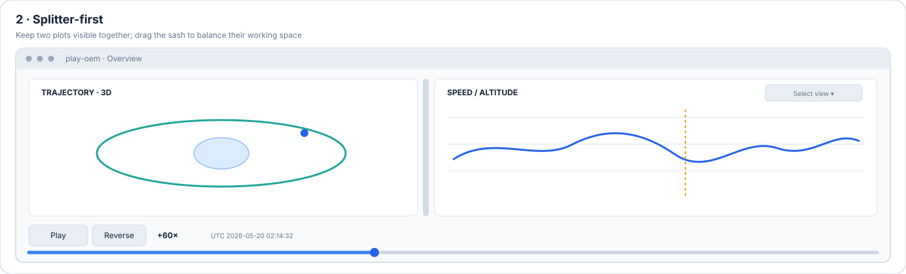
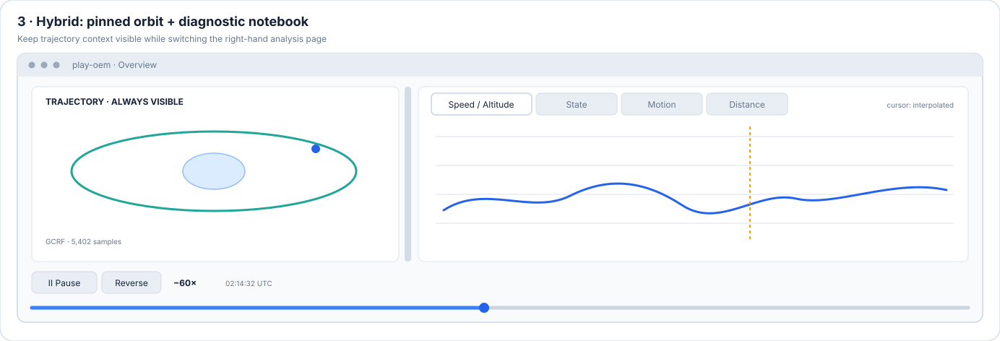

# `play-oem` — GUI Development and Improvement

This document guides implementation, validation, and iterative improvement of the
`play-oem` graphical interface. It complements, rather than replaces:

- [PLAY_OEM_CONCEPTS.md](./PLAY_OEM_CONCEPTS.md), the user-facing requirements and terminology.
- [PLAY_OEM_SOFTWARE_DESIGN.md](./PLAY_OEM_SOFTWARE_DESIGN.md), the software architecture,
  component contracts, backend decisions, and technical constraints.
- [PLAY_OEM_IMPLEMENTATION_PLAN.md](./PLAY_OEM_IMPLEMENTATION_PLAN.md), the dependency-ordered
  implementation sequence and completion evidence.

Keep those documents authoritative for their respective subjects. Update this guide when the
GUI workflow, validation approach, or improvement priorities change.

## Visual design concepts

These six GUI layout variants are **alternative design choices**, not stages or a
recommended sequence. The mock-ups are illustrative proposals, not implemented screenshots;
dimensions and colors are illustrative, and final controls should follow platform conventions.
No layout has been selected.

### Candidate layout variants

#### A. Playback strip

Users control playback, seek, and see a compact state summary in a short, wide player while plot
windows remain separate.

- **Fits:** users who want a compact player alongside one or more independently positioned plots.
- **Trade-offs:** leaves less room for telemetry and can become crowded at narrow widths; separate
  plot windows remain.
- **Implementation:** retain the existing control frame and per-view plot frames; use wx sizers
  to reorganize the transport and readouts without changing plot ownership.

#### B. Unified analysis desk

Users see playback controls and several plots together in one coordinated workspace, with the
ability to arrange or hide views to suit the current analysis.

- **Fits:** users who want all relevant plots in one coordinated workspace and value simultaneous
  comparison.
- **Trade-offs:** largest change to frame ownership; embedded Matplotlib/VTK panes, resizing,
  layout persistence, and platform behavior need validation.
- **Implementation:** host the controls and plot canvases in panels owned by one workspace frame.
  A dockable version could use `wx.aui.AuiManager`; it needs a shared embedded-view host and
  explicit pane lifecycle management.

#### C. Compact telemetry panel

Users keep current time and state visible in a narrow vertical player, with secondary controls and
metadata tucked away until needed; plot windows stay separate.

- **Fits:** users who keep a player beside plots or on a secondary display and want telemetry
  readily visible.
- **Trade-offs:** taller than the playback strip; some actions are tucked behind expanders and
  it is less suited to short screens.
- **Implementation:** keep the separate player frame and plot frames; use `wx.CollapsiblePane`
  for secondary controls and metadata, and adapt the vertical sizers for narrow widths.

#### D. Notebook-first workspace

Users switch among view groups while playback controls stay visible in a fixed toolbar or bottom
strip. Overview displays the 3D trajectory and speed/altitude plot together; other tabs provide
State, Motion, or distance diagnostics.

- **Fits:** compact single-window navigation when users usually inspect one diagnostic group at
  a time.
- **Trade-offs:** tab pages are mutually exclusive, so arbitrary plots cannot be compared
  simultaneously. Group related diagnostics to avoid an unwieldy tab bar.
- **Implementation:** host each page in a `wx.Panel` within one `wx.Notebook`. Update a page to
  the current clock time when selected; avoid redrawing hidden canvases unnecessarily and verify
  VTK initialization when its page becomes visible.

#### E. Splitter-first workspace

Users see two synchronized views at once, such as trajectory and speed/altitude, and can resize
the space each receives. The secondary view can be changed as needed.

- **Fits:** side-by-side comparison when two visible views are usually sufficient.
- **Trade-offs:** pane widths compete with plot readability on smaller displays. More simultaneous
  views need nested splitters or detached windows.
- **Implementation:** place two view-host panels in a `wx.SplitterWindow`, set useful minimum
  pane sizes and an initial sash position, and define how users choose the secondary view.

#### F. Hybrid: pinned trajectory plus notebook diagnostics

Users keep the trajectory visible while switching among 2D diagnostics; playback controls and
current time stay in place, with Speed/Altitude shown by default.

- **Fits:** users who want spatial context to remain visible while switching among diagnostics.
- **Trade-offs:** the pinned trajectory consumes space; only one 2D page is visible at a time.
- **Implementation:** use a `wx.SplitterWindow` with the trajectory host on one side and a
  `wx.Notebook` of 2D view panels on the other. Refresh the selected page on tab change and
  validate hidden/shown VTK behavior if VTK hosts the trajectory.

### Shared interaction principles

- Keep the current UTC time and elapsed time visible during playback, alongside a clear playing
  state and signed speed/direction.
- Give the timeline a large, easy-to-hit seek target. Keep precise text entry and start/end or
  sample-step actions available without crowding the primary transport row.
- Show a concise position/velocity summary and explicit cursor status; reveal secondary OEM
  metadata in a collapsible section.
- Make view/group selection discoverable without dedicating a button to every view in the most
  compact layout. Do not hide essential playback actions in menus.
- Use wx sizers, standard controls, keyboard accelerators, and native focus behavior. Treat accent
  color as a state cue, not the only way to communicate status.
- At narrow window sizes, let controls wrap or collapse deliberately rather than clipping labels
  or making sliders unusable.

### wxPython integration implications

The current `PlayerApp` opens each registered plot in its own `wx.Frame`; the control window is
separate. No `wx.Notebook` or `wx.SplitterWindow` use exists in the active `src` tree. Variants A
and C preserve the detached plot-frame model most directly. Variants B, D, E, and F embed plot
views and require changes to the current view-host lifecycle: `_open_view` creates a `wx.Frame`,
parents the WxAgg canvas or VTK widget to it, and stores that frame in `_OpenView`.

Before selecting an embedded layout, verify:

- Matplotlib canvases resize and redraw correctly as notebook pages are selected and splitter
  sashes move; splitter pane minimums and the initial sash position remain usable.
- Hidden views show the current cursor immediately when selected and do not create unnecessary
  render work while invisible.
- Closing a tab or view unsubscribes it exactly once; changing tabs does not accidentally close a
  view intended to remain available.
- The VTK wx interactor can be hidden, resized, shown, and rendered correctly in notebook pages
  on each supported platform. Preserve the single wx event loop and explicit backend errors.
- Click-to-seek, zoom/pan modes, keyboard focus, and current-state readouts remain consistent
  across panes and pages.

### Choosing between variants

Compare the choices against the actual workflow rather than treating one as a default:

- Prefer **A** when keeping the existing detached plots and minimizing layout changes matter most.
- Prefer **B** when users need a configurable, all-in-one workspace with several panes visible.
- Prefer **C** when a narrow player beside plots is more useful than an integrated workspace.
- Prefer **D** when compact navigation among groups matters more than simultaneous comparison.
- Prefer **E** when two plots should remain visible together and be resizable.
- Prefer **F** when the trajectory should stay pinned while users switch among 2D diagnostics.

The design remains open until a layout is chosen. Prototype the relevant Matplotlib interactions
first; validate VTK separately before selecting any embedded host.

## Existing implementation context

`play-oem` currently uses one wx application and event loop. wx owns the control window, plot
frames, timers, and native controls. Matplotlib plots use WxAgg; the 3D trajectory may use the
optional VTK wx integration when it initializes successfully. The playback clock, cursor lookup,
data loading, and series computation remain independent of the GUI toolkit.

The current startup experience is the compact Overview: a 3D trajectory and a speed/altitude
plot, with playback controls and current-state context in the main control window. Additional
views can be opened independently or as groups. The implementation details and current contracts
are maintained in the software design document.

Matplotlib cursor updates currently use `canvas.draw_idle()` full redraws. Partial WxAgg bitmap
blitting was removed after click-to-seek produced duplicated and mispositioned plot content in
the reported macOS UI. Automated coverage checks that cursor updates request full redraws rather
than partial blits; it does not replace visual verification in the running application.

## Development workflow

For each GUI change:

1. **Identify the user-facing requirement.** Link the change to a requirement in the concepts
   document or record the accepted scope in the implementation plan. Do not change playback or
   data semantics as a side effect of a presentation change.
2. **Trace the existing GUI path.** Follow the relevant event from its wx control or Matplotlib
   callback through the application and playback clock to the view update. Reuse the existing
   clock, cursor, view protocol, registry, and lifecycle patterns.
3. **Keep work on the wx UI thread.** Update widgets, Matplotlib artists, and VTK actors through
   the application's wx event loop. Avoid adding another GUI loop or allowing queued frames to
   accumulate.
4. **Separate model behavior from presentation.** Keep time conversion, cursor lookup, and
   derived data testable without a display. Keep view rendering and wx event handling in their
   existing GUI layers.
5. **Add focused automated coverage.** Test event-to-action wiring, synchronization, redraw
   requests, invalid-input behavior, and view lifecycle as applicable. Use headless Matplotlib
   tests for backend-independent behavior and a display-backed wx test environment for wx
   integration.
6. **Run a manual interaction check for visible behavior.** Exercise the affected window with
   realistic OEM data. Verify that the change is perceivable and that plot interaction, keyboard
   focus, and window lifecycle remain usable.
7. **Record evidence and limitations.** Update the implementation-plan checklist and evidence.
   Distinguish automated results, manual observations, and platform/backend measurements; do
   not generalize a single host's result to untested platforms.

## GUI validation checklist

Use the checks relevant to the change; complete the broader release checks in implementation
plan Step 28.

### Controls and synchronization

- Play, pause, reverse, speed changes, stepping, seeking, and end-of-range behavior remain
  synchronized across the control window and every open view.
- Timeline dragging and click-to-seek move the shared cursor to the expected time. Seeking does
  not change playback speed or direction.
- Direct time entry accepts supported formats; invalid input is clearly reported and does not
  move the cursor.
- Keyboard shortcuts work when appropriate and do not intercept typing while an editable field
  has focus.
- The time slider reflects clock changes without recursively triggering additional seeks.

### Plot interaction and data honesty

- Click-to-seek changes only the requested time; repeated clicks do not duplicate, offset, or
  otherwise corrupt plotted content.
- Matplotlib navigation modes do not accidentally convert zoom/pan gestures into seeks.
- Views remain synchronized after seeking in either direction and when opened during playback.
- OEM segment gaps are visible and are not drawn or interpolated across. Readouts identify
  sampled, interpolated, gap, or unavailable state as appropriate.
- Units, reference frame, and altitude assumptions remain clear in axes and readouts.

### Layout and lifecycle

- Default Overview and requested individual/group views open without duplicate windows.
- Existing windows are raised when their view is requested again.
- Closing one plot does not stop playback or close other views; closing the control window shuts
  down timers, subscriptions, plot frames, and the wx event loop cleanly.
- Resizing and moving windows does not hide controls, clip important readouts, or corrupt plots.
- Error messages for unavailable wxPython, Matplotlib, or explicitly requested VTK are actionable.

### Responsiveness and portability

- Measure the user-visible playback update rate with the documented workload and distinguish it
  from renderer-only or headless throughput.
- Check that UI input remains responsive under high playback rates and with large OEM histories.
- Check the selected 3D backend's initialization and rendering on each supported platform before
  claiming cross-platform support.
- Record operating system, Python and dependency versions, backend, dataset, view selection,
  playback rate, run duration, and measurement method for performance results.

## Improvement priorities

Treat these as ordered investigation areas, not authorization to change requirements or weaken
correctness. Implement a change only after establishing the current behavior and its acceptance
criterion.

### 1. Re-establish the performance baseline

The existing native wx measurements in Step 27 and the software-design document predate the
switch from partial blitting to full `draw_idle()` redraws. They must not be treated as current
performance results. Re-run the all-view workload on the current path before deciding whether
the accepted below-target baseline still applies. Keep the N1 threshold and any acceptance or
deferral explicit.

Measure UI playback updates and interaction responsiveness separately. Include the exact host,
backend, synthetic or real OEM data, number of samples, open views, playback multiplier, run
duration, and counting method. A headless Agg render-loop result is not evidence of native wx UI
responsiveness.

### 2. Verify the click-to-seek correction visually

Exercise click-to-seek in each 2D time-series view in a live wx session. Check ordinary clicks,
repeated clicks, clicks near plot edges, and interaction while playback is active. Confirm that
zoom/pan toolbar modes retain their expected behavior. Record manual results separately from
automated redraw tests.

### 3. Improve usability from observed friction

Use manual checks and user feedback to identify problems with control discoverability, status
messages, slider precision, keyboard focus, layout, and the amount of information in the default
dashboard. Prioritize issues that prevent a required action or make state ambiguous. Avoid adding
controls or dashboard density without evidence that they solve a concrete usability problem.

### 4. Validate accessibility and platform behavior

Check keyboard-only operation, visible focus, control labels, readable sizing, and platform-native
behavior. Verify the wx/Matplotlib/VTK combination independently on macOS, Linux, and Windows.
Document unsupported or unverified behavior rather than assuming consistency across native
window systems and graphics contexts.

### 5. Revisit rendering optimizations only with evidence

If a current-path measurement shows a material responsiveness problem, profile the full update
path before optimizing. Preserve full-resolution data for cursor lookup, maintain the view
contract, and verify that any rendering optimization does not reintroduce corruption or stale
cursor positions. Re-run focused correctness tests and the same benchmark workload after a
change. Keep algorithmic or backend experiments out of the GUI interaction path unless evidence
shows they are needed.

## Completion evidence

A GUI improvement is complete when:

- The intended user-visible behavior is demonstrated or tested.
- Playback and data semantics, plot accuracy, and window lifecycle remain intact.
- Relevant focused tests pass; any manual checks are identified as manual rather than automated.
- Performance claims have reproducible workload details and match the current implementation.
- The implementation plan, software design, and concepts document are updated if the change
  affects their scope.
