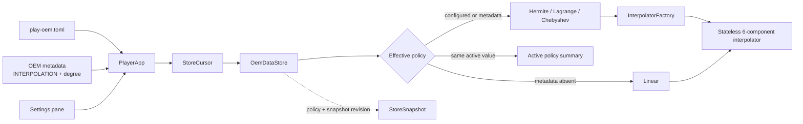
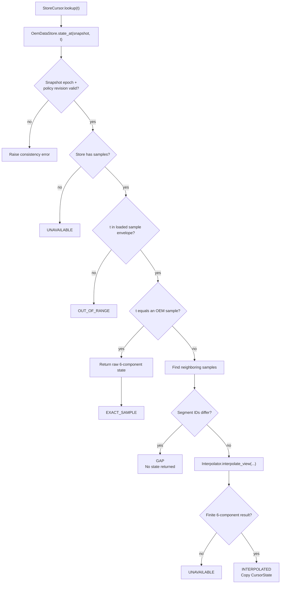
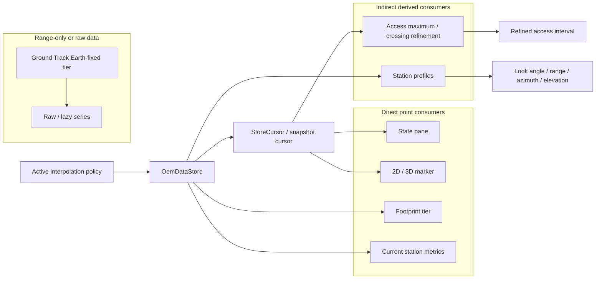
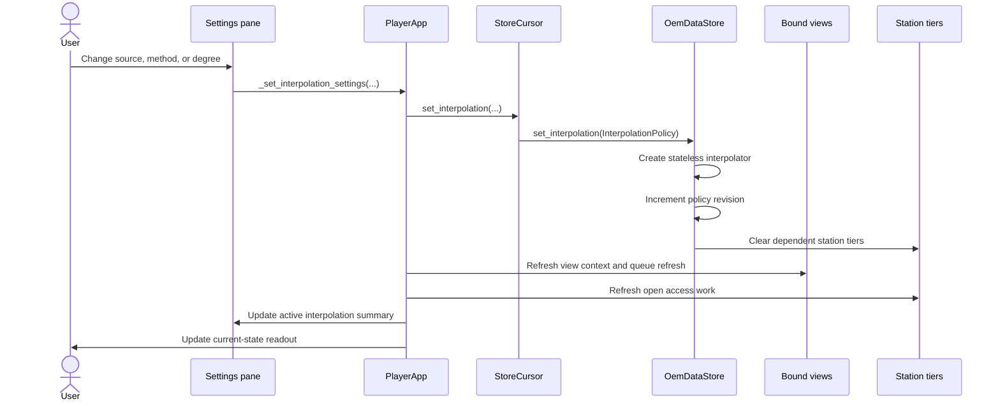
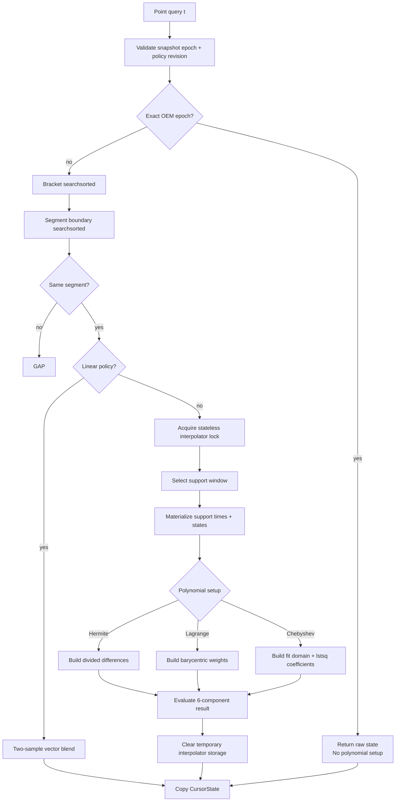
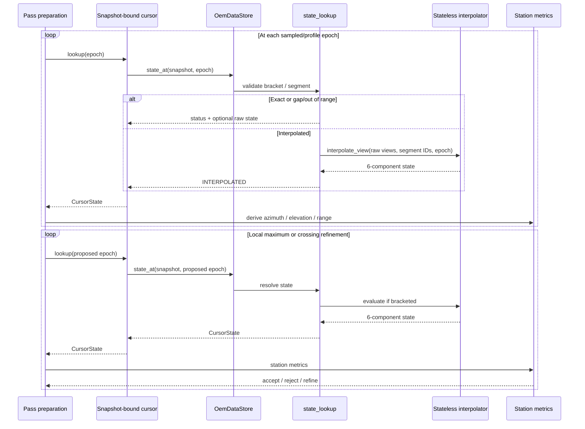

# play-oem interpolation

## Summary

Play-OEM interpolates OEM Cartesian states at arbitrary point queries. It does not replace the
stored OEM samples or create an orbit-wide derived grid. The `OemDataStore` owns the active
interpolation policy and a reusable stateless 6-component interpolator:

- components 0-2 are position in meters
- components 3-5 are velocity in meters per second

An interpolator is used only for a point inside a valid OEM segment. OEM samples remain exact,
and the store never extrapolates beyond the loaded time envelope or bridges a gap between
segments.

## Policy ownership

`InterpolationPolicy` is the store-owned representation of the active policy:

```text
InterpolationPolicy(method, degree)
```

- `method` is normalized to lowercase. The default is `linear`.
- `degree` is optional. Polynomial degrees are limited to non-negative integers.
- `linear` has no degree or polynomial-specification object.
- `hermite`, `lagrange`, and `chebyshev` use `InterpolationSpec`.

The default Hermite degree is 5. Lagrange and Chebyshev also have package-level default degrees,
but an OEM or Play-OEM setting can supply an explicit degree.

`OemDataStore.set_interpolation()`:

1. validates the policy;
2. creates a new 6-dimensional interpolator through `InterpolatorFactory`;
3. replaces the store policy and interpolator atomically under the store lock;
4. increments the store policy revision; and
5. clears store station tiers that depend on interpolated playback states.

The policy revision is included in `StoreSnapshot`. A snapshot created under an older policy
cannot be evaluated after the policy changes; `state_at()` detects the revision mismatch and
raises an internal consistency error.

## Policy selection

Play-OEM has two interpolation sources:

- **Configured settings**: `hermite`, `lagrange`, or `chebyshev`, plus a degree.
- **OEM metadata**: `INTERPOLATION` and `INTERPOLATION_DEGREE` from the loaded file.

The Settings pane exposes both choices. "Use settings below" applies the configured method and
degree immediately. "Follow OEM metadata" uses the metadata of the currently loaded OEM.

When OEM metadata is absent:

- `INTERPOLATION` is considered unspecified and the effective method is linear;
- the Control & Info state summary reports "Linear (OEM metadata unspecified)";
- the interpolation policy is not converted to a Hermite fallback.

Configured settings are loaded and saved in `play-oem.toml`. OEM metadata is updated as metadata
becomes available during incremental loading.

The relevant settings flow is:

```text
play-oem.toml
  -> PlayerApp configuration
  -> ControlWindow settings controls
  -> PlayerApp._set_interpolation_settings()
  -> StoreCursor.set_interpolation()
  -> OemDataStore.set_interpolation()
  -> OemDataStore state_at() queries
```

During a new incremental load, the loader applies the configured policy immediately. It applies
OEM metadata instead only when the user has selected "Follow OEM metadata" and metadata has been
published by the loader.



## Point lookup

`StoreCursor.lookup(t)` resolves a point against the snapshot currently bound to the cursor.
It delegates to `OemDataStore.state_at(snapshot, t)`, which performs the lookup in
`oem_data_store/state_lookup.py`.

The lookup has the following order:

1. Validate the finite query time.
2. Verify that the snapshot still belongs to the store epoch and policy revision.
3. Reject an empty store as unavailable.
4. Reject times outside the loaded sample envelope as out of range.
5. Return a raw state when the query equals an OEM sample:
   `CursorStatus.EXACT_SAMPLE`.
6. Locate the neighboring samples and their OEM segment IDs.
7. Return `CursorStatus.GAP` when the neighboring samples belong to different segments.
8. Otherwise, call the store interpolator for a state and require a finite 6-component result:
   `CursorStatus.INTERPOLATED`.

Exact sample queries do not call the interpolator. Polynomial and linear point evaluation use
the same segment boundary and bracket checks.



## Stateless evaluator

The core interpolator supports `interpolate_view(independent_values, dependent_values, t)`.
The Play-OEM store creates the interpolator once with `stateless=True` and does not give it
ownership of OEM arrays.

For each evaluation:

- the store passes read-only raw views for all committed rows and the requested segment IDs;
- the interpolator locates the local bracket or exact sample;
- polynomial implementations select a segment-local centered support window;
- Hermite uses the 6-component state in Cartesian mode;
- linear evaluation uses the two bracket samples;
- the result is copied before it becomes a `CursorState`.

The interpolator does not retain support points after a call. It also does not cache orbit-wide
data, so random seek and reverse playback use the same stateless rules as forward playback.

## Gap and coverage semantics

OEM segment IDs are authoritative. Every raw sample retains the ID assigned by the parser, and
the segment lookup is included in each gap decision.

The following states are explicit:

| Status | Meaning |
|---|---|
| `EXACT_SAMPLE` | The query equals a committed OEM sample. |
| `INTERPOLATED` | The query is between samples in one valid segment. |
| `GAP` | Neighboring samples belong to different segments or a segment boundary separates the query. |
| `OUT_OF_RANGE` | The query is outside the loaded or file time envelope. |
| `UNAVAILABLE` | No usable store data or valid result exists. |

A gap lookup returns no state and no previous-sample carry-forward. UI readouts clear unavailable
position, velocity, speed, altitude, and distance fields rather than presenting stale values.

Coverage in a partially loaded store means the loaded sample envelope. It is not a promise that
the interval is continuous. Gap and usable-time checks remain separate from interpolation.

## Runtime consumers

The same `state_at()` path serves both playback and derived features:

| Consumer | Purpose |
|---|---|
| State pane and dashboard | Current position, velocity, speed, altitude, and distance. |
| 2D ground-track cursor | Position at the current playback epoch. |
| Matplotlib and VTK 3D orbit markers | Marker state for the current playback epoch. |
| Current footprints | Current ECEF position and footprint calculation. |
| Current station metrics | Look angle, range, and station access state at playback time. |
| Station profiles | Point-state and station-metric evaluation for profile rows. |
| Station-access refinement | Golden-section maxima and crossing-time searches at arbitrary epochs. |

Ground Track and station views must obtain a state through the store or a snapshot-bound cursor.
They must not maintain their own interpolator or cached `OEM` series fallback.

Range plots generally remain raw-series or lazy-derived-range computations. The interpolation
policy affects them indirectly when they derive point states, but it does not convert all plot
history into an interpolation grid.



## Indirect use by derived features

Some Play-OEM features do not expose interpolation controls or call an interpolator directly.
They are indirect users because they request states through `StoreCursor.lookup()` or
`OemDataStore.state_at()` and therefore inherit the store's active policy.

### Ground Track

The range-based Ground Track Earth-fixed tier converts committed OEM position samples directly.
It is not itself a point interpolator. The playback marker and its dynamic overlay use
`state_at(t)` independently, so a marker between OEM samples uses the active store policy while
the Earth-fixed range remains tied to committed samples and frame conversion.

The footprint tier is a direct point consumer as well: it resolves the playback epoch through
`state_at(t)`, accepts only exact or interpolated status, and converts that state to the
Earth-fixed frame. Its cached key includes the resolved position, timestamp, elevation mask,
and epoch, preventing values from the wrong policy or snapshot from being reused.

### Station profiles and station metrics

Station-profile preparation creates a snapshot-bound `_StoreStationCursor` and evaluates profile
epochs through `cursor.lookup(epoch)`. The profile tier is therefore an indirect interpolation
consumer:

- profile rows use the store policy to resolve each arbitrary epoch;
- exact, interpolated, gap, and out-of-range states remain distinct;
- each row is marked unavailable when no valid state exists;
- station access, range, azimuth, and elevation are then calculated from that resolved state;
- a profile does not cache or distribute one previously resolved state across gap rows.

The same principle applies to `station_metrics_at()` and current station-status calculations.
These are point lookups at playback time, not lookups into a precomputed range profile.

### Station-access refinement

Station-access pass preparation can evaluate arbitrary times inside a sampled bracket. Its
local maximum and crossing algorithms repeatedly call the snapshot-bound cursor:

```text
sample bracket
  -> cursor.lookup(proposed epoch)
  -> Cartesian state
  -> station look-angle metrics
  -> accept/reject and refine proposed epoch
```

The interpolator therefore affects the numerical elevation and the refined access boundary.
The access tier must also stop at OEM segment boundaries and coverage limits; interpolation
must not create a false crossing across a gap.

The station-access profile cache is cleared when `set_interpolation()` changes the policy.
This prevents maximum, crossing, and look-angle results prepared under the previous policy from
remaining visible under the new one.

### 3D trajectories

The bounded 3D trajectory path is built from raw position/time views. The moving marker and 3D
tail cursor use point-state lookup through `state_at()` or `StoreCursor.lookup()`.

Consequently:

- the static trajectory shape remains bounded by committed raw samples;
- the marker at an arbitrary playback epoch reflects the active interpolation policy;
- a gap at the marker epoch yields an unavailable state rather than a sample carried forward;
- switching interpolation policies refreshes the marker and related view state.

The VTK and Matplotlib backends share this contract even though they render the state differently.

### Range-query policy consistency

Indirect consumers must capture a store snapshot and resolve all dependent work against that
same snapshot. They must not retain a policy-specific cursor beyond the snapshot generation or
make independent assumptions about interpolation degree.

Policy changes invalidate station-derived tiers and refresh bound view contexts. The direct
cursor and indirect users must then agree on:

- the effective method and degree;
- exact-versus-interpolated status;
- segment boundaries;
- coverage and gap limits; and
- policy revision.

## Range-derived work

Where derived data requires states between OEM samples, it must use the store snapshot and active
interpolation policy consistently. Two existing examples are:

- station-profile point states created for each profile epoch;
- station-access maximum and crossing searches that repeatedly call `cursor.lookup()`.

This work should pass the snapshot-bound cursor or call `store.state_at()` with the matching
snapshot. It must not evaluate a stale snapshot after a policy change or hold a separate
`InterpolationPolicy` that diverges from the store.

Changing interpolation:

- refreshes the bound view context;
- queues affected store-view refresh work;
- refreshes open ground-station access work;
- updates the active interpolation summary; and
- updates the current-state readout.

The UI also persists configured settings for later application starts.



## Interpolator performance investigation

Interpolator-related profiling should distinguish work performed once per playback frame,
work repeated by derived features, and work unique to polynomial window setup.

### Playback hot path

One clock tick can drive several point-state consumers. The hot path is only the work needed
for that tick: it may include the dashboard, 3D marker, footprint, and current station metrics.
Record wall time and lookup count in each lane.

```mermaid
gantt
    title Playback Tick Interpolator Hot Path
    dateFormat X
    axisFormat %L ms
    section Clock and cursor
    Clock advance / seek           :0, 1
    Store snapshot validation      :1, 2
    State pane lookup              :2, 3
    section 3D and Ground Track
    3D marker lookup               :3, 4
    Ground Track marker lookup     :4, 5
    section Point-derived tiers
    Footprint lookup / transform   :5, 6
    Station metric lookup          :6, 7
    section Output
    Artist, label, and panel refresh:7, 9
```



For this workload, profile:

- exact-sample, interpolated, gap, and out-of-range lookup counts;
- duplicate query count by timestamp;
- bracket and segment `searchsorted` time;
- frame-conversion time separately from interpolation time;
- interpolator lock wait; and
- wall time in view refresh after the state is resolved.

A single lookup reused across all point consumers is preferable to one independent lookup per
view.

### Point-query cost flow

The point-query implementation crosses bracket search, segment validation, support-window
selection, polynomial setup, and temporary-storage cleanup. The following diagram identifies
the stages to time independently.



The important measurements are the hit and miss counts for support-window reuse, coefficient or
weight rebuild count, lock wait, support-row count, output-copy count, and time spent in
`np.linalg.lstsq` for Chebyshev.

### Station-access refinement

Station passes can call point lookup repeatedly for one maximum or crossing. Profile each pass
from sampling through refinement, and do not attribute all work to the interpolator.



Measure lookup count, interpolation count, exact-sample count, support-window rebuild count,
station-metric cost, and frame-conversion cost per pass. Compare one station against a view with
many stations and open pass-ground-track/profile views. The main optimization targets are
deduplicating identical epochs, caching nearby windows, batching states, and preventing stale
station tiers from surviving a policy change.

## Implementation boundaries

- Parsing and raw OEM storage are separate from interpolation.
- `InterpolationPolicy` belongs to `OemDataStore`.
- `StoreCursor` owns no independent interpolator.
- `state_lookup.py` owns status and segment-gap rules.
- `InterpolatorFactory` owns creation of linear, Hermite, Lagrange, and Chebyshev evaluators.
- Views consume `CursorState`; they do not select interpolation algorithms.
- Range and playback data use the same snapshot and policy, so their state values remain consistent.

## Testing requirements

Interpolation behavior is covered by Play-OEM cursor, store, and control-window tests. Changes
must preserve:

- exact OEM sample identity;
- identical interpolation for forward, backward, random-seek, and direct lookup;
- segment-local behavior;
- no interpolation across gaps;
- out-of-range and unavailable state values;
- policy and metadata overrides;
- snapshot policy-revision invalidation;
- UI active-policy summaries;
- station-access crossing and maximum behavior; and
- stateless behavior with repeated and interleaved queries.

Related implementation tests include:

- `tests/ephem_toolkit/play_oem/test_play_oem_cursor.py`
- `tests/ephem_toolkit/play_oem/test_play_oem_data.py`
- `tests/ephem_toolkit/play_oem/test_oem_data_store.py`
- `tests/ephem_toolkit/play_oem/test_play_oem_control_window.py`
