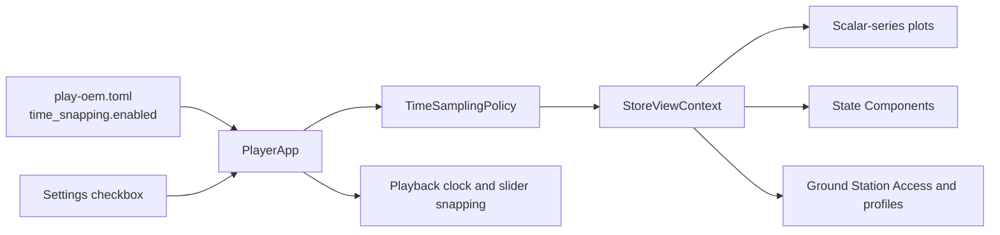
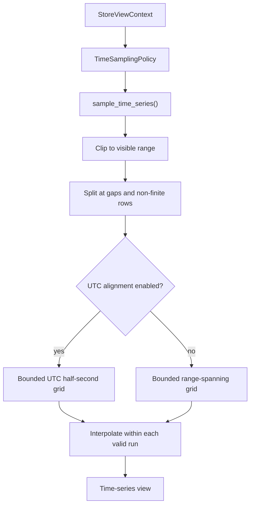

# play-oem timestamp alignment

## Summary

Play-OEM time-series plots use a shared bounded sampler to prepare display data. The sampler
interpolates each valid source segment onto a regular grid and preserves gaps between segments.
By default, its grid is aligned to UTC half-second boundaries. This reduces the number of
generated plot points while keeping timestamps consistent across time-based views.

Timestamp alignment is a display-sampling policy. It does not alter raw OEM samples, calculated
station-access events, playback-clock timestamps, or timeline endpoint edits.

## Policy ownership

`TimeSamplingPolicy` is the player-scoped representation of the active plot-sampling preference:

```text
TimeSamplingPolicy(align_to_utc_half_seconds)
```

- The default is `true`.
- The policy owns whether generated plot grids align to UTC half-seconds.
- It delegates bounded interpolation to `sample_time_series()`.
- `StoreViewContext` carries the same policy to related views, so each caller does not maintain
  its own setting.
- Changing the setting updates the active policy and schedules open store-backed views to refresh.

The policy is intentionally scoped to one player instance. Playback and slider snapping remain
separate behaviors with their own existing call paths.

## Policy selection

The setting can be selected in the Settings pane or in the user configuration file. The TOML key
is:

```toml
[time_snapping]
enabled = true
```

If the section or key is absent, alignment is enabled. The settings flow is:

```text
play-oem.toml
  -> PlayerApp configuration
  -> TimeSamplingPolicy
  -> StoreViewContext
  -> time-series plot sampling
```

The Settings checkbox updates the policy for the running player and persists the value in
`play-oem.toml` when application settings are saved.



## Sampling behavior

`sample_time_series()` clips data to the requested bounds, builds a bounded grid, and interpolates
values without crossing non-finite rows or source-segment gaps. Each view supplies its existing
display point limit.

When UTC half-second alignment is enabled:

- one timestamp per segment anchors the grid to the UTC half-second lattice;
- the grid spacing is a multiple of 0.5 seconds and grows as needed to honor the point limit;
- samples outside the requested range are omitted; and
- if the range contains no grid point, its start is retained as one sample.

When alignment is disabled, the same bounded interpolation and gap handling apply, but the grid
spans the visible range without anchoring to UTC half-seconds.

Ground-station profiles use the resampled values for display. Pass intervals, crossing times,
and other calculated event times retain their computed timestamps.

## Runtime consumers

| Consumer | Sampling behavior |
|---|---|
| RTN, Angular Velocity, Direction Change, Geocentric Distance | Shared bounded sampler through `StoreViewContext.series_groups()`. |
| Speed / Altitude | Shared series policy with its existing point limit. |
| State Components | Shared policy samples raw-state columns by source segment. |
| Ground Station Access | Shared policy samples time-based elevation display curves. |
| Ground-station profiles | Shared policy samples profile display values; calculated access events keep their timestamps. |
| Ground Track and 3D Orbit | Do not use time-series sampling; their plotted paths are spatial coordinates. |
| Playback clock and timeline slider | Continue using the UTC half-second snap function through separate controls. |

The shared view path is:



## Performance results

A headless benchmark compared the earlier one-anchor, unbounded half-second grid with the bounded
sampler using `tmp/LEO3_ITRF_2026-08-20-121524.oem` (10,081 states spanning seven days). Full-load
stage timings are medians of three fresh-store runs per version.

| Stage | Unbounded grid | Bounded sampler |
|---|---:|---:|
| Raw OEM load | 0.067 s | 0.062 s |
| Kinematics series query | 0.580 s | 0.559 s |
| Series sampling and interpolation | 0.054 s | 0.0004 s |
| Ground Track data preparation | 0.032 s | 0.033 s |

On the completed snapshot, series sampling was about 130 times faster and generated 1,997 rows
instead of 1,209,601, saving about 53 ms. The Ground Track query returned 10,285 rows in both
runs. Raw loading and Ground Track preparation are outside the display-sampling change; their
timing differences were within run-to-run variation.

A second headless benchmark sampled 20 successive raw-data publications and refreshed the
kinematics series after each append. Two-run medians were 1.148 s total for unbounded sampling
and 0.625 s for bounded sampling. Series-sampling time fell from 0.500 s to 0.009 s; series-query
time was 0.579 s and 0.551 s, respectively. Final series output again fell from 1,209,601 rows to
1,997. These timings exclude wx drawing.

## Validation record

The recorded focused sampler and view run passed 96 tests, with 1 skipped. The recorded full
Play-OEM run reported 702 passed, 15 skipped, and 55 failures in playback scrubber, slider, and
workspace tests. At the time, the environment could not provide wx with a working X display, and
some test harnesses lacked widget methods. `compileall` passed for the changed source and test
files.

These are recorded results for the bounded sampler and view integration. They do not establish
that the Settings toggle's persistence and live behavior were covered by that test run.
