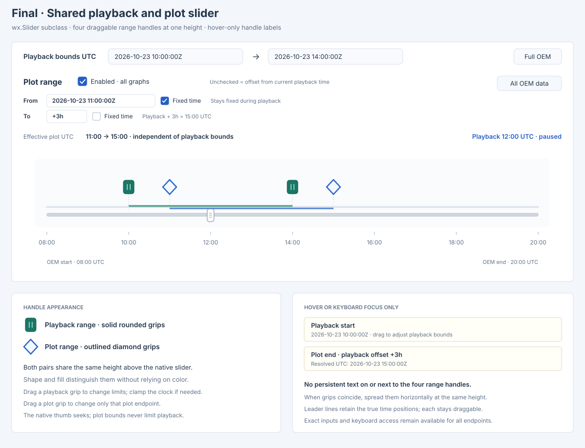
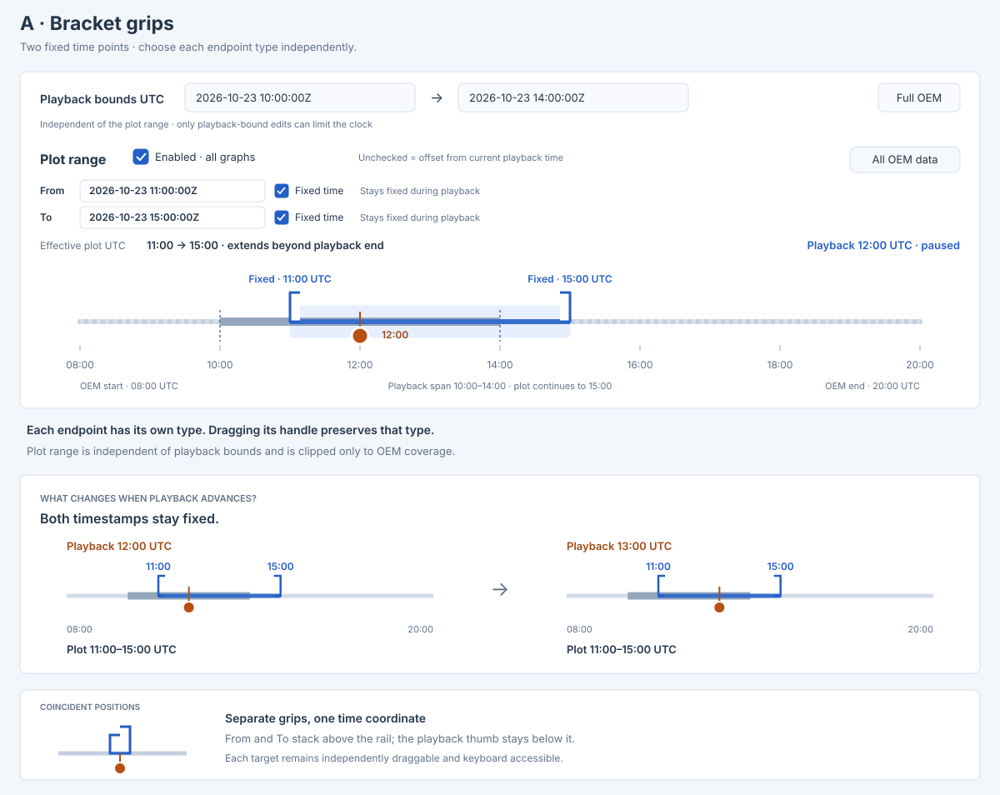
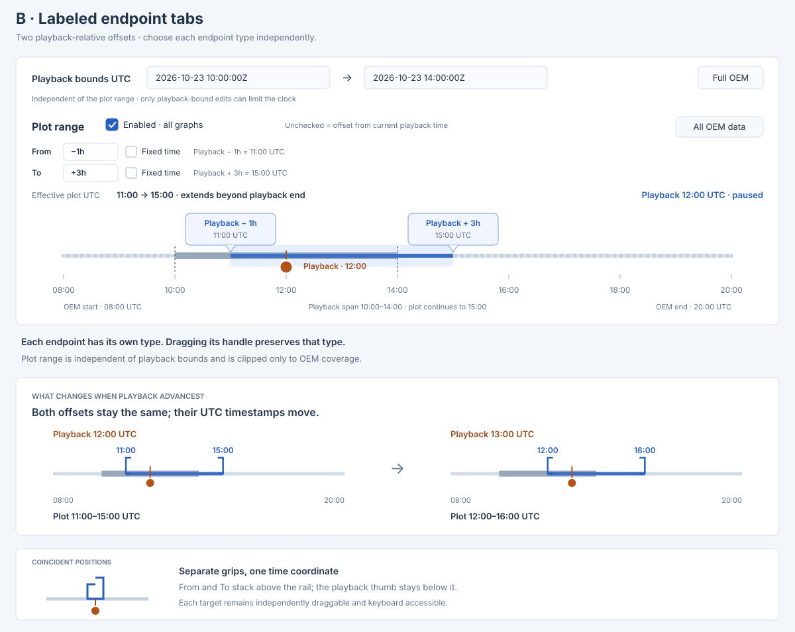
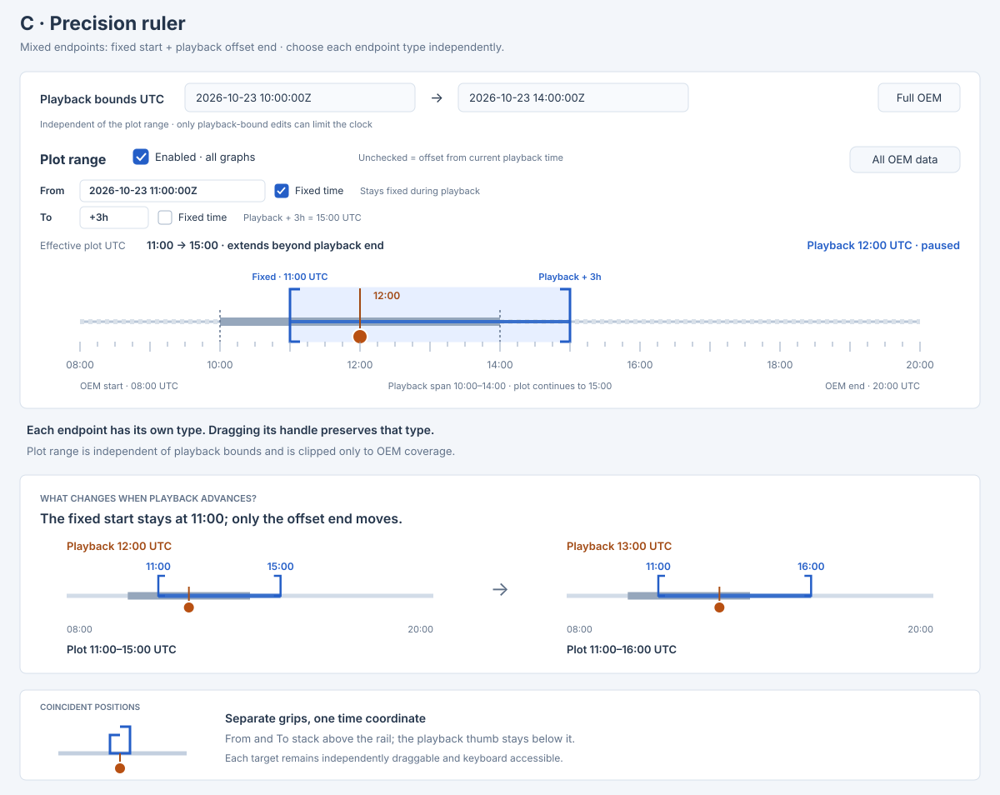

# `play-oem` — Shared Time Range GUI Design

> Status: **proposed**. The final four-handle wx.Slider design is selected; implementation
> and GUI validation are pending.

This document defines the shared time-range editor for the existing wx workspace. It extends
the workspace interaction design in [PLAY_OEM_GUI_DESIGN.md](./old/PLAY_OEM_GUI_DESIGN.md).
Range semantics and proposed interfaces are specified in
[PLAY_OEM_TIME_RANGE_SOFTWARE_DESIGN.md](./PLAY_OEM_TIME_RANGE_SOFTWARE_DESIGN.md).
Work sequencing is in
[PLAY_OEM_TIME_RANGE_IMPLEMENTATION_PLAN.md](./PLAY_OEM_TIME_RANGE_IMPLEMENTATION_PLAN.md).
The final SVG below defines the selected design. Earlier mockups are retained at the end
for reference; none supersedes the final control contract.

## Final design



Use a custom widget directly derived from `wx.Slider`, retaining its standard current-time
thumb. Place two draggable range handles in each of two rows above the native slider: solid
rounded playback grips in the lower row and outlined diamond plot grips in the upper row. Shape and
fill distinguish the ranges without relying on color. Hover/focus tooltips provide endpoint
identity, value, and fixed/offset mode; no text appears on or beside the handles.

Keep the plot inputs compact, each with a **Fixed time** checkbox immediately to its right.
Playback and plot ranges are independent and share the full OEM time scale. The lower cards
in the SVG are design annotations and tooltip examples, not additional controls or permanent
captions beside handles. Implementation and live GUI validation remain pending.

## User goal and terminology

Select which part of the loaded OEM every graph displays, using fixed timestamps, a window
following playback, or a mixture of fixed and relative endpoints.

- **OEM coverage** is the complete loaded sample envelope, including any internal gaps.
- **Playback range** is an independent pair of fixed UTC bounds where the clock may move;
  it defaults to full OEM coverage.
- **Plot range** selects the samples shown in every graph. **Effective UTC** reports its
  resolved endpoints after clipping to OEM coverage.
- **Playback offset** always refers to the playback clock, never the computer's current time.

Use one editor for both graph stacks. No individual graph has an independent range control.
Maintain **plot range ⊆ OEM coverage** and **playback range ⊆ OEM coverage**.
Plot and playback ranges may overlap, extend beyond one another, or be disjoint. Plot edits never change playback
bounds or seek the clock. The default is **All OEM data**, with playback bounds initially
covering the full OEM. Plot edits affect histories and spatial paths together.

Playback may be outside the plot range. The timeline thumb and global current-state readouts
remain live; current-time overlays inside plots are hidden when outside their effective range.

## Selected layout and control contract

Place the shared slider at the top of the timeline panel, with a small gap below its divider.
Put the time readouts, plot endpoint row, playback-bound fields, and transport controls beneath
it; omit a standalone timeline title. Put plot range handles on their own row above the playback
range handles. Keep the playback handles immediately above the standard slider with a visible gap
from its track. All handles share its time scale with the native current-time thumb. The rail always represents complete
OEM coverage and never rescales to either selection. Retain OEM start/end labels.

The editor contains:

- **Playback bounds UTC: From / To**, two fixed timestamp fields, and **Full OEM**. Accept
  only ordered bounds inside OEM coverage; Full OEM restores playback bounds to coverage.
  These fields stay synchronized with their two draggable playback grips and remain
  independent of the plot endpoint modes.
- **Plot range Enabled** and **All OEM data**. All OEM data disables the plot filter and
  displays all samples inside OEM coverage. It changes neither playback
  bounds nor time. Preserve the last valid plot endpoints for re-enabling. First enable uses
  fixed endpoints at OEM coverage limits.
- Put **Plot range**, **From**, its exact value input and **Fixed time** checkbox, **To**,
  its exact value input and checkbox, and **All OEM data** on one compact horizontal row.
  Each checkbox sits immediately to the right of its input. Checked selects a fixed UTC
  timestamp; unchecked selects a signed offset from current playback time. There are no
  separate mode or Offset buttons. Name the checkboxes accessibly **From fixed time** and
  **To fixed time**. Do not add a persistent effective-UTC readout row; handle tooltips show
  resolved UTC values. Respect native theme/font minimum sizes and
  allow long or fractional input to scroll without losing precision. Requested values survive
  OEM clipping.
- One full-OEM `wx.Slider` subclass retaining the standard current-time thumb. Add two rows of
  draggable range handles above it: playback start/end in the lower row as solid green rounded
  grips; plot start/end in the upper row as outlined blue diamonds. Shape,
  fill, and focus outline distinguish them without relying on color. No letters, names,
  timestamps, or permanent captions appear on or near the handles.
- Show handle identity and value in hover/focus tooltips only: range, start/end, full UTC,
  and for plot offsets the signed rule plus resolved UTC. Exact input rows remain visible.
  Narrow playback/plot span marks can share the native time scale; plot fill/grips remain
  legible outside playback bounds. Plotting may extend beyond or be disjoint from playback.

No file loaded disables both editors. Disabling plot filtering leaves the playback span and
seek thumb active, hides plot grips, and shows All OEM data; it does not restore full OEM
playback unless the user separately chooses Full OEM.

## Entry, live updates, and validation

Accept fixed UTC through the existing timestamp parser and normalize to explicit UTC.
Reject durations in playback-bound or fixed-plot fields. Plot offsets accept finite signed
durations such as `-1h`, `+3h`, `-1h30m`, and `0s`, with a leading sign applying to the whole
value. Both signs are allowed on either plot endpoint. Unitless offsets mean seconds and
are normalized with an explicit unit, distinct from the existing elapsed-time seek convention.

Reject reversed fixed/fixed plot endpoints and reversed offset/offset plot endpoints. Mixed
endpoints can cross as playback moves; accept them and show an empty range while crossed.
Requests wholly outside playback are rendered normally within OEM coverage. A non-reversed
request becomes empty only when it has no intersection with OEM coverage. A future-only window such as
`+1h → +3h` is valid and never moves the current clock to enter it.

Toggling a Fixed time checkbox preserves its requested endpoint instant at the paused
playback time,
before clipping: fixed → offset uses `fixed - playback`, and offset → fixed uses
`playback + offset`. Validate the resulting same-mode pair before applying it.

Focus entering an editable field, a mode change, enable/reset, or plot-handle drag pauses
playback and resets timer bookkeeping. Hover and non-editing slider focus do not pause.
Valid submissions and drags update graphs live; playback remains paused until resumed.
Plot edits preserve time and playback bounds. Only valid playback-bound edits can clamp the
clock into their new interval, with a concise **Limited to playback range** status.

Text drafts commit on Enter or focus loss. Invalid text remains visible with an inline error;
keep the applied model unchanged. Escape restores that field's applied value. Block other
range edits until a draft is corrected or reverted, avoiding silent discard. Each reset
explicitly discards drafts in its own editor; an invalid draft in the other editor must be
resolved first. Playback still uses the last applied settings. Never overwrite focused drafts
on playback refresh or emit recursive editing events from programmatic synchronization.

## Shared-slider pointer behavior

- Drag a playback grip to change that fixed playback bound within OEM coverage. Prevent
  start from passing end, pause on edit, and clamp the clock only if the updated playback
  interval excludes it. Update UTC fields live; retain plot rules. Relative plot endpoints
  resolve again only if clock time changes. A playback-grip gesture does not emit a separate seek.

- Drag a plot grip to edit that endpoint only; keep its fixed/offset mode. Clamp dragging to
  OEM coverage, not to playback bounds or the current time. Preserve ordering for same-mode
  endpoint pairs;
  mixed endpoints may cross and produce an empty range. Relative offsets can pass through
  zero. If no valid in-bounds position exists for a same-mode endpoint because the opposite
  requested endpoint lies outside OEM coverage, retain the applied value and explain that the
  opposite endpoint or exact fields must be edited first. Keep the clock stationary.
- Drag the current-time thumb or click unoccupied rail to seek inside playback bounds. A click
  outside those bounds clamps to the nearest playback boundary, never to a plot boundary.
  Plot shading does not intercept rail seeks; dragging shading does not move the plot range.
- Hit-test all four grips and the native thumb before rail clicks; capture the chosen
  operation until release.
  A grip gesture never also seeks; thumb gestures never edit plot rules. Pressing a grip
  pauses playback before resolving its new offset.
- Requested plot endpoints beyond OEM coverage appear as clipped grips at the nearest
  OEM boundary. Plot endpoints outside playback but inside coverage are not clipped.
  Clearly label OEM clipping while retaining exact requested fields.
  Beginning a drag replaces that requested endpoint with the pointer-derived in-bounds value.
- When the effective range is empty, show no selected fill. Show clipped endpoint grips as
  outlined/dashed editing targets with **No plot overlap** or **Plot start is after plot end**;
  coincident clipped grips must not imply a singleton selected interval.
- Capture loss or Escape terminates a drag at its last applied valid value. Live edits are
  not rolled back. If grips collide, fan them out horizontally within their own row, using
  leader lines to their true time coordinates. Do not vertically stack or hide them. At drag
  start retain the pointer-to-time offset so a displaced grip does not jump. The native thumb
  remains independently reachable. Apply the same collision rule to grips within either pair.

Playback-limit changes do not clip plots. Fixed plots remain unchanged; moving/mixed plots
update only when the current playback time changes, including clamping caused by playback
edits. Full OEM resets only playback bounds. All OEM data always selects all OEM history.

## Playback and graph behavior

| Plot rule | Plot behavior | Playback behavior |
|---|---|---|
| Fixed start → fixed end | Fixed interval intersected with OEM coverage | Independent bounds unchanged |
| Playback −1h → playback +3h | Moving interval clipped to OEM coverage | Independent bounds unchanged |
| Fixed start → playback +3h | Mixed interval; can be empty as the clock moves | Independent bounds unchanged |
| Playback −1h → fixed end | Mixed interval; can be empty as the clock moves | Independent bounds unchanged |
| Playback +1h → playback +3h | Future-only interval, possibly empty near OEM end | Independent bounds unchanged |

Every navigation route uses playback bounds, including seeking, plot clicks, stepping,
reverse, and start/end. Pause at a playback boundary in the direction attempting to cross
it. Plot boundaries never stop playback or change seek limits.

When current time is outside a nonempty plot range, show **Playback time outside plot range**
and hide graph cursor lines, 3D current markers, ground-track current markers, footprints,
and current-time tail endpoints. Global readouts and slider thumb remain live. Resume those
plot overlays automatically when the current time enters the effective range and is valid.

Time-series X axes follow nonempty effective plot bounds in existing elapsed-time units/origin.
Keep full-data Y scales stable and vertical zoom local. While filtering is enabled, shared
plot controls govern X navigation. Home restores effective X bounds and full-data Y scale;
for an empty range, use OEM coverage on X without displaying history samples.
Preserve map navigation, projection, center longitude, spatial bounds, and the 3D camera.

## Empty, singleton, and gap states

- No intersection with OEM coverage is valid: clear history/overlays and show **Plot range
  does not overlap OEM coverage**. Mixed endpoint reversal uses **Plot start is after plot end**.
  These states do not reject the rule, alter playback bounds, or stop playback.
- A nonempty interval with no source samples uses **No samples in selected range**. Valid
  interpolated current overlays may remain only if their timestamp lies inside the range.
- Gaps retain existing unavailable-current-state indications; never bridge missing data.
- Equal plot endpoints are valid and select only that instant. After resuming from editing,
  they impose no playback limit or automatic boundary pause.
  Show a sample as a point. Apply one second of visual X padding on each side without
  widening the actual filter. Empty-state axes use OEM coverage, padded if singleton.
- Singleton playback bounds do prevent advancement and show **Playback limited to one instant**.
  Fixed plots can still span OEM coverage; only the playback clock is restricted to that instant. Both editors remain available.

## Keyboard, focus, and sizing

Use native wx fields/checkboxes/buttons and a custom widget directly subclassing `wx.Slider`.
Expose five distinct accessible targets: playback start/end, plot start/end, and native
current time, each with a descriptive name/value and applicable bounds/mode. UTC fields
and plot fields are exact-value alternatives for every range drag. Tooltips appear on
keyboard focus as well as hover, without permanent captions beside the grips.

Tab order follows layout: playback-bound fields/Full OEM, plot enable/All OEM data, plot
From input/Fixed time checkbox, plot To input/Fixed time checkbox, existing playback
controls, then slider playback-start/plot-start/current-time/playback-end/plot-end targets.
On any focused range grip, Left/Right moves one second and Shift+Arrow one minute; Home/End
requests its earliest/latest valid position in OEM coverage, respecting playback pair ordering. On the current-time thumb,
retain seek key behavior using playback bounds. Consume handled keys so they cannot also
trigger transport shortcuts. Preserve native Space in fields and checkbox. Show visible
focus and provide endpoint details on focus as well as hover.

Keep From and To in two compact rows at normal and minimum widths. At narrow sizes wrap
only helper/status text below its row when necessary; keep the label, input, and Fixed time checkbox together.
Errors may add a temporary line rather than crowding the inputs. Keep the slider full width
and all controls reachable through existing timeline scrolling. Verify long timestamps,
high DPI, light/dark appearance, and coincident targets. Preserve graph-stack scroll positions.

## Review checklist for implementation

- Maintain plot range ⊆ OEM coverage and playback range ⊆ OEM coverage; neither range
  constrains the other, including disjoint and empty plot cases.
- Plot editing and All OEM data never change playback bounds or current time.
- Independent playback edits clamp only when required and retain plot rules; fixed plots
  remain unchanged and relative plots follow only any resulting change of clock time.
- A direct wx.Slider subclass supports four draggable, same-height range grips plus the native
  current-time thumb; no persistent text appears on or beside grips. Test hover/focus tooltips,
  horizontal fan-out, and independent hit targets at coincident and clipped positions.
- Retain the five alternatives and three earlier SVG studies; implement the final four-handle
  mockup, with matching software and implementation designs.
- Each input has its own Fixed time checkbox on the right, with checked/unchecked meaning
  fixed UTC/playback offset; no separate mode buttons remain. Examples distinguish fixed,
  moving, and mixed behavior before and after a playback-time change.
- Fixed, relative, mixed, future-only, and past-only windows behave consistently in all views.
- Distinguish malformed drafts, no overlap, reversed mixed bounds, no samples, and OEM gaps.
- Keep global current-state readouts live outside plots and hide out-of-range plot overlays.
- Preserve stable Y scales, camera/map navigation, keyboard access, and focused drafts.
- New/duplicated graphs inherit both settings; successful OEM replacement resets both.
- Record automated and live GUI evidence separately; implementation checks remain pending.

## Unselected mockups

The following layouts and appearance studies are retained as design history only. They may
show superseded controls, handle counts, labels, or collision behavior. Implement the final
SVG and control contract above; these mockups add no requirements.

### Earlier layout alternatives

All layout alternatives use independent playback bounds. Their compact sketches omit some
controls to emphasize placement; they do not redefine playback through plot controls.

#### 1. Inline range bar

```text
┌────────────────────── All graphs ─────────────────────────┐
│                        Plot area                          │
├──────────────────────────────────────────────────────────┤
│ Plot range [Enabled ✓]                   [All OEM data]  │
│ From [Playback offset ▾] [-1h]                            │
│ To   [Playback offset ▾] [+3h]                            │
│ Effective UTC: 2026-10-23 11:00Z → 15:00Z                 │
├──────────────────────────────────────────────────────────┤
│ Playback UTC: 12:00Z          [◀] [Pause] [▶]             │
│ Seek ─────────────────●─────────────────────────────────  │
└──────────────────────────────────────────────────────────┘
```

Always-visible fields make frequent exact edits straightforward. The permanent bar consumes
vertical graph space and gives no graphical overview of the selected interval.

#### 2. Left-side range inspector

```text
┌─ Controls ────────────────┬──────── All graphs ────────────┐
│ Plot range [Enabled ✓]   │                                 │
│                          │                                 │
│ FROM                     │           Plot area             │
│ [Playback offset ▾]      │                                 │
│ [-1h              ]      │                                 │
│ TO                       │                                 │
│ [Playback offset ▾]      │                                 │
│ [+3h              ]      │                                 │
│ Effective UTC            │                                 │
│ Oct 23 11:00Z → 15:00Z   │                                 │
│ [All OEM data]          │                                 │
├──────────────────────────┴───────────────────────────────┤
│ Playback UTC: 12:00Z   [◀] [Pause] [▶]   ────●──────────── │
└──────────────────────────────────────────────────────────┘
```

Fits the existing controls pane and accommodates detailed feedback. Competes with other
control sections and separates range editing from the playback timeline.

#### 3. Summary chip with popover

```text
┌────────────────────── All graphs ─────────────────────────┐
│ Plot range: [Playback −1h → +3h ▾]                        │
│             ┌──────────────────────────────────────┐      │
│             │ Applies to all graphs                │      │
│             │ From [Playback offset ▾] [-1h]        │     │
│             │ To   [Playback offset ▾] [+3h]        │     │
│             │ UTC: Oct 23 11:00Z → 15:00Z           │     │
│             │ [All OEM data]                   [Close] │ │
│             └──────────────────────────────────────┘      │
│                        Plot area                          │
├──────────────────────────────────────────────────────────┤
│ Playback UTC: 12:00Z   [◀] [Pause] [▶]   ────●────────────│
└──────────────────────────────────────────────────────────┘
```

Keeps the rule visible with little permanent UI. Exact controls require an extra action and
the popover can obscure a graph. This retained alternative uses the agreed live-edit policy;
Close would dismiss the editor without undoing accepted edits.

#### 4. Setup dialog with preview

```text
┌─ Set plot range ──────────────────────────────────────────┐
│ Applies to every graph                                    │
│ Quick setup: [All OEM data] [Fixed] [Follow playback] [Mixed]│
│                                                           │
│ From [Playback offset ▾] [-1h                         ]   │
│ To   [Playback offset ▾] [+3h                         ]   │
│                                                           │
│ Preview at playback UTC 2026-10-23 12:00Z                 │
│ Data ───────[═══════     │══════════════════]───────────────│
│          11:00Z  playback           15:00Z                │
│                                     [Cancel] [Apply]      │
└──────────────────────────────────────────────────────────┘
```

Provides room for guided setup and explanation. Interrupts graph work and favors staged
Apply/Cancel editing over the selected live-edit interaction. Presets and dialog staging
are unselected concepts, not additional implementation requirements.

### Earlier shared-slider wireframe

This intermediate wireframe is superseded by the final SVG.

```text
┌──────────────────────────────────────────────────────────────────────────┐
│All graphs                                                                │
│                                                                          │
│Plot range [Enabled ✓]                                  [All OEM data]    │
│Unchecked Fixed time = offset from current playback time                  │
│From [-1h] [ ] Fixed time   Playback − 1h = 11:00 UTC                     │
│To   [+3h] [ ] Fixed time   Playback + 3h = 15:00 UTC                     │
│Effective plot UTC: 11:00Z → 15:00Z                                       │
│Playback bounds UTC: [10:00] → [14:00]                    [Full OEM]      │
│Playback UTC: [2026-10-23 12:00:00Z]   [◀] [Pause] [▶]                    │
│                  ▮    ◇                 ▮     ◇                         │
│OEM ─────────────────────●─────────────────────────────────              │
│                   current time                                           │
└──────────────────────────────────────────────────────────────────────────┘
```

### Earlier slider appearance studies

These three earlier SVG studies illustrate endpoint combinations. They predate the final
four-handle design and are retained as reference, not implementation targets. Each compact endpoint row has a
value input followed immediately by a **Fixed time** checkbox on its right. Checked means
a fixed UTC timestamp; unchecked means an offset from current playback time. The
examples are not separate feature modes: any variant supports any endpoint combination.

Every example uses OEM coverage 08:00–20:00 UTC on 2026-10-23 and independent playback
bounds 10:00–14:00 UTC. The main slider shows playback at 12:00 UTC and plotting from
11:00–15:00 UTC, beyond playback end. A before/after panel shows what changes at playback
13:00 UTC; a separate detail retains coincident-handle behavior.

| Mockup | Plot From | Plot To | At playback 12:00 | At playback 13:00 |
|---|---|---|---|---|
| A — Fixed example | Fixed UTC 11:00 | Fixed UTC 15:00 | 11:00–15:00 | 11:00–15:00 |
| B — Offset example | Playback −1h | Playback +3h | 11:00–15:00 | 12:00–16:00 |
| C — Mixed example | Fixed UTC 11:00 | Playback +3h | 11:00–15:00 | 11:00–16:00 |

The final design supersedes the handle appearance and placement in these studies.
Their fixed/offset endpoint examples remain valid, including the reverse mixed combination.

**A — Bracket grips, shown with two fixed time points.** Compact bracket-shaped grips keep
the rail uncluttered. The playback thumb moves while both selected UTC endpoints stay put.
This is an earlier appearance study.



**B — Labeled endpoint tabs, shown with two offsets.** Larger drag targets show each rule and
its resolved UTC. Both endpoints move with playback while the entered offsets stay unchanged.
Tabs need more room and stack vertically when they overlap.



**C — Precision ruler, shown with mixed endpoints.** The fixed start stays anchored while
the offset end follows playback. Tall boundaries and quarter-hour ticks emphasize exact
positioning without introducing snap behavior.


