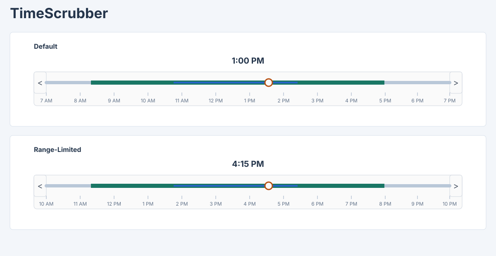

# `play-oem` - TimeScrubber

> Status: **design proposal validated by the interactive demonstration**.

This document defines the compact TimeScrubber demonstrated by
[`play_oem_time_scrubber_demo.py`](../../../examples/play_oem_time_scrubber_demo.py).
It retains the shared playback, plot-range, seek, and loading contracts in
[PLAY_OEM_TIME_RANGE_GUI_DESIGN.md](./old/PLAY_OEM_TIME_RANGE_GUI_DESIGN.md).

## Selected direction

Offer `TimeScrubber` as an advanced alternative to the existing `TimeSlider`.
It surrounds the underlying slider behavior with zoomable tick alignment,
viewport panning, and a live current-time label.

The selected layout has no overview window, popover, lens, second slider, or permanent
zoom toolbar.

```text
┌────────────────── <  16:15  ────────────────────── > ┐
│        00:00   11:00  12:00   13:00  14:00       │
│ < or >                                                   >
└──────────────────────────────────────────────────────┘
```

The edge controls are painted 30×52 chevrons. They use a clear border, large glyph, and
strongly contrasting foreground so they remain visible independently of native macOS,
Linux, or Windows button themes.

## Reference layout

The demo presents two examples in a single compact frame:

1. **Default**: the detail rail starts at complete OEM coverage.
2. **Range-Limited**: the detail rail starts on a narrower OEM viewport.

Each example contains:

- a bold title;
- a centered current-time label;
- a left chevron;
- the existing `TimeSlider`;
- adaptive tick labels below the slider;
- a right chevron;
- a short interaction hint.



## Arrow behavior

The `<` and `>` controls shift the visible time range. They do not move, edit, or seek
the playback handle. A chevron is disabled and dimmed when the viewport cannot scroll
further in that direction because it has reached complete OEM coverage.

| Action | Visible viewport | Playback handle | Plot range |
|---|---|---|---|
| Click `<` | Shift earlier by 10% of viewport width | No change | No change |
| Click `>` | Shift later by 10% of viewport width | No change | No change |
| Drag the slider rail | Existing seek behavior | May move to requested playback time | No change |
| Drag a playback grip | No viewport change | Edits playback bound | No change |
| Drag a plot grip | No viewport change | No change | Edits that plot endpoint |

Both chevrons remain visible at OEM boundaries. At the start, `<` clamps the viewport to
OEM start. At the end, `>` clamps it to OEM end.

## Zoom semantics

Zoom and the visible viewport use inverse range width:

- **Zoom in** multiplies the viewport width by less than `1.0`, producing a narrower
  visible time range and finer tick spacing. Zoom stops at a 10-second minimum viewport
  width.
- **Zoom out** multiplies the viewport width by more than `1.0`, producing a wider visible
  time range.
- vertical mouse-wheel positive/away or wheel-up zoom direction is zoom in;
- vertical mouse-wheel negative/toward or wheel-down zoom direction is zoom out;
- horizontal mouse-wheel/trackpad scroll shifts the viewport earlier or later;
- `+` zooms in and `-` zooms out; `0` restores full OEM coverage.

The zoom anchor remains the pointer or viewport center. Zoom must never change playback,
plot, or seek state.

The complete viewport is the union of valid declared OEM bounds and observed samples.
The chevrons and keyboard pan commands never expand that coverage.

## Slider behavior

The custom `TimeScrubber` implementation extends `TimeSlider` and replaces the visible
viewport behavior without replacing the baseline widget:

- playback grips remain solid green;
- plot grips remain outlined blue;
- the seek thumb remains orange or the platform highlight;
- tick density adapts to the visible viewport;
- major tick intervals use a coarse 1–2–5 seconds/minutes/hours/days ladder;
- minor tick marks divide each major interval evenly and are suppressed below a readable spacing;
- labels use a fixed stride based on label width and major-tick spacing, preserving equal
  visible spacing instead of selectively omitting labels based on their overlap state;
- major tick timestamps are aligned to natural UTC clock boundaries, such as hour,
  half-hour, 15-minute, 5-minute, minute, or second boundaries;
- the timestamp nearest the middle of the current viewport anchors the next zoom level,
  preserving middle-tick visual continuity;
- day-or-larger ticks use ISO date labels `YYYY-MM-DD`;
- coincident grips use existing fan-out and leader behavior;
- loading coverage uses the same timeline state;
- grips and the seek marker disappear when their timestamps leave the visible viewport;
  the playback track segment is clipped to the visible viewport;
  editing remains reachable through existing fields and keyboard focus.

The rail may use a narrower viewport, but it does not replace `_coverage`,
`_playback`, `_plot_rule`, or `_now`. A viewport is presentation state only.

## Zoom and pan interactions

| Action | Result |
|---|---|
| Click or drag the current-time track | Seek inside playback bounds |
| Drag the left/right playback grip | Edit one playback bound |
| Drag the left/right plot grip | Edit one plot endpoint |
| Vertical mouse wheel | Zoom around the pointer |
| Horizontal mouse wheel / trackpad scroll | Pan the visible range |
| Ctrl/Cmd+`+` | Zoom in around the center |
| Ctrl/Cmd+`-` | Zoom out around the center |
| Ctrl/Cmd+`0` | Fit complete OEM coverage |
| Double-click the rail | Fit complete OEM coverage |
| Click `<` | Shift visible range earlier |
| Click `>` | Shift visible range later |

Inside TimeScrubber, vertical wheel scroll zooms the viewport and horizontal
wheel/trackpad scroll pans it. Vertical and horizontal wheel events never change playback,
plot, or seek state.

Wheel gestures use deliberate low-sensitivity factors: one vertical notch changes viewport
width by approximately 3%, and one horizontal notch pans by approximately 5% of the
current viewport width.

Vertical wheel input is accumulated until it reaches two platform wheel notches; small
wheel or trackpad movements below that threshold are ignored. Opposite-direction movements
cancel accumulated movement, and one gesture is capped at two zoom notches.

## Current-time label

The label above the rail reports the current playback timestamp. It updates when:

- the seek thumb is dragged;
- an unoccupied rail position is clicked;
- keyboard seek changes the thumb;
- a playback range clamps the clock.

The label is not an exact-edit field. Exact timestamp entry remains in the existing
timeline controls.

## Keyboard and accessibility

The existing grip tab order and arrow-key behavior remain unchanged.

Add the two chevron controls to keyboard traversal immediately outside the range target:

```text
left-chevron -> playback-start -> seek-thumb -> plot-start ->
plot-end -> playback-end -> right-chevron
```

Actual Tab order may follow the existing native-control contract and must be consistent
with the demo implementation. Both chevrons expose:

- name: `Pan earlier` or `Pan later`;
- tooltip: `Pan earlier` or `Pan later`;
- keyboard activation with native Enter/Space behavior;
- visible focus.

The timeline viewport itself exposes an accessible value describing visible start, visible
end, and OEM coverage.

## Loading behavior

- OEM declared/observed coverage establishes the unzoomed rail domain.
- Parser progress and unread regions remain aligned as the viewport changes.
- Seeking into unread time follows existing committed-playback clamping.
- The viewport never changes loaded coverage or the store range hint.
- Loading-time range drags may defer graph updates and flush once when the drag ends.
- A viewport pan or chevron click does not defer or refresh plots.

## Sizing

- Card title remains left aligned above the card.
- The rail occupies the available card width.
- Each chevron is 30 px wide and 52 px high.
- Tick labels use 12–13 px and center below their time mark.
- The current-time label sits above the rail and remains centered.
- Narrow cards retain the chevrons outside the rail and wrap helper text below.
- Dark mode, DPI scaling, and platform font settings must be validated against the
  painted chevron control.

## Unselected alternatives

The earlier overview strip, floating zoom lens, and magnifying-window concepts were
considered but are not selected. They add a second timeline or temporary overlay and do
not match the compact, no-extra-widgets behavior demonstrated by the reference image.

## Acceptance checklist

- `<` shifts only the visible range earlier.
- `>` shifts only the visible range later.
- Both chevrons remain visible and clickable at OEM boundaries.
- Arrow presses do not change playback bounds, plot bounds, or current time.
- The rail can be seeked and dragged using existing `TimeSlider` behavior.
- Range grips remain independent of chevron viewport navigation.
- Tick labels update with the viewport.
- Full-OEM reset restores the complete OEM domain.
- Vertical and horizontal wheel behavior is scoped to TimeScrubber viewport zoom/pan.
- Loading, failure, cancellation, and file replacement preserve existing timeline semantics.
- Automated tests verify viewport state separately from playback and plot state.
- Native manual checks cover macOS dark/light appearance, narrow width, DPI, and keyboard
  activation.
