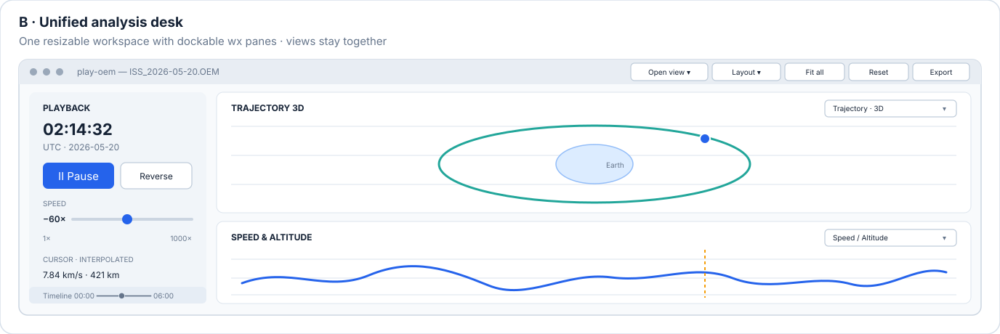
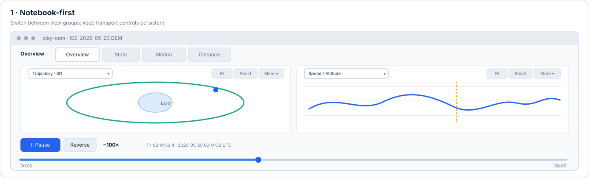
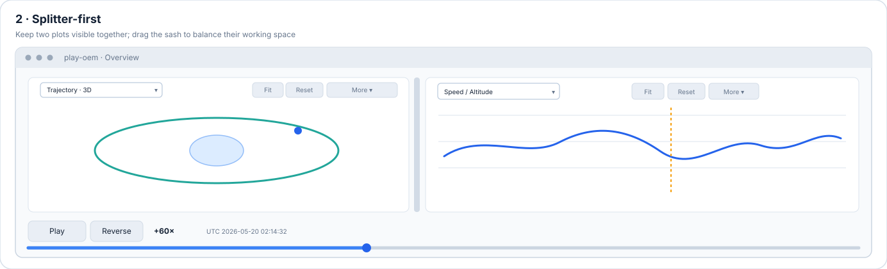
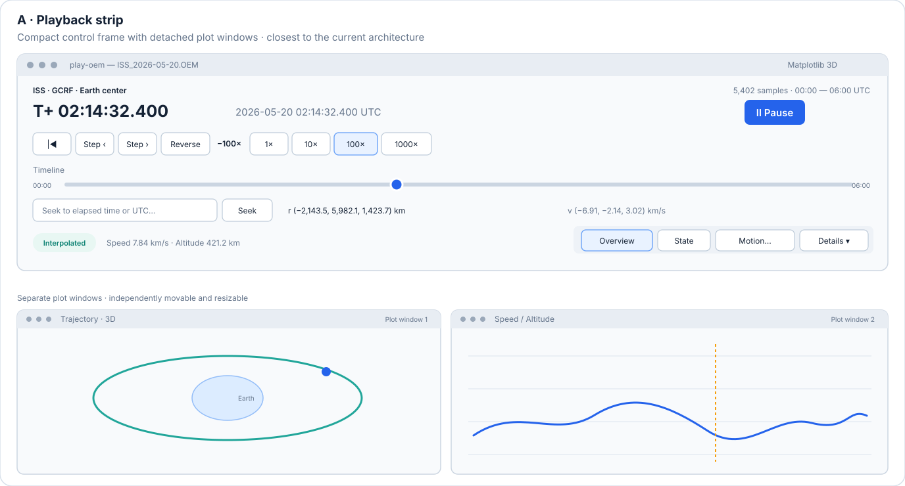
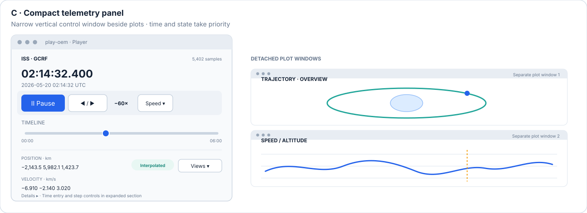
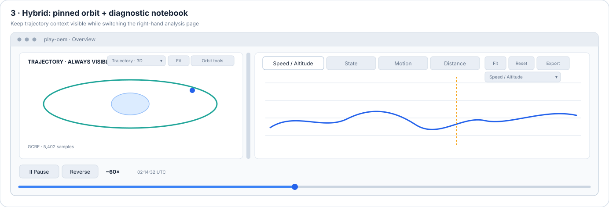

# Archived `play-oem` GUI design alternatives

These alternatives were considered during design but are not the selected final design. They are
kept here as historical reference only.

## Other candidates not selected

### B. Unified analysis desk

Users see playback controls and several plots together in one coordinated workspace, with the
ability to arrange or hide views to suit the current analysis.

- **Fits:** users who want all relevant plots in one coordinated workspace and value simultaneous
  comparison.
- **Trade-offs:** largest change to frame ownership; embedded Matplotlib/VTK panes, resizing,
  layout persistence, and platform behavior need validation.
- **Toolbar:** a persistent workspace bar for playback, view/layout selection, and backend/status;
  give each graphic panel its own view-selection combobox and keep other plot actions local to
  that panel.
- **Implementation:** host the controls and plot canvases in panels owned by one workspace frame.
  A dockable version could use `wx.aui.AuiManager`; it needs a shared embedded-view host and
  explicit pane lifecycle management.

### D. Notebook-first workspace

Users switch among view groups while playback controls stay visible in a fixed toolbar or bottom
strip. Overview displays the 3D trajectory and speed/altitude plot together; other tabs provide
State, Motion, or distance diagnostics.

- **Fits:** compact single-window navigation when users usually inspect one diagnostic group at
  a time.
- **Trade-offs:** tab pages are mutually exclusive, so arbitrary plots cannot be compared
  simultaneously. Group related diagnostics to avoid an unwieldy tab bar.
- **Toolbar:** keep playback, timeline seek, and time readout in a fixed global toolbar. Each
  graphic panel's combobox names and changes its contents; keep only Fit and Reset visible, with
  less-used actions such as Export in an overflow menu.
- **Implementation:** host each page in a `wx.Panel` within one `wx.Notebook`. Update a page to
  the current clock time when selected; avoid redrawing hidden canvases unnecessarily and verify
  VTK initialization when its page becomes visible.

### E. Splitter-first workspace

Users see two synchronized views at once, such as trajectory and speed/altitude, and can resize
the space each receives. The secondary view can be changed as needed.

- **Fits:** side-by-side comparison when two visible views are usually sufficient.
- **Trade-offs:** pane widths compete with plot readability on smaller displays. More simultaneous
  views need nested splitters.
- **Toolbar:** provide shared playback controls and a view-selection combobox in each pane; let
  each combobox name its panel, keep Fit and Reset visible, and group less-used plot actions under
  More.
- **Implementation:** place two view-host panels in a `wx.SplitterWindow`, set useful minimum
  pane sizes and an initial sash position. Selecting a trajectory in one combobox and cycling
  diagnostics in the other configures the layout as a persistent trajectory plus a changeable
  diagnostic panel.

## Abandoned designs

The following concepts were abandoned and are no longer being pursued. They are retained only to
document discarded alternatives.

### A. Playback strip

Users control playback, seek, and see a compact state summary in a short, wide player while plot
windows remain separate.

- **Fits:** users who want a compact player alongside one or more independently positioned plots.
- **Trade-offs:** leaves less room for telemetry and can become crowded at narrow widths; separate
  plot windows remain.
- **Toolbar:** a compact transport row with play/pause, reverse, speed presets, seek, and shortcuts
  for view groups; put less-used actions under an overflow/details control.
- **Implementation:** retain the existing control frame and per-view plot frames; use wx sizers
  to reorganize the transport and readouts without changing plot ownership.

### C. Compact telemetry panel

Users keep current time and state visible in a narrow vertical player, with secondary controls and
metadata tucked away until needed; plot windows stay separate.

- **Fits:** users who keep a player beside plots or on a secondary display and want telemetry
  readily visible.
- **Trade-offs:** taller than the playback strip; some actions are tucked behind expanders and
  it is less suited to short screens.
- **Toolbar:** a small primary-action row for play/pause, direction, and speed, with seek, step,
  and view selection in a compact overflow menu.
- **Implementation:** keep the separate player frame and plot frames; use `wx.CollapsiblePane`
  for secondary controls and metadata, and adapt the vertical sizers for narrow widths.

### F. Hybrid workspace

F was abandoned because E can be configured to provide the same workflow without a separate
notebook variant: keep Trajectory selected in one pane, choose Speed/Altitude, State, Motion, or
Distance in the other pane's combobox, and resize the splitter as needed. This retains the
trajectory while changing the diagnostic view, with playback controls remaining shared.

